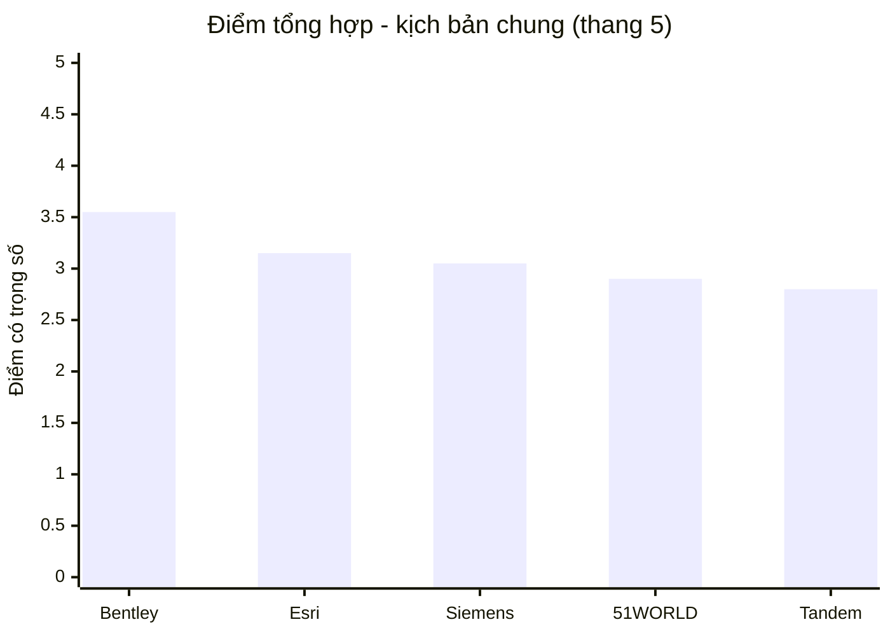
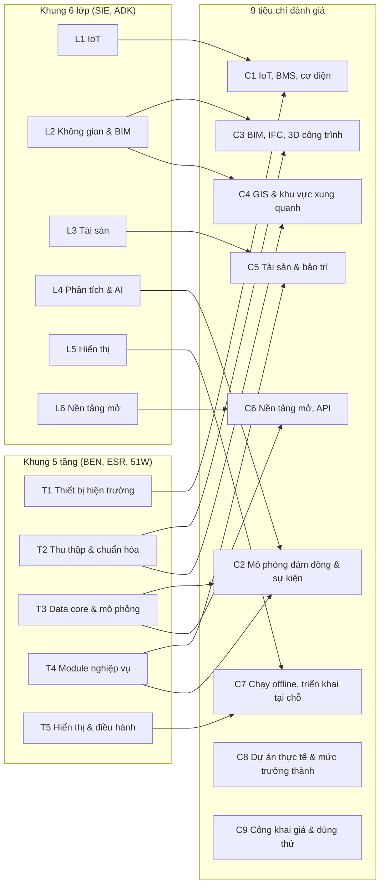
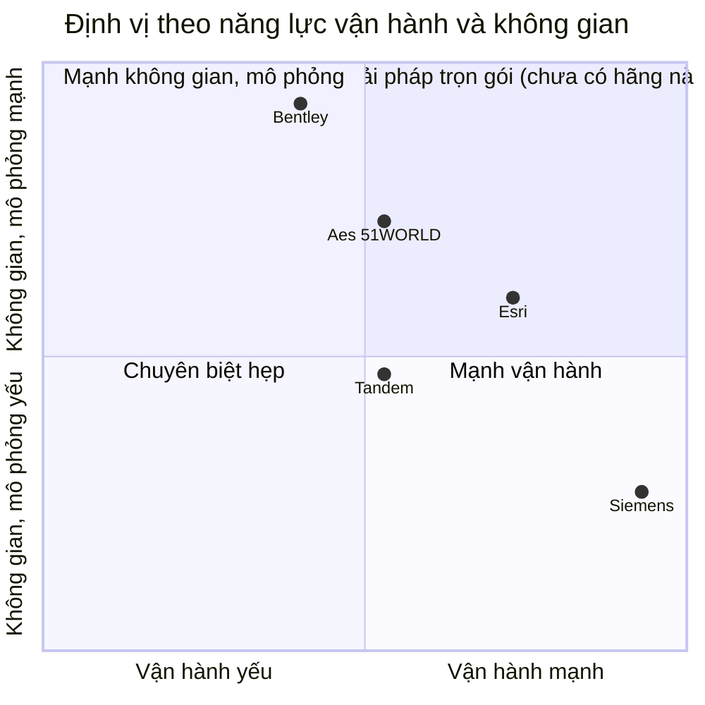
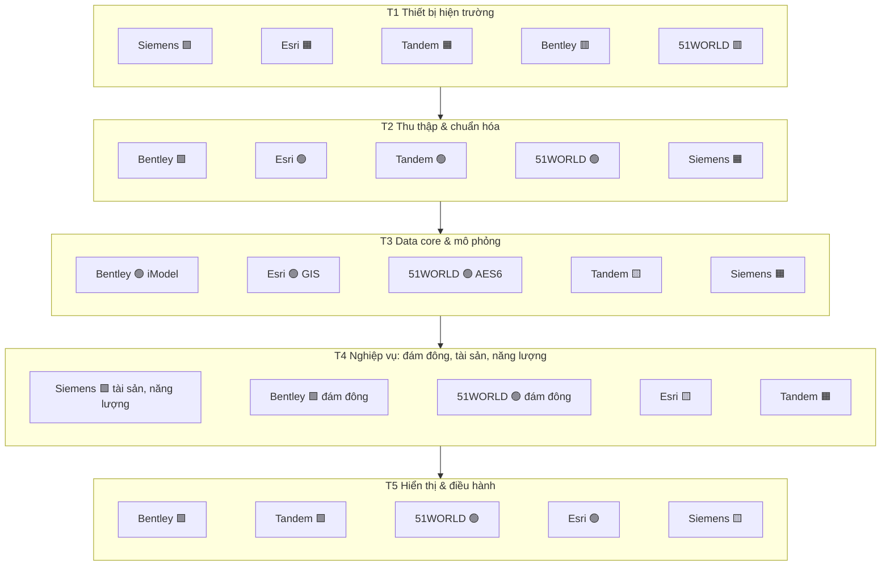
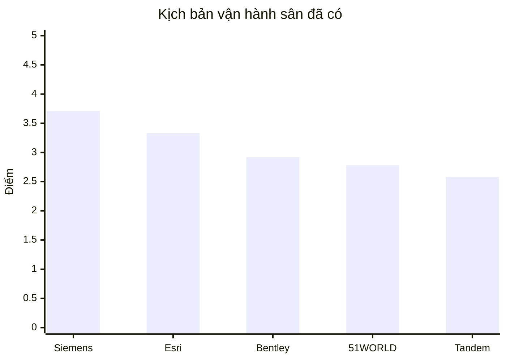
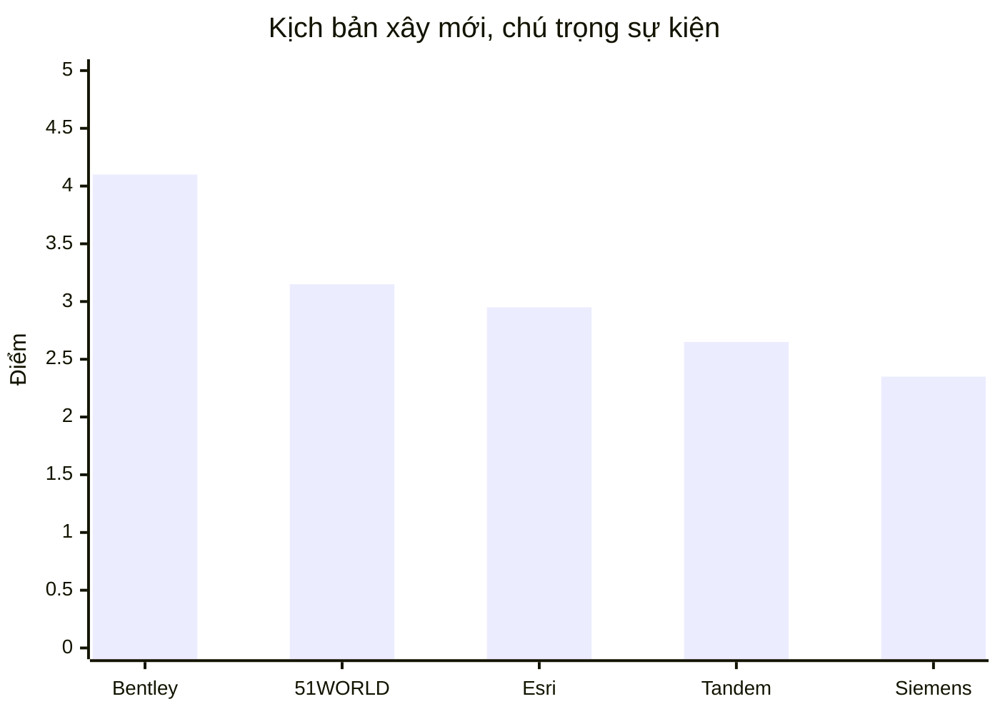
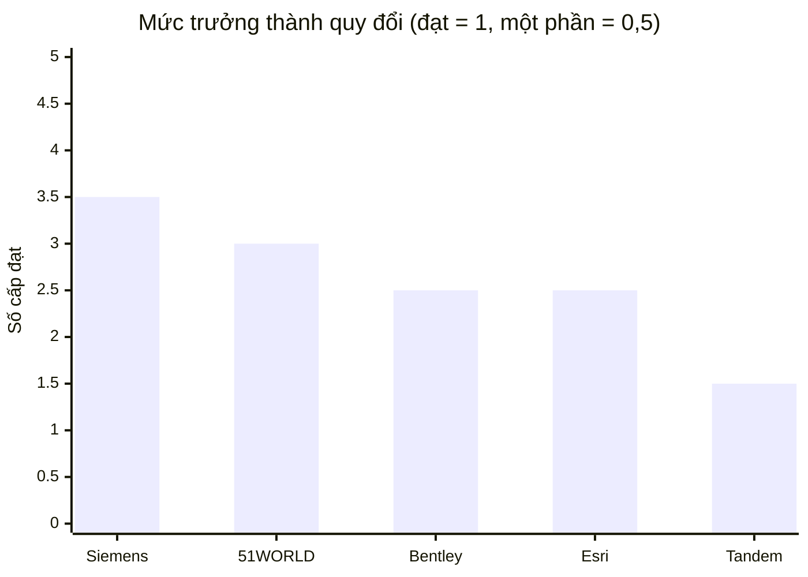
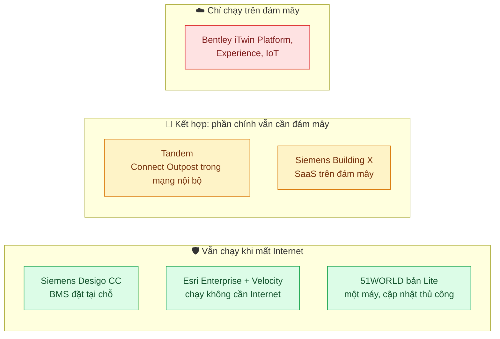
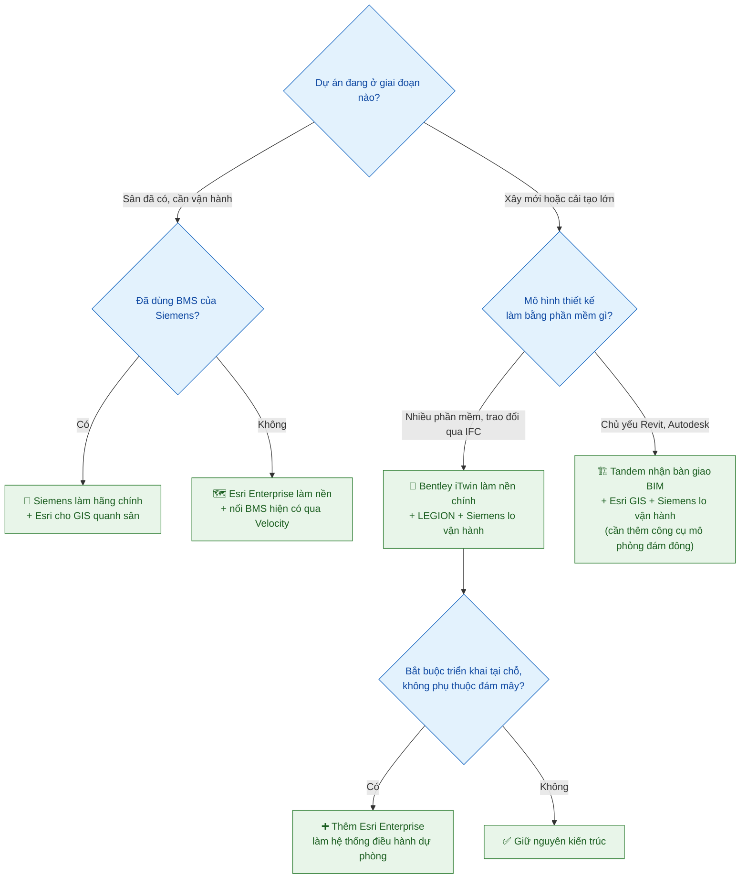
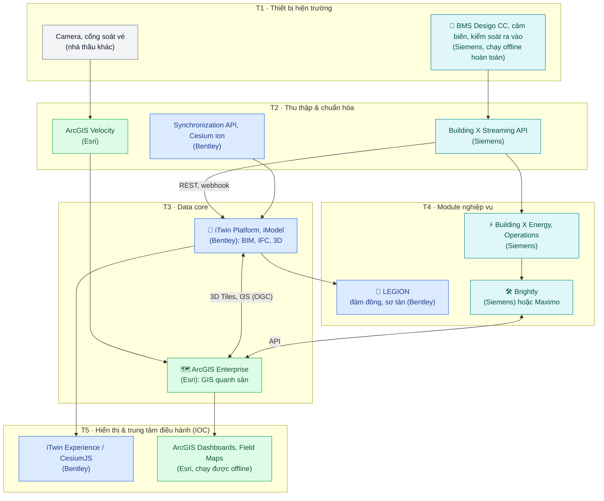

# 🏆 Benchmark tổng hợp 5 hệ sinh thái Digital Twin

> 📅 **Cập nhật:** 03/11/2026  |  ✍️ **Tác giả:** Hoàng Trung Hiếu  |  🔖 **Phiên bản:** 1.1  
> 🏷️ **Chủ đề:** So sánh Siemens, Autodesk Tandem, Bentley iTwin, Esri ArcGIS và 51WORLD (51Aes) cho bài toán bản sao số khu công trình phức hợp (sân vận động)

> [!NOTE]
> **Đối tượng đánh giá:** 5 hệ sinh thái đã khảo sát riêng, so sánh trên cùng 9 tiêu chí (mục 1).  
> **Nguồn chính:** 5 báo cáo riêng trong repo; báo cáo này không thu thập thêm bằng chứng mới. Ký hiệu nguồn:
> **[SIE]** [Siemens](bao-cao-digital-twin-siemens_v3.md) · **[ADK]** [Autodesk Tandem](bao-cao-digital-twin-autodesk-tandem.md) · **[BEN]** [Bentley iTwin](bao-cao-digital-twin-bentley-itwin.md) · **[ESR]** [Esri ArcGIS](bao-cao-digital-twin-esri-arcgis.md) · **[51W]** [51WORLD](bao-cao-digital-twin-51world-51aes.md).  
> Đường dẫn tới tài liệu gốc của hãng xem trong từng báo cáo riêng.

---

## 📑 Mục lục

- [⚡ Tóm tắt nhanh](#-tóm-tắt-nhanh)
- [📏 1. Phương pháp đánh giá](#-1-phương-pháp-đánh-giá)
- [🧭 2. Định vị 5 hệ sinh thái](#-2-định-vị-5-hệ-sinh-thái)
- [🧱 3. So sánh theo khung kiến trúc chung](#-3-so-sánh-theo-khung-kiến-trúc-chung)
- [📊 4. Chấm điểm có trọng số](#-4-chấm-điểm-có-trọng-số)
- [📈 5. Mức trưởng thành, chi phí, triển khai](#-5-mức-trưởng-thành-chi-phí-triển-khai)
- [🏟️ 6. Bằng chứng thực tế tại sân vận động](#️-6-bằng-chứng-thực-tế-tại-sân-vận-động)
- [🥇 7. Trả lời câu hỏi: nên chọn hãng nào?](#-7-trả-lời-câu-hỏi-nên-chọn-hãng-nào)
- [🧩 8. Có kết hợp nhiều hãng được không?](#-8-có-kết-hợp-nhiều-hãng-được-không)
- [⚠️ 9. Rủi ro và bước tiếp theo](#️-9-rủi-ro-và-bước-tiếp-theo)

---

## ⚡ Tóm tắt nhanh

> [!IMPORTANT]
> **Kết luận chính:**
> 1. **Không hãng nào là giải pháp trọn gói** cho sân vận động. Cả 5 báo cáo đều đi đến kết luận này. Chưa hãng nào có sân vận động vận hành bằng digital twin tích hợp mà được nguồn độc lập xác nhận.
> 2. **Xếp hạng (kịch bản chung, tính cả vòng đời dự án):** 🥇 **Bentley iTwin** (3,55) › 🥈 **Esri ArcGIS** (3,15) › 🥉 **Siemens** (3,05) › **51WORLD** (2,90) › **Autodesk Tandem** (2,80), thang điểm 5.
> 3. **Thứ hạng thay đổi theo giai đoạn dự án:** với dự án **xây mới, chú trọng tổ chức sự kiện**, Bentley dẫn đầu cách biệt (4,10); với **sân đã có, cần vận hành**, **Siemens vươn lên số 1** (3,71).
> 4. **Có thể và nên kết hợp nhiều hãng.** Mỗi hãng mạnh ở một tầng khác nhau nên gần như bổ sung cho nhau. Kiến trúc đề xuất: **Siemens (vận hành, BMS, tài sản) + Bentley iTwin (data core, 3D, mô phỏng đám đông) + Esri ArcGIS (GIS khu vực quanh sân, dự phòng khi mất mạng)**. Siemens và Bentley đã từng làm chung tại dự án Siemensstadt Square [SIE].
> 5. Mọi điểm số là **đánh giá định tính Mức C**, dựa trên bằng chứng Mức B. **Chưa hãng nào có dữ kiện Mức A.**

---

## 📏 1. Phương pháp đánh giá

### 1.1. Quy chuẩn bằng chứng

Dùng lại thang A–B–C chung của cả 5 báo cáo:

| Cấp | Ý nghĩa | Tình trạng ở 5 báo cáo |
|:---:|---|:---:|
| 🟢 **A** | Đã dùng thử trực tiếp, hoặc có case study độc lập kèm số liệu | ⬜ **Chưa hãng nào có** |
| 🔵 **B** | Tài liệu chính thức của hãng | ✅ Phần lớn dữ kiện |
| 🟠 **C** | Suy luận của nhóm hoặc nguồn bên thứ ba | 📝 Toàn bộ điểm số trong báo cáo này |

### 1.2. Quy hai khung kiến trúc về một bộ tiêu chí

Các báo cáo riêng dùng hai khung khác nhau: **6 lớp** (Siemens, Tandem) và **5 tầng** (Bentley, Esri, 51WORLD). Để so sánh được, báo cáo này quy cả hai về **9 tiêu chí** bám sát nhu cầu của sân vận động:

> *C7, C8, C9 không phải tính năng mà là điều kiện triển khai, được lấy từ các mục "Điểm nghẽn khi mất mạng", "Dự án thực tế" và "Chi phí" của từng báo cáo.*

### 1.3. Thang điểm

| Điểm | Ý nghĩa |
|:---:|---|
| **5** | Hãng tự làm, có sản phẩm chính thức và đã được áp dụng thực tế |
| **4** | Có sản phẩm chính thức, còn vài hạn chế nhỏ |
| **3** | Có, nhưng phải tích hợp thêm công cụ bên ngoài hoặc mới ở mức cơ bản |
| **2** | Mới chỉ nêu tên chức năng, đang Beta, hoặc chủ yếu dựa vào đối tác |
| **1** | Chưa thấy trong các nguồn đã rà soát |

---

## 🧭 2. Định vị 5 hệ sinh thái

| Hãng | Sản phẩm thực chất là gì | Thế mạnh gốc | Cách bán | Tóm tắt một câu |
|---|---|---|---|---|
| 🏢 **Siemens** | Phần mềm SaaS dựng sẵn (Building X) + BMS (Desigo CC) + phần mềm bảo trì (Brightly) | Thiết bị và vận hành tòa nhà | Thuê bao SaaS + dịch vụ tư vấn Siemens Advanta | *"Bộ não vận hành tòa nhà, không phải nền tảng để tự dựng twin"* [SIE] |
| 🏗️ **Autodesk Tandem** | SaaS digital twin xây trên mô hình BIM | Mô hình Revit/IFC bàn giao từ thiết kế, thi công | Theo dung lượng sử dụng, có gói miễn phí | *"Khâu cuối của chuỗi Revit → thi công → vận hành"* [ADK] |
| 🧩 **Bentley iTwin** | Nền tảng PaaS mở + các module lắp ghép (Cesium, LEGION, iTwin IoT) | Dữ liệu kỹ thuật hạ tầng từ nhiều định dạng | Bán credit PaaS (có bảng giá) + gói doanh nghiệp E365 | *"Nền dữ liệu và lớp hiển thị; mỗi dự án tự lắp ghép"* [BEN] |
| 🗺️ **Esri ArcGIS** | Nền GIS (Enterprise/Online) + ứng dụng + phần mở rộng | Bản đồ, dữ liệu địa không gian | Theo số tài khoản người dùng + credit | *"Nền dữ liệu không gian, mạnh ở khu vực xung quanh và chạy được offline"* [ESR] |
| 🌐 **51WORLD** | Nền tảng trọn gói do hãng tự phát triển (AES6, WDP, CIM) | Dựng hình 3D quy mô đô thị | Theo hợp đồng dự án, thu tiền khi nghiệm thu | *"Lớp hiển thị và mô phỏng quy mô lớn"* [51W] |

### 2.1. Biểu đồ định vị

Trục ngang là **năng lực vận hành** (trung bình C1 IoT, C5 tài sản, C7 chạy offline); trục dọc là **năng lực không gian và mô phỏng** (trung bình C2 đám đông, C3 BIM, C4 GIS). Tọa độ quy đổi từ điểm ở mục 4 (Mức C).

> 💡 **Cách đọc:** Bentley và Siemens nằm ở hai góc đối diện, nên **kết hợp hai hãng này sẽ đáp ứng được nhiều nhu cầu nhất**. Esri nằm khoảng giữa, lệch về phía vận hành, phù hợp làm lớp bổ trợ GIS và dự phòng. Không hãng nào lọt vào ô "trọn gói".

---

## 🧱 3. So sánh theo khung kiến trúc chung

### 3.1. Bảng màu so sánh năng lực

*🟩 5 · 🟢 4 · 🟨 3 · 🟧 2 · 🟥 1 (Mức C)*

| Tiêu chí | Siemens | Bentley | Esri | Tandem | 51WORLD |
|---|:---:|:---:|:---:|:---:|:---:|
| **C1** IoT, BMS, cơ điện | 🟩 5 | 🟧 2 | 🟨 3 | 🟨 3 | 🟧 2 |
| **C2** Mô phỏng đám đông & sự kiện | 🟥 1 | 🟩 5 | 🟥 1 | 🟥 1 | 🟢 4 |
| **C3** BIM, IFC, 3D công trình | 🟧 2 | 🟩 5 | 🟨 3 | 🟩 5 | 🟨 3 |
| **C4** GIS & khu vực xung quanh | 🟥 1 | 🟢 4 | 🟩 5 | 🟥 1 | 🟢 4 |
| **C5** Tài sản & bảo trì | 🟩 5 | 🟨 3 | 🟨 3 | 🟨 3 | 🟧 2 |
| **C6** Nền tảng mở, API | 🟨 3 | 🟩 5 | 🟢 4 | 🟢 4 | 🟨 3 |
| **C7** Chạy offline, triển khai tại chỗ | 🟢 4 | 🟥 1 | 🟩 5 | 🟧 2 | 🟢 4 |
| **C8** Dự án thực tế & mức trưởng thành | 🟢 4 | 🟨 3 | 🟨 3 | 🟥 1 | 🟧 2 |
| **C9** Công khai giá & dùng thử | 🟧 2 | 🟢 4 | 🟧 2 | 🟩 5 | 🟥 1 |

### 3.2. Căn cứ chấm điểm

| Tiêu chí | Siemens [SIE] | Bentley [BEN] | Esri [ESR] | Tandem [ADK] | 51WORLD [51W] |
|---|---|---|---|---|---|
| **C1** | Desigo CC, bộ điều khiển phần cứng, Cloud Gateway; hãng tự làm toàn bộ | iTwin IoT nhận dữ liệu qua MQTT, OPC-UA, CSV, API; không sản xuất thiết bị | Velocity nhận MQTT, Kafka, gRPC...; bản cho Enterprise chỉ chạy một máy; GeoEvent đang bị ngừng hỗ trợ | Streams, Connect, MQTT Broker (trả phí); phải dựa vào BMS của hãng khác | IOC nhận dữ liệu nhiều nguồn; **chưa thấy nêu giao thức** |
| **C2** | Chưa thấy | **LEGION**: mô phỏng vào sân, giữa hiệp, sơ tán; đã dùng tại Al Thumama | Chưa thấy; chức năng đếm đám đông đã bị gỡ | Chưa hỗ trợ | **ACF** mô phỏng luồng người, **AIC** bố trí mặt bằng, sơ tán; chỉ có số liệu do hãng tự công bố |
| **C3** | Lifecycle Twin (BIM, COBie, Revit); **không thấy hỗ trợ IFC**; 3D phải nhờ NavVis, BizzTech | IFC 2x3 đến 4.3, hơn 50 định dạng, iModel lưu lịch sử thay đổi | Đọc được Revit, IFC2x3 đến IFC4x3 nhưng **chỉ đọc**, chỉ lấy mô hình chính | Đọc trực tiếp Revit và IFC; trình xem 3D rất mạnh | RVT, FBX, OSGB, 3DGS; **chưa thấy hỗ trợ IFC** |
| **C4** | Geometry API chỉ nhận GeoJSON 2D; GIS phải nhờ đối tác | Cesium, 3D Tiles (chuẩn OGC), hiển thị được lớp bản đồ ArcGIS, WMS | GIS là sản phẩm core: I3S, 3D Tiles, OGC API; có Urban, CityEngine | **Chưa có GIS tích hợp sẵn** | 3D Tiles, mô hình đô thị "2000 km²"; chưa thấy chuẩn OGC |
| **C5** | **Brightly** (phần mềm bảo trì CMMS/EAM, mua lại với giá 1,575 tỷ USD) | AssetWise APM; phần mềm bảo trì phải tích hợp từ bên ngoài | Tích hợp chính thức với IBM Maximo | Danh mục thiết bị, phiếu công việc (Beta), plugin Maximo, Eptura | Mới chỉ nêu tên chức năng; chưa thấy phần mềm bảo trì |
| **C6** | REST API, Mendix; **không có nền tảng mở để tự dựng twin**; giới hạn 6 triệu lượt gọi API/năm | iTwin.js mã nguồn mở, REST API, máy chủ MCP | Maps SDK, REST, chuẩn OGC | Tandem Data API (thuộc APS), OAuth | JS SDK hơn 300 hàm, MCP; phải xin token qua bộ phận kinh doanh |
| **C7** | BMS đặt tại chỗ, chạy độc lập; Building X chạy trên đám mây | **Chỉ chạy trên đám mây**, chưa công bố chế độ offline | Enterprise, Velocity chạy được không cần Internet; Field Maps dùng offline | SaaS; Connect Outpost chạy trong mạng nội bộ | Triển khai được trên hạ tầng riêng; bản Lite chạy offline trên một máy, cập nhật dữ liệu thủ công |
| **C8** | 6 sân vận động đang dùng (BMS, an ninh, năng lượng); đạt cấp Predictive (Mức B) | Al Thumama (giai đoạn thiết kế); đạt cấp 1–2 và một phần cấp 4 | Gillette (qua đối tác, Mức C), Schiphol, cảng Cái Mép; đạt cấp Informative | Không có sân vận động; mới ở mức cơ bản của cấp 2 | Chỉ có dự án do hãng tự công bố; không có sân vận động |
| **C9** | Không có bảng giá; dùng thử 14 ngày, sandbox chỉ cho đọc dữ liệu | Có bảng giá PaaS, gói Community miễn phí; LEGION và iTwin IoT không công bố giá | Không có bảng giá; dùng thử 21 ngày, cần email doanh nghiệp | **Có gói miễn phí**, gói trả phí từ ~405 USD/tháng | Không công bố giá, không thấy cho dùng thử |

### 3.3. Mức tự chủ theo từng tầng

> 🔎 **Nhận xét chính:** Chỉ **Siemens** tự cung cấp được thiết bị hiện trường (T1). Bốn hãng còn lại đều phải dựa vào BMS hoặc cảm biến của bên khác. Ngược lại, Siemens yếu nhất ở T2–T3, đúng chỗ Bentley và Esri mạnh nhất.

---

## 📊 4. Chấm điểm có trọng số

### 4.1. Trọng số theo 3 kịch bản dự án

| Tiêu chí | 🎯 Kịch bản chung (cả vòng đời) | 🔧 Vận hành sân đã có | 🏗️ Xây mới, chú trọng sự kiện |
|---|:---:|:---:|:---:|
| C1 IoT, BMS, cơ điện | 20% | 30% | 10% |
| C2 Mô phỏng đám đông & sự kiện | 15% | 10% | 25% |
| C3 BIM, IFC, 3D công trình | 15% | 5% | 20% |
| C4 GIS & khu vực xung quanh | 10% | 10% | 15% |
| C5 Tài sản & bảo trì | 10% | 20% | 5% |
| C6 Nền tảng mở, API | 10% | 5% | 10% |
| C7 Chạy offline, triển khai tại chỗ | 10% | 15% | 5% |
| C8 Dự án thực tế & mức trưởng thành | 5% | 3% | 5% |
| C9 Công khai giá & dùng thử | 5% | 2% | 5% |
| **Tổng** | **100%** | **100%** | **100%** |

> *Lý do chọn trọng số cho kịch bản chung:* ưu tiên cao nhất là **an toàn tính mạng khán giả trong ngày diễn ra sự kiện** (C1, C2, C7) và **khối công trình lớn, phức tạp** (C3); GIS cho khu vực quanh sân (giao thông, bãi xe) và quản lý tài sản xếp thứ hai.

### 4.2. Kết quả

| Hạng | 🎯 Kịch bản chung | 🔧 Vận hành sân đã có | 🏗️ Xây mới, chú trọng sự kiện |
|:---:|---|---|---|
| 🥇 | **Bentley 3,55** | **Siemens 3,71** | **Bentley 4,10** |
| 🥈 | Esri 3,15 | Esri 3,33 | 51WORLD 3,15 |
| 🥉 | Siemens 3,05 | Bentley 2,92 | Esri 2,95 |
| 4 | 51WORLD 2,90 | 51WORLD 2,78 | Tandem 2,65 |
| 5 | Tandem 2,80 | Tandem 2,58 | Siemens 2,35 |

> 📌 **Thứ hạng thay đổi thế nào giữa các kịch bản:** **Esri ổn định nhất**, luôn nằm trong nhóm 3 hãng đầu (từ 2,95 đến 3,33). **Siemens biến động mạnh nhất** (từ hạng 1 xuống hạng 5) vì thế mạnh gần như chỉ nằm ở mảng vận hành. **Tandem** luôn đứng cuối hoặc gần cuối do thiếu GIS, thiếu mô phỏng đám đông và chưa có dự án sân vận động.

---

## 📈 5. Mức trưởng thành, chi phí, triển khai

### 5.1. Mức trưởng thành theo thang Verdantix

*✅ Đạt · 🟡 Một phần · ❌ Chưa đạt (theo đánh giá trong từng báo cáo, phần lớn Mức C)*

| Cấp độ | Siemens | Bentley | Esri | Tandem | 51WORLD |
|---|:---:|:---:|:---:|:---:|:---:|
| 1. Descriptive (mô tả) | ✅ | ✅ | ✅ | ✅ | ✅ |
| 2. Informative (thông tin) | ✅ | ✅ | ✅ | 🟡 | ✅ |
| 3. Predictive (dự báo) | ✅ *(dự báo năng lượng)* | ❌ | 🟡 | ❌ | 🟡 *(dự báo 15 phút tới)* |
| 4. Comprehensive (toàn diện) | 🟡 | 🟡 *(nhờ LEGION)* | ❌ | ❌ | 🟡 |
| 5. Autonomous (tự vận hành) | ❌ | ❌ | ❌ | ❌ | ❌ |

> ⚠️ Không hãng nào đạt cấp 5 (hệ thống tự ra lệnh điều khiển thiết bị). Bentley và 51WORLD đạt một phần cấp 4 nhờ có **mô phỏng đám đông**, cũng là năng lực sân vận động cần nhất trong ngày diễn ra sự kiện.

### 5.2. Cách tính chi phí

| Hãng | Có công bố giá? | Cách tính phí | Mức tối thiểu ước tính được |
|---|:---:|---|---|
| **Autodesk Tandem** | ✅ Có | Theo dung lượng, không giới hạn số tài khoản; Connect bản trả phí ~625 USD/tháng | Miễn phí → ~405 USD/tháng |
| **Bentley iTwin** | 🟡 Một phần | Credit PaaS (Standard 199, Premium 499 USD/tháng); LEGION, iTwin IoT không công bố giá | ~2.388–5.988 USD/năm *(chỉ riêng phần PaaS)* |
| **Siemens** | ❌ Không | SaaS tính theo điểm đo, số cửa, số địa điểm; Mendix ~13.000–32.700 USD/năm; tư vấn Advanta 150–300+ USD/giờ | Không ước tính được |
| **Esri ArcGIS** | ❌ Không | Theo số tài khoản + credit; Indoors, Velocity, IPS cấp phép riêng | Không ước tính được |
| **51WORLD** | ❌ Không | Theo hợp đồng dự án, thu tiền khi nghiệm thu; khách hàng tự trang bị máy chủ GPU | Không ước tính được |

> 💰 **Nhận định (Mức C):** với một sân vận động, phần lớn chi phí thực tế nằm ở **các module chuyên dụng và chi phí tích hợp (thuê đơn vị SI)**, chứ không nằm ở các gói có bảng giá. Bảng giá rẻ của Tandem hay phần PaaS của Bentley **không phản ánh tổng chi phí sở hữu (TCO)** của dự án.

### 5.3. Cách triển khai và khả năng chạy khi mất mạng

Ngày có 60.000–80.000 khán giả, mạng trong sân có thể bị quá tải; vì vậy hệ thống an toàn **không được chỉ trông vào đám mây** [BEN].

---

## 🏟️ 6. Bằng chứng thực tế tại sân vận động

| Hãng | Sân vận động / địa điểm lớn | Hãng làm gì ở đó | Có dùng digital twin để vận hành? | Mức |
|---|---|---|:---:|:---:|
| **Siemens** | Optus, MCG, Superdome, Mané Garrincha, Red Bull Arena, Malšovická | BMS, an ninh, năng lượng | ❌ | B |
| **Bentley** | Al Thumama (Qatar) | LEGION mô phỏng vào sân, ra sân, sơ tán ở **giai đoạn thiết kế** | ❌ *(chỉ thiết kế)* | B/C |
| **Esri** | Gillette Stadium; Atlanta Braves, Super Bowl 2019 | ArcGIS Online là một trong nhiều nơi nhận dữ liệu; ví dụ về giao thông, drone | ❌ | C |
| **Tandem** | Cleveland Browns, Lusail, Jeddah | Dùng ACC, Revit, Navisworks, **không dùng Tandem** | ❌ | B |
| **51WORLD** | Nhà Hội nghị Quốc gia Bắc Kinh; mô phỏng cổng ra vào ở Tô Châu | Hiển thị 3D, xếp chỗ; mô phỏng sơ tán | ❌ | B *(chỉ do hãng công bố)* |

> [!CAUTION]
> **Không hãng nào trong 5 hãng** có sân vận động vận hành bằng digital twin tích hợp mà được nguồn độc lập xác nhận. Các dự án gần nhất về **quy mô khu phức hợp** là **Siemensstadt Square** (76 ha, Siemens + Bentley) [SIE], **Sân bay Schiphol** (Esri + Maximo) [ESR] và **Sân bay Denver** (Tandem, chủ yếu để điều phối thi công) [ADK].

---

## 🥇 7. Trả lời câu hỏi: nên chọn hãng nào?

### 7.1. Xếp hạng từ cao đến thấp (kịch bản chung)

| Hạng | Hãng | Điểm | Vai trò phù hợp nhất | Lý do chính |
|:---:|---|:---:|---|---|
| 🥇 **1** | **Bentley iTwin** | **3,55** | **Data core & 3D, mô phỏng đám đông** | Mạnh nhất về IFC, gộp dữ liệu từ nhiều nguồn, 3D Tiles/Cesium, nền tảng mở; là hãng duy nhất có mô phỏng đám đông đã dùng thật ở sân vận động (Al Thumama). Điểm yếu lớn nhất: **chỉ chạy trên đám mây** và không có thiết bị hiện trường |
| 🥈 **2** | **Esri ArcGIS** | **3,15** | **GIS khu vực quanh sân & dự phòng khi mất mạng** | GIS tốt nhất cho giao thông, bãi xe, quảng trường; chạy được khi không có Internet; tích hợp chính thức với Maximo. Thiếu mô phỏng đám đông |
| 🥉 **3** | **Siemens** | **3,05** | **Vận hành tòa nhà, BMS, năng lượng, tài sản** | Hãng duy nhất tự cung cấp thiết bị hiện trường, có phần mềm bảo trì mạnh (Brightly), nhiều sân vận động đang dùng BMS của hãng. Không phải nền tảng để tự dựng twin; yếu về 3D và GIS |
| **4** | **51WORLD** | **2,90** | Màn hình điều hành 3D, mô phỏng sự kiện *(phương án thay thế)* | Dựng hình 3D quy mô lớn, có ACF/AIC cho sự kiện, chạy được offline. Nhưng dùng định dạng riêng, không hỗ trợ IFC, không công bố giá, chưa thấy hỗ trợ ngoài Trung Quốc |
| **5** | **Autodesk Tandem** | **2,80** | Kho dữ liệu BIM nhận bàn giao *(nếu thiết kế dùng Revit)* | Rẻ, mở, BIM và trình xem 3D rất tốt; nhưng thiếu GIS, mô phỏng đám đông, AI và chưa có dự án sân vận động |

### 7.2. Cây quyết định chọn hãng chính

---

## 🧩 8. Có kết hợp nhiều hãng được không?

> [!TIP]
> **Có, và đây là cách nên làm.** Cả 5 báo cáo đều chỉ ra những phần còn thiếu phải bổ sung từ bên ngoài, và những phần thiếu đó lại đúng là thế mạnh của hãng khác. Trên thực tế, các hãng đã từng hợp tác với nhau:
> - **Siemens + Bentley:** bản sao số cấp khuôn viên của Siemensstadt Square do Siemens phát triển cùng Bentley [SIE].
> - **Bentley + Esri:** iTwin IoT hiển thị được lớp bản đồ ArcGIS trên địa hình 3D; cả hai cùng dùng chuẩn OGC 3D Tiles [BEN] [ESR].
> - **Tandem + Esri:** hội thảo Autodesk University 2025 có bài trình bày kết nối Tandem với ArcGIS GeoBIM [ADK].
> - **Esri + IBM Maximo**, **Tandem + Maximo/Eptura:** có tích hợp chính thức cho quản lý tài sản [ESR] [ADK].
> - **ioLabs** là đối tác chung của cả Siemens, Autodesk và Esri [SIE].

### 8.1. Mức độ phù hợp khi ghép từng cặp hãng

*🟢 bổ sung cho nhau tốt · 🟡 ghép được nhưng có phần trùng · 🔴 trùng vai trò, không nên cùng làm nền tảng chính*

| | Siemens | Bentley | Esri | Tandem | 51WORLD |
|---|:---:|:---:|:---:|:---:|:---:|
| **Siemens** | — | 🟢 đã làm chung | 🟢 | 🟢 | 🟡 |
| **Bentley** | 🟢 | — | 🟢 cùng dùng 3D Tiles | 🔴 trùng vai trò quản lý BIM | 🔴 trùng phần 3D, đám đông |
| **Esri** | 🟢 | 🟢 | — | 🟢 bổ sung GIS | 🟡 trùng phần GIS 3D |
| **Tandem** | 🟢 | 🔴 | 🟢 | — | 🟡 |
| **51WORLD** | 🟡 | 🔴 | 🟡 | 🟡 | — |

### 8.2. Kiến trúc kết hợp đề xuất

**Phân vai từng hãng:**

| Vai trò | Hãng | Lý do |
|---|---|---|
| **Lớp an toàn & vận hành** (thiết bị, năng lượng, bảo trì) | 🏢 Siemens | Tự cung cấp thiết bị, chạy offline, phần mềm bảo trì mạnh, nhiều sân vận động đã dùng |
| **Dữ liệu công trình & mô phỏng** (T2–T4) | 🧩 Bentley | IFC, iModel, Cesium, LEGION; nền tảng mở để đơn vị tích hợp (SI) tự lắp ghép |
| **GIS quanh sân & dự phòng** (T3, T5) | 🗺️ Esri | Giao thông, bãi xe, quảng trường; làm trung tâm điều hành dự phòng khi mất Internet |
| *Phương án thay thế* | 🏗️ Tandem | Thay Bentley **chỉ khi** toàn bộ thiết kế làm trên Revit và không cần mô phỏng đám đông tích hợp |
| *Phương án thay thế* | 🌐 51WORLD | Thay phần hiển thị và mô phỏng đám đông **chỉ khi** chấp nhận định dạng riêng của hãng và việc hỗ trợ chủ yếu ở Trung Quốc |

### 8.3. Ba phương án kết hợp

| Phương án | Thành phần | Điểm cao nhất C1→C9 | Ưu điểm | Đánh đổi |
|---|---|:---:|---|---|
| **A. Tối thiểu** | Siemens + Bentley | 5·5·5·4·5·5·4·4·4 | Hai hãng đã làm chung ở Siemensstadt; đáp ứng cả vận hành lẫn mô phỏng | GIS quanh sân chỉ dừng ở mức Cesium; trung tâm điều hành vẫn phụ thuộc đám mây |
| **B. Đề xuất** ⭐ | Siemens + Bentley + Esri | 5·5·5·**5**·5·5·**5**·4·4 | Đáp ứng gần đủ các tiêu chí, có dự phòng khi mất mạng trong ngày sự kiện | Phải ký 3 hợp đồng, cần đơn vị tích hợp (SI) có năng lực |
| **C. Theo hệ Autodesk** | Tandem + Esri + Siemens | 5·**1**·5·5·5·4·5·4·5 | Chi phí khởi đầu thấp, hợp với đội thiết kế dùng Revit | **Thiếu mô phỏng đám đông**, phải mua công cụ riêng |

*Mỗi số là điểm cao nhất mà tổ hợp đạt được ở từng tiêu chí C1 đến C9 (lấy điểm của hãng mạnh nhất trong tổ hợp, Mức C). Phương án B là tổ hợp duy nhất đạt từ 4 điểm trở lên ở mọi tiêu chí và đạt 5 ở cả GIS lẫn khả năng chạy offline; phương án C bị điểm rất thấp ở C2 (đám đông).*

### 8.4. Lộ trình triển khai gợi ý cho phương án B

---

## ⚠️ 9. Rủi ro và bước tiếp theo

### 9.1. Rủi ro khi kết hợp nhiều hãng

| Rủi ro | Mức độ | Cách giảm thiểu |
|---|:---:|---|
| **Chi phí tích hợp cao, nhiều hợp đồng** (3 hãng, phần lớn không công bố giá) | 🔴 Cao | Xin báo giá sớm; chọn một đơn vị tích hợp (SI) chịu trách nhiệm toàn bộ |
| **Dữ liệu bị trùng, không thống nhất** giữa iModel, ArcGIS và Building X | 🟠 Trung bình | Quy định rõ hệ thống nào giữ dữ liệu gốc cho từng loại (BIM → iModel, GIS → ArcGIS, tài sản → Brightly) |
| **Bentley phụ thuộc đám mây** trong ngày sự kiện | 🔴 Cao | Dùng BMS Siemens và Esri Enterprise đặt tại chỗ làm lớp an toàn |
| **Bị phụ thuộc vào một nhà cung cấp** (định dạng I3S, định dạng riêng của AES, giới hạn API của Siemens) | 🟠 Trung bình | Bắt buộc trao đổi dữ liệu qua chuẩn mở: IFC, 3D Tiles, OGC API, MQTT |
| **Bằng chứng mới dừng ở Mức B/C** | 🟠 Trung bình | Dùng thử trước khi ký hợp đồng (giai đoạn 0) |
| **51WORLD: chủ quyền dữ liệu, hỗ trợ ngoài Trung Quốc** | 🟠 Trung bình | Chỉ cân nhắc khi hãng cam kết hỗ trợ tại Việt Nam và có tài liệu hướng dẫn xuất dữ liệu ra định dạng mở |

### 9.2. Bước tiếp theo

1. **Nâng bằng chứng lên Mức A:** dùng thử Bentley Community, Tandem Free và sandbox Building X trên cùng một mô hình IFC sân vận động.
2. **Thử kết nối giữa các hệ thống:** đẩy dữ liệu điểm đo từ Building X Streaming API sang iTwin IoT và ArcGIS Velocity; trao đổi dữ liệu 3D Tiles giữa Cesium và ArcGIS Online.
3. **Thử ngắt mạng:** ngắt Internet rồi kiểm tra thành phần nào còn hoạt động (Desigo CC, Esri Enterprise, bản Lite của 51WORLD).
4. **Xin báo giá** LEGION, iTwin IoT, Building X, ArcGIS Indoors, Velocity để tính được tổng chi phí thực tế.

---

## 📚 Nguồn

Báo cáo tổng hợp từ 5 báo cáo riêng trong repo; danh mục tài liệu gốc xem trong từng file:

| Ký hiệu | Báo cáo | Số nguồn tham khảo |
|:---:|---|:---:|
| [SIE] | [Báo cáo Digital Twin Siemens](bao-cao-digital-twin-siemens_v3.md) | 33 |
| [ADK] | [Báo cáo Digital Twin Autodesk Tandem](bao-cao-digital-twin-autodesk-tandem.md) | 30 |
| [BEN] | [Báo cáo Bentley iTwin Digital Twin](bao-cao-digital-twin-bentley-itwin.md) | 28 |
| [ESR] | [Báo cáo Digital Twin Esri (ArcGIS)](bao-cao-digital-twin-esri-arcgis.md) | 35 |
| [51W] | [Báo cáo Digital Twin 51WORLD](bao-cao-digital-twin-51world-51aes.md) | 29 |
