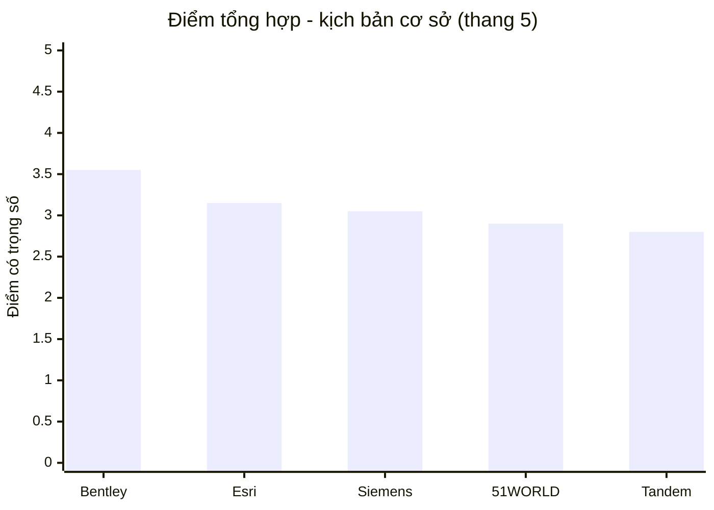
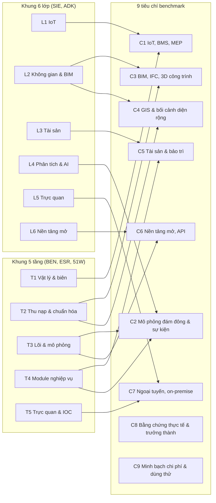
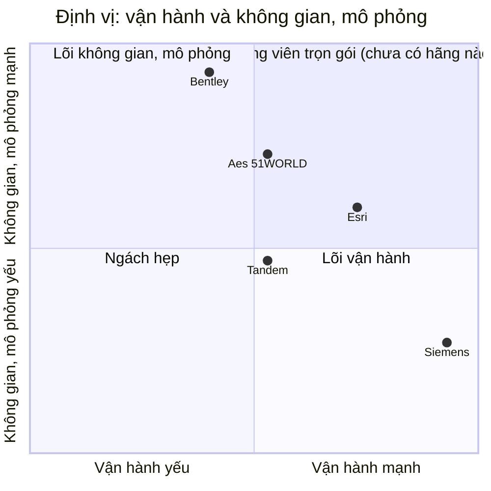
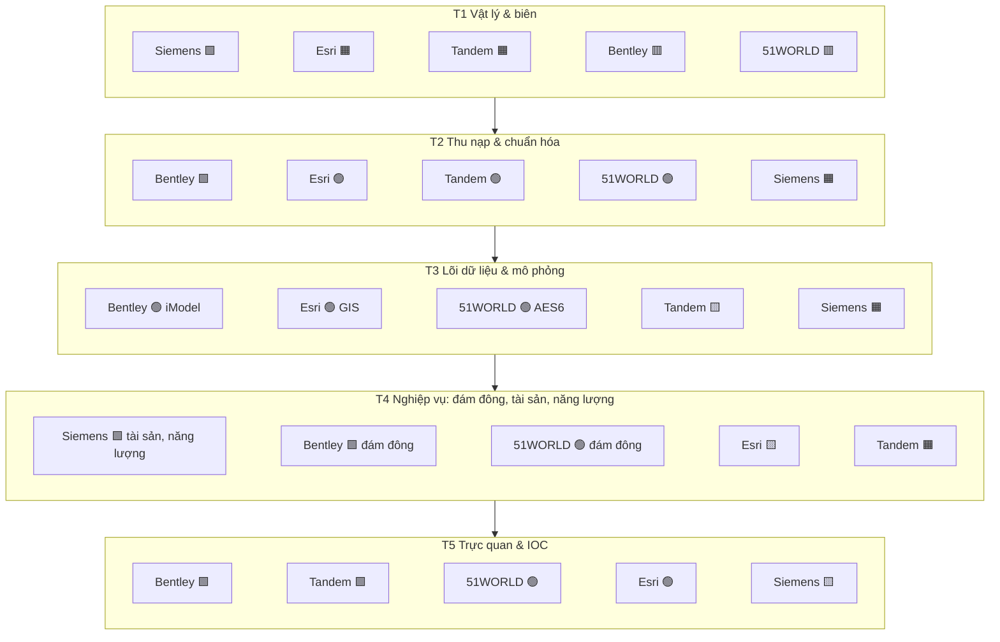
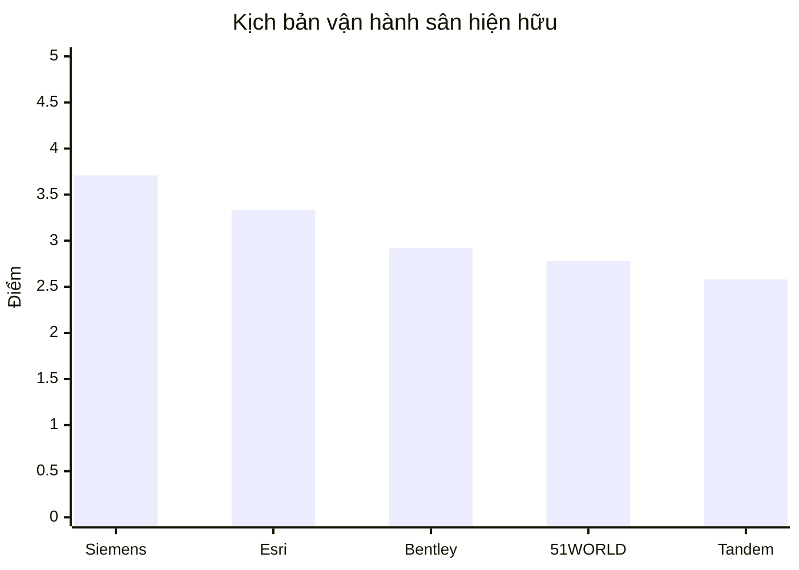
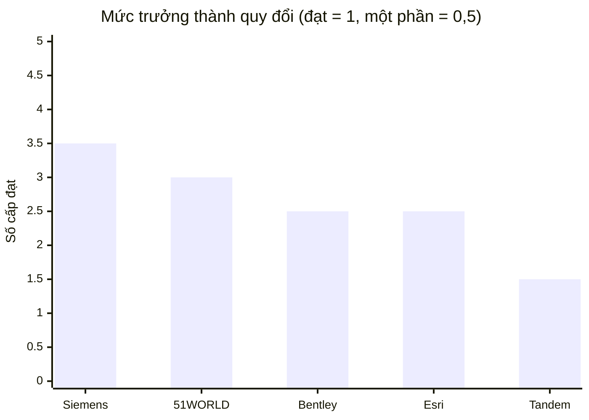
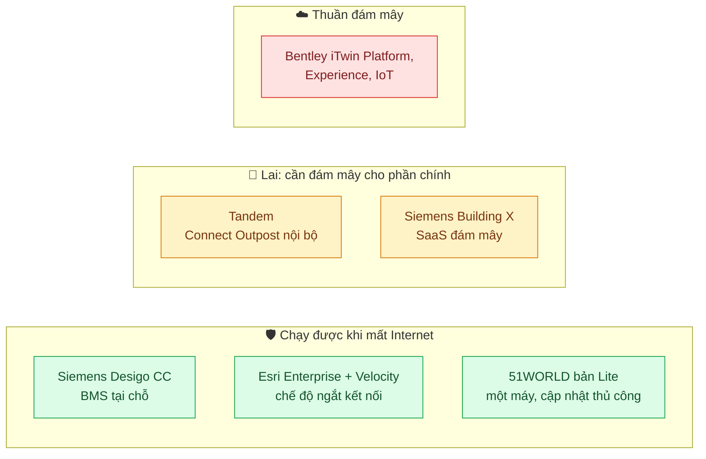
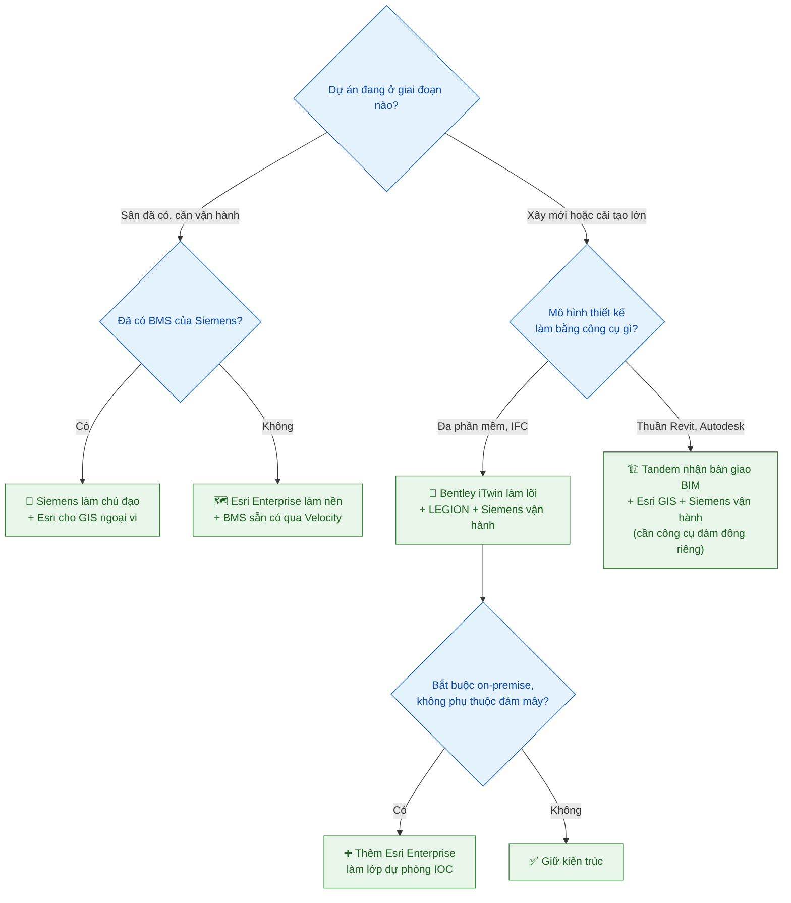
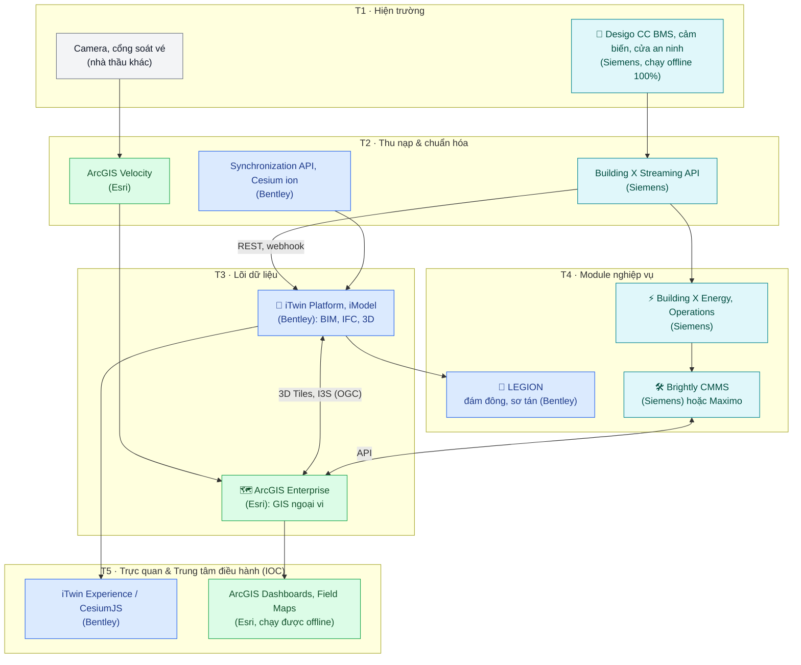
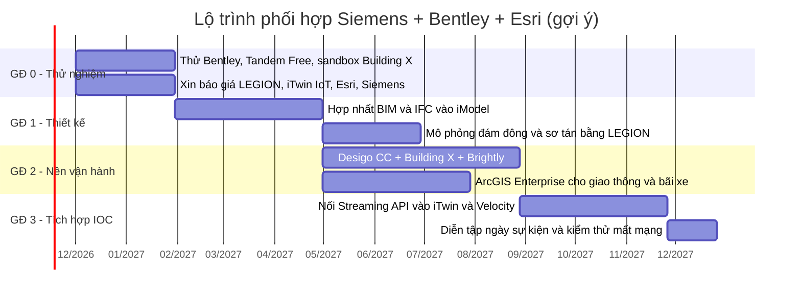

# 🏆 Benchmark tổng hợp 5 hệ sinh thái Digital Twin

> 📅 **Cập nhật:** 03/11/2026  |  ✍️ **Tác giả:** Hoàng Trung Hiếu  |  🔖 **Phiên bản:** 1.0  
> 🏷️ **Chủ đề:** So sánh Siemens, Autodesk Tandem, Bentley iTwin, Esri ArcGIS và 51WORLD (51Aes) cho bài toán bản sao số khu công trình phức hợp (sân vận động)

> [!NOTE]
> **Nguồn dữ liệu:** Báo cáo này **không thu thập thêm bằng chứng mới**. Toàn bộ dữ kiện lấy từ 5 báo cáo đơn lẻ trong repo, nguồn gốc ghi theo ký hiệu:
> **[SIE]** [Siemens](bao-cao-digital-twin-siemens_v3.md) · **[ADK]** [Autodesk Tandem](bao-cao-digital-twin-autodesk-tandem.md) · **[BEN]** [Bentley iTwin](bao-cao-digital-twin-bentley-itwin.md) · **[ESR]** [Esri ArcGIS](bao-cao-digital-twin-esri-arcgis.md) · **[51W]** [51WORLD](bao-cao-digital-twin-51world-51aes.md).  
> Trích dẫn tài liệu gốc (link hãng) xem trong từng báo cáo đơn lẻ.

---

## 📑 Mục lục

- [⚡ Tóm tắt điều hành](#-tóm-tắt-điều-hành)
- [📏 1. Phương pháp benchmark](#-1-phương-pháp-benchmark)
- [🧭 2. Định vị 5 hệ sinh thái](#-2-định-vị-5-hệ-sinh-thái)
- [🧱 3. So sánh theo khung kiến trúc thống nhất](#-3-so-sánh-theo-khung-kiến-trúc-thống-nhất)
- [📊 4. Chấm điểm có trọng số](#-4-chấm-điểm-có-trọng-số)
- [📈 5. Mức trưởng thành, chi phí, triển khai](#-5-mức-trưởng-thành-chi-phí-triển-khai)
- [🏟️ 6. Bằng chứng thực tế tại sân vận động](#️-6-bằng-chứng-thực-tế-tại-sân-vận-động)
- [🥇 7. Trả lời câu hỏi: nên chọn hãng nào?](#-7-trả-lời-câu-hỏi-nên-chọn-hãng-nào)
- [🧩 8. Có phối hợp nhiều hãng được không?](#-8-có-phối-hợp-nhiều-hãng-được-không)
- [⚠️ 9. Rủi ro và bước tiếp theo](#️-9-rủi-ro-và-bước-tiếp-theo)

---

## ⚡ Tóm tắt điều hành

> [!IMPORTANT]
> **Kết luận ngắn:**
> 1. **Không hãng nào là giải pháp trọn gói** cho sân vận động. Cả 5 báo cáo đều kết luận như vậy, và chưa hãng nào có sân vận động vận hành bằng digital twin tích hợp với nguồn độc lập xác nhận.
> 2. **Xếp hạng (kịch bản cơ sở):** 🥇 **Bentley iTwin** (3,55) › 🥈 **Esri ArcGIS** (3,15) › 🥉 **Siemens** (3,05) › **51WORLD** (2,90) › **Autodesk Tandem** (2,80) trên thang 5.
> 3. **Thứ hạng đổi theo giai đoạn:** dự án **xây mới, nặng về sự kiện** thì Bentley dẫn rất xa (4,10); **vận hành sân hiện hữu** thì **Siemens lên số 1** (3,71).
> 4. **Có thể và nên phối hợp.** Các hãng mạnh ở các tầng khác nhau, gần như bù khuyết cho nhau. Kiến trúc khuyến nghị: **Siemens (vận hành, BMS, tài sản) + Bentley iTwin (lõi dữ liệu, 3D, mô phỏng đám đông) + Esri ArcGIS (GIS ngoại vi, dự phòng ngoại tuyến)**. Đã có tiền lệ Siemens ghép với Bentley tại Siemensstadt Square [SIE].
> 5. Mọi điểm số là **đánh giá định tính Mức C** dựng trên bằng chứng Mức B. **Chưa có dữ kiện Mức A** cho hãng nào.

---

## 📏 1. Phương pháp benchmark

### 1.1. Quy chuẩn bằng chứng

Giữ nguyên thang A–B–C dùng chung trong 5 báo cáo:

| Cấp | Ý nghĩa | Trạng thái chung của 5 báo cáo |
|:---:|---|:---:|
| 🟢 **A** | Đã thử trực tiếp hoặc có case study độc lập có số liệu | ⬜ **Chưa có ở hãng nào** |
| 🔵 **B** | Tài liệu chính thức của hãng | ✅ Phần lớn dữ kiện |
| 🟠 **C** | Suy luận của nhóm hoặc nguồn bên thứ ba | 📝 Toàn bộ điểm số trong báo cáo này |

### 1.2. Hợp nhất hai khung kiến trúc

Các báo cáo đơn lẻ dùng hai khung: **6 lớp** (Siemens, Tandem) và **5 tầng** (Bentley, Esri, 51WORLD). Để so được với nhau, báo cáo này quy về **9 tiêu chí** sát với nhu cầu sân vận động:

> *C7, C8, C9 là các tiêu chí phi chức năng, được rút từ mục "Điểm nghẽn ngoại tuyến", "Dự án thực tế" và "Chi phí" của từng báo cáo.*

### 1.3. Thang điểm

| Điểm | Ý nghĩa |
|:---:|---|
| **5** | Tự chủ, có sản phẩm chính thức và bằng chứng ứng dụng |
| **4** | Có sản phẩm chính thức, còn hạn chế nhỏ |
| **3** | Có, nhưng phụ thuộc tích hợp ngoài hoặc mới ở mức cơ bản |
| **2** | Chỉ có ở mức tên chức năng, Beta, hoặc phụ thuộc đối tác chính |
| **1** | Chưa thấy trong nguồn đã rà soát |

---

## 🧭 2. Định vị 5 hệ sinh thái

| Hãng | Bản chất sản phẩm | Điểm xuất phát | Mô hình bán | Câu tóm tắt |
|---|---|---|---|---|
| 🏢 **Siemens** | SaaS dựng sẵn (Building X) + BMS (Desigo CC) + CMMS (Brightly) | Thiết bị & vận hành tòa nhà | Thuê bao SaaS + dịch vụ Siemens Advanta | *"Bộ não vận hành tòa nhà, không phải nền tảng để tự dựng twin"* [SIE] |
| 🏗️ **Autodesk Tandem** | SaaS digital twin trên nền BIM | Mô hình Revit/IFC bàn giao | Theo dung lượng, có gói miễn phí | *"Mắt xích cuối của chuỗi Revit → thi công → vận hành"* [ADK] |
| 🧩 **Bentley iTwin** | PaaS mở + module lắp ghép (Cesium, LEGION, iTwin IoT) | Dữ liệu kỹ thuật hạ tầng đa định dạng | Credit PaaS công khai + E365 | *"Nền dữ liệu và lớp trực quan, tự ghép theo dự án"* [BEN] |
| 🗺️ **Esri ArcGIS** | Nền GIS (Enterprise/Online) + ứng dụng + extension | Bản đồ, địa không gian | Người dùng có tên + credit | *"Nền dữ liệu không gian, mạnh ngoại vi và ngoại tuyến"* [ESR] |
| 🌐 **51WORLD** | Nền tảng trọn gói tự phát triển (AES6, WDP, CIM) | Render 3D quy mô đô thị | Theo dự án, nghiệm thu bàn giao | *"Lớp trực quan và mô phỏng quy mô lớn"* [51W] |

### 2.1. Bản đồ định vị

Trục ngang là **năng lực vận hành** (trung bình C1 IoT, C5 tài sản, C7 ngoại tuyến); trục dọc là **năng lực không gian và mô phỏng** (trung bình C2 đám đông, C3 BIM, C4 GIS). Tọa độ quy đổi từ điểm ở mục 4 (Mức C).

> 💡 **Đọc biểu đồ:** Bentley và Siemens nằm ở hai góc đối nhau, nên **ghép hai hãng này cho độ phủ lớn nhất**. Esri nằm gần tâm phải, phù hợp vai trò lớp bổ trợ GIS và dự phòng. Không hãng nào chạm góc phần tư "trọn gói".

---

## 🧱 3. So sánh theo khung kiến trúc thống nhất

### 3.1. Bản đồ nhiệt năng lực

*🟩 5 · 🟢 4 · 🟨 3 · 🟧 2 · 🟥 1 (Mức C)*

| Tiêu chí | Siemens | Bentley | Esri | Tandem | 51WORLD |
|---|:---:|:---:|:---:|:---:|:---:|
| **C1** IoT, BMS, MEP | 🟩 5 | 🟧 2 | 🟨 3 | 🟨 3 | 🟧 2 |
| **C2** Mô phỏng đám đông & sự kiện | 🟥 1 | 🟩 5 | 🟥 1 | 🟥 1 | 🟢 4 |
| **C3** BIM, IFC, 3D công trình | 🟧 2 | 🟩 5 | 🟨 3 | 🟩 5 | 🟨 3 |
| **C4** GIS & bối cảnh diện rộng | 🟥 1 | 🟢 4 | 🟩 5 | 🟥 1 | 🟢 4 |
| **C5** Tài sản & bảo trì | 🟩 5 | 🟨 3 | 🟨 3 | 🟨 3 | 🟧 2 |
| **C6** Nền tảng mở, API | 🟨 3 | 🟩 5 | 🟢 4 | 🟢 4 | 🟨 3 |
| **C7** Ngoại tuyến, on-premise | 🟢 4 | 🟥 1 | 🟩 5 | 🟧 2 | 🟢 4 |
| **C8** Bằng chứng thực tế & trưởng thành | 🟢 4 | 🟨 3 | 🟨 3 | 🟥 1 | 🟧 2 |
| **C9** Minh bạch chi phí & dùng thử | 🟧 2 | 🟢 4 | 🟧 2 | 🟩 5 | 🟥 1 |

### 3.2. Căn cứ chấm điểm

| Tiêu chí | Siemens [SIE] | Bentley [BEN] | Esri [ESR] | Tandem [ADK] | 51WORLD [51W] |
|---|---|---|---|---|---|
| **C1** | Desigo CC, bộ điều khiển phần cứng, Cloud Gateway; tự chủ 100% | iTwin IoT nhận MQTT, OPC-UA, CSV, API; không làm thiết bị | Velocity nhận MQTT, Kafka, gRPC...; bản Enterprise chỉ một máy; GeoEvent đang ngừng | Streams, Connect, MQTT Broker trả phí; phụ thuộc BMS ngoài | IOC nhận dữ liệu đa nguồn; **chưa thấy giao thức** |
| **C2** | Chưa thấy | **LEGION**: vào sân, giữa hiệp, sơ tán; dùng tại Al Thumama | Chưa thấy; chức năng đếm đám đông đã bị gỡ | Chưa hỗ trợ | **ACF** luồng người, **AIC** bố trí, sơ tán; chỉ có số của hãng |
| **C3** | Lifecycle Twin (BIM, COBie, Revit); **không thấy IFC**; 3D qua NavVis, BizzTech | IFC 2x3 đến 4.3, hơn 50 định dạng, iModel có Changeset | Đọc Revit, IFC2x3 đến IFC4x3 nhưng **chỉ đọc**, chỉ mô hình chính | Revit gốc, IFC; viewer 3D rất mạnh | RVT, FBX, OSGB, 3DGS; **chưa thấy IFC** |
| **C4** | Geometry API chỉ GeoJSON 2D; GIS dựa vào đối tác | Cesium, 3D Tiles (OGC), hiển thị lớp ArcGIS, WMS | Lõi GIS, I3S, 3D Tiles, OGC API; Urban, CityEngine | **Chưa có GIS nguyên bản** | 3D Tiles, cảnh đô thị "2000 km²"; chưa thấy OGC |
| **C5** | **Brightly** (CMMS/EAM, M&A 1,575 tỷ USD) | AssetWise APM; CMMS phải tích hợp ngoài | Tích hợp chính thức IBM Maximo | Inventory, Tickets Beta, plugin Maximo, Eptura | Chỉ có tên chức năng; chưa thấy EAM/CMMS |
| **C6** | REST API, Mendix; **không có DTP mở**; hạn mức 6 triệu lệnh gọi/năm | iTwin.js mã nguồn mở, REST API, MCP server | Maps SDK, REST, chuẩn OGC | Tandem Data API (APS), OAuth | JS SDK 300+ interface, MCP; token phải xin qua kinh doanh |
| **C7** | BMS tại chỗ chạy độc lập; Building X trên đám mây | **Thuần đám mây**, chưa công bố chế độ ngoại tuyến | Enterprise, Velocity chạy ngắt kết nối; Field Maps offline | SaaS; Connect Outpost cho mạng nội bộ | Triển khai private; bản Lite chạy offline một máy, cập nhật thủ công |
| **C8** | 6 sân vận động dùng (BMS, an ninh, năng lượng); Predictive (B) | Al Thumama (thiết kế); cấp 1–2 + một phần cấp 4 | Gillette (qua đối tác, C), Schiphol, cảng Cái Mép; Informative | Không có sân vận động; cấp 2 cơ bản | Chỉ dự án do hãng đăng; không có sân vận động |
| **C9** | Không niêm yết; dùng thử 14 ngày, sandbox chỉ đọc | Bảng giá PaaS công khai, gói Community miễn phí; LEGION, IoT giấu giá | Không niêm yết; dùng thử 21 ngày cần email doanh nghiệp | **Gói miễn phí**, giá ~405 USD/tháng | Không công khai, không thấy dùng thử |

### 3.3. Mức độ tự chủ theo tầng

> 🔎 **Quan sát chính:** Chỉ **Siemens** tự chủ T1 (thiết bị hiện trường). Bốn hãng còn lại đều dựa vào BMS hoặc cảm biến của bên khác. Ngược lại, Siemens yếu nhất ở T2–T3, đúng chỗ Bentley và Esri mạnh nhất.

---

## 📊 4. Chấm điểm có trọng số

### 4.1. Trọng số theo 3 kịch bản dự án

| Tiêu chí | 🎯 Cơ sở (vòng đời đầy đủ) | 🔧 Vận hành sân hiện hữu | 🏗️ Xây mới, nặng sự kiện |
|---|:---:|:---:|:---:|
| C1 IoT, BMS, MEP | 20% | 30% | 10% |
| C2 Mô phỏng đám đông & sự kiện | 15% | 10% | 25% |
| C3 BIM, IFC, 3D công trình | 15% | 5% | 20% |
| C4 GIS & bối cảnh diện rộng | 10% | 10% | 15% |
| C5 Tài sản & bảo trì | 10% | 20% | 5% |
| C6 Nền tảng mở, API | 10% | 5% | 10% |
| C7 Ngoại tuyến, on-premise | 10% | 15% | 5% |
| C8 Bằng chứng & trưởng thành | 5% | 3% | 5% |
| C9 Chi phí & dùng thử | 5% | 2% | 5% |
| **Tổng** | **100%** | **100%** | **100%** |

> *Lý do trọng số cơ sở:* sân vận động có **an toàn sinh mạng ngày sự kiện** (C1, C2, C7) và **khối công trình lớn, phức tạp** (C3) là ưu tiên cao nhất; GIS ngoại vi (giao thông, bãi xe) và tài sản là nhu cầu thứ hai.

### 4.2. Kết quả

| Hạng | 🎯 Cơ sở | 🔧 Vận hành hiện hữu | 🏗️ Xây mới, sự kiện |
|:---:|---|---|---|
| 🥇 | **Bentley 3,55** | **Siemens 3,71** | **Bentley 4,10** |
| 🥈 | Esri 3,15 | Esri 3,33 | 51WORLD 3,15 |
| 🥉 | Siemens 3,05 | Bentley 2,92 | Esri 2,95 |
| 4 | 51WORLD 2,90 | 51WORLD 2,78 | Tandem 2,65 |
| 5 | Tandem 2,80 | Tandem 2,58 | Siemens 2,35 |

> 📌 **Độ nhạy:** **Esri ổn định nhất** (luôn ở top 3, dao động 2,95–3,33). **Siemens dao động mạnh nhất** (từ hạng 1 xuống hạng 5) vì toàn bộ sức mạnh dồn vào vận hành. **Tandem** luôn cuối hoặc gần cuối do thiếu GIS, mô phỏng đám đông và chưa có bằng chứng sân vận động.

---

## 📈 5. Mức trưởng thành, chi phí, triển khai

### 5.1. Mức trưởng thành theo thang Verdantix

*✅ Đạt · 🟡 Một phần · ❌ Chưa (đối chiếu của từng báo cáo, phần lớn Mức C)*

| Cấp độ | Siemens | Bentley | Esri | Tandem | 51WORLD |
|---|:---:|:---:|:---:|:---:|:---:|
| 1. Descriptive | ✅ | ✅ | ✅ | ✅ | ✅ |
| 2. Informative | ✅ | ✅ | ✅ | 🟡 | ✅ |
| 3. Predictive | ✅ *(dự báo năng lượng)* | ❌ | 🟡 | ❌ | 🟡 *(dự báo 15 phút)* |
| 4. Comprehensive | 🟡 | 🟡 *(LEGION)* | ❌ | ❌ | 🟡 |
| 5. Autonomous | ❌ | ❌ | ❌ | ❌ | ❌ |

> ⚠️ Không hãng nào đạt cấp 5 (điều khiển vòng kín). Bentley và 51WORLD có cấp 4 một phần nhờ **mô phỏng đám đông**, đúng năng lực sân vận động cần nhất ngày sự kiện.

### 5.2. Mô hình chi phí

| Hãng | Giá công khai | Cách tính phí | Cận dưới ước tính được |
|---|:---:|---|---|
| **Autodesk Tandem** | ✅ Có | Theo dung lượng, không giới hạn tài khoản; Connect trả phí ~625 USD/tháng | Free → ~405 USD/tháng |
| **Bentley iTwin** | 🟡 Một phần | Credit PaaS (Standard 199, Premium 499 USD/tháng); LEGION, iTwin IoT giấu giá | ~2.388–5.988 USD/năm *(chỉ tầng PaaS)* |
| **Siemens** | ❌ Không | SaaS theo điểm đo, cửa, địa điểm; Mendix ~13.000–32.700 USD/năm; Advanta 150–300+ USD/giờ | Không lập được |
| **Esri ArcGIS** | ❌ Không | Người dùng có tên + credit; Indoors, Velocity, IPS cấp phép riêng | Không lập được |
| **51WORLD** | ❌ Không | Theo dự án, ghi nhận khi nghiệm thu; khách tự chịu hạ tầng GPU | Không lập được |

> 💰 **Nhận định (Mức C):** với một sân vận động, phần lớn chi phí thực nằm ở **module chuyên dụng và tích hợp (SI)**, không nằm ở các gói có giá công khai. Bảng giá rẻ của Tandem hay Bentley PaaS **không phản ánh TCO** dự án.

### 5.3. Mô hình triển khai và dự phòng ngoại tuyến

Ngày có 60.000–80.000 khán giả, mạng trong sân có thể quá tải; hệ thống an toàn **không được phụ thuộc duy nhất vào đám mây** [BEN].

---

## 🏟️ 6. Bằng chứng thực tế tại sân vận động

| Hãng | Sân vận động / địa điểm lớn | Vai trò thực tế | Là digital twin vận hành? | Mức |
|---|---|---|:---:|:---:|
| **Siemens** | Optus, MCG, Superdome, Mané Garrincha, Red Bull Arena, Malšovická | BMS, an ninh, năng lượng | ❌ | B |
| **Bentley** | Al Thumama (Qatar) | LEGION mô phỏng vào, ra, sơ tán ở **giai đoạn thiết kế** | ❌ *(thiết kế)* | B/C |
| **Esri** | Gillette Stadium; Atlanta Braves, Super Bowl 2019 | ArcGIS Online là một trong nhiều đích dữ liệu; ví dụ giao thông, drone | ❌ | C |
| **Tandem** | Cleveland Browns, Lusail, Jeddah | Dùng ACC, Revit, Navisworks, **không phải Tandem** | ❌ | B |
| **51WORLD** | Nhà Hội nghị Quốc gia Bắc Kinh; mô phỏng cổng ở Tô Châu | Trực quan, xếp chỗ; mô phỏng sơ tán | ❌ | B *(chỉ hãng đăng)* |

> [!CAUTION]
> **0/5 hãng** có sân vận động vận hành bằng digital twin tích hợp với nguồn độc lập. Tiền lệ gần nhất về **quy mô khu phức hợp** là **Siemensstadt Square** (76 ha, Siemens + Bentley) [SIE], **Sân bay Schiphol** (Esri + Maximo) [ESR] và **Sân bay Denver** (Tandem, thiên về điều phối thi công) [ADK].

---

## 🥇 7. Trả lời câu hỏi: nên chọn hãng nào?

### 7.1. Xếp hạng từ cao đến thấp (kịch bản cơ sở)

| Hạng | Hãng | Điểm | Vai trò phù hợp nhất | Lý do chính |
|:---:|---|:---:|---|---|
| 🥇 **1** | **Bentley iTwin** | **3,55** | **Lõi dữ liệu & 3D, mô phỏng đám đông** | Mạnh nhất về IFC, hợp nhất dữ liệu, 3D Tiles/Cesium, nền tảng mở, và là hãng duy nhất có mô phỏng đám đông dùng thật ở sân vận động (Al Thumama). Điểm yếu chí mạng: **thuần đám mây**, không có T1 |
| 🥈 **2** | **Esri ArcGIS** | **3,15** | **GIS ngoại vi & dự phòng ngoại tuyến** | GIS tốt nhất cho giao thông, bãi xe, quảng trường; chạy được ngắt kết nối; tích hợp chính thức Maximo. Thiếu mô phỏng đám đông |
| 🥉 **3** | **Siemens** | **3,05** | **Vận hành tòa nhà, BMS, năng lượng, tài sản** | Duy nhất tự chủ thiết bị hiện trường, có CMMS mạnh (Brightly) và nhiều sân vận động đang dùng BMS. Không phải nền tảng để tự dựng twin; yếu 3D, GIS |
| **4** | **51WORLD** | **2,90** | Trực quan IOC, mô phỏng sự kiện *(phương án thay thế)* | Render quy mô lớn, ACF/AIC cho sự kiện, có offline. Nhưng định dạng nội bộ, không IFC, giá ẩn, hỗ trợ ngoài Trung Quốc chưa thấy |
| **5** | **Autodesk Tandem** | **2,80** | Kho dữ liệu bàn giao BIM *(nếu thiết kế dùng Revit)* | Rẻ, mở, BIM và viewer rất tốt, nhưng thiếu GIS, mô phỏng đám đông, AI; chưa có sân vận động |

### 7.2. Cây quyết định chọn hãng chủ đạo

---

## 🧩 8. Có phối hợp nhiều hãng được không?

> [!TIP]
> **Có, và đây là cách khuyến nghị.** Cả 5 báo cáo đều chỉ ra khoảng trống phải bù bằng bên ngoài; các khoảng trống đó lại trùng đúng thế mạnh của hãng khác. Thực tế các hãng đã bắt tay nhau:
> - **Siemens + Bentley:** twin khuôn viên Siemensstadt Square do Siemens phát triển cùng Bentley [SIE].
> - **Bentley + Esri:** iTwin IoT hiển thị lớp ArcGIS trên địa hình 3D; cả hai dùng chuẩn OGC 3D Tiles [BEN] [ESR].
> - **Tandem + Esri:** AU 2025 trình diễn nối Tandem với ArcGIS GeoBIM [ADK].
> - **Esri + IBM Maximo**, **Tandem + Maximo/Eptura:** tích hợp tài sản chính thức [ESR] [ADK].
> - **ioLabs** là đối tác chung của Siemens, Autodesk và Esri [SIE].

### 8.1. Ma trận tương thích ghép cặp

*🟢 bù khuyết tốt · 🟡 ghép được, có phần trùng · 🔴 trùng vai, không nên ghép làm lõi*

| | Siemens | Bentley | Esri | Tandem | 51WORLD |
|---|:---:|:---:|:---:|:---:|:---:|
| **Siemens** | — | 🟢 có tiền lệ | 🟢 | 🟢 | 🟡 |
| **Bentley** | 🟢 | — | 🟢 cùng 3D Tiles | 🔴 trùng lõi BIM | 🔴 trùng 3D, đám đông |
| **Esri** | 🟢 | 🟢 | — | 🟢 bù GIS | 🟡 trùng GIS 3D |
| **Tandem** | 🟢 | 🔴 | 🟢 | — | 🟡 |
| **51WORLD** | 🟡 | 🔴 | 🟡 | 🟡 | — |

### 8.2. Kiến trúc phối hợp khuyến nghị

**Phân vai trong kiến trúc:**

| Vai trò | Hãng | Lý do |
|---|---|---|
| **Lớp an toàn & vận hành** (T1, năng lượng, bảo trì) | 🏢 Siemens | Tự chủ thiết bị, chạy offline, CMMS mạnh, sân vận động đã dùng |
| **Lõi dữ liệu công trình & mô phỏng** (T2–T4) | 🧩 Bentley | IFC, iModel, Cesium, LEGION; nền tảng mở để SI tự ghép |
| **GIS ngoại vi & dự phòng** (T3, T5) | 🗺️ Esri | Giao thông, bãi xe, quảng trường; IOC dự phòng khi mất Internet |
| *Thay thế tùy chọn* | 🏗️ Tandem | Thay Bentley **chỉ khi** toàn bộ thiết kế làm trên Revit và không cần mô phỏng đám đông tích hợp |
| *Thay thế tùy chọn* | 🌐 51WORLD | Thay lớp trực quan và đám đông **chỉ khi** chấp nhận định dạng nội bộ, hỗ trợ chủ yếu tại Trung Quốc |

### 8.3. Ba phương án phối hợp

| Phương án | Thành phần | Điểm cao nhất C1→C9 | Ưu điểm | Đánh đổi |
|---|---|:---:|---|---|
| **A. Tối thiểu** | Siemens + Bentley | 5·5·5·4·5·5·4·4·4 | Có tiền lệ Siemensstadt; phủ vận hành và mô phỏng | GIS ngoại vi chỉ ở mức Cesium; IOC vẫn phụ thuộc đám mây |
| **B. Khuyến nghị** ⭐ | Siemens + Bentley + Esri | 5·5·5·**5**·5·5·**5**·4·4 | Phủ gần đủ, có dự phòng ngoại tuyến cho ngày sự kiện | 3 hợp đồng, cần đơn vị tích hợp (SI) mạnh |
| **C. Hệ Autodesk** | Tandem + Esri + Siemens | 5·**1**·5·5·5·4·5·4·5 | Rẻ để khởi đầu, khớp đội thiết kế dùng Revit | **Thiếu mô phỏng đám đông**, phải mua công cụ riêng |

*Mỗi số là điểm cao nhất mà tổ hợp đạt được ở tiêu chí C1 đến C9 (lấy hãng mạnh nhất trong tổ hợp, Mức C). Phương án B là tổ hợp duy nhất đạt ≥ 4 ở mọi tiêu chí và 5 ở cả GIS lẫn ngoại tuyến; phương án C hụt hẳn C2 (đám đông).*

### 8.4. Lộ trình triển khai gợi ý cho phương án B

---

## ⚠️ 9. Rủi ro và bước tiếp theo

### 9.1. Rủi ro khi phối hợp nhiều hãng

| Rủi ro | Mức độ | Biện pháp giảm thiểu |
|---|:---:|---|
| **Chi phí tích hợp và nhiều hợp đồng** (3 hãng, giá phần lớn không công khai) | 🔴 Cao | Xin báo giá sớm; chọn một SI chịu trách nhiệm tích hợp đầu-cuối |
| **Trùng dữ liệu, lệch "nguồn chân lý"** giữa iModel, ArcGIS và Building X | 🟠 Trung bình | Quy định rõ hệ thống gốc cho từng loại dữ liệu (BIM → iModel, GIS → ArcGIS, tài sản → Brightly) |
| **Phụ thuộc đám mây của Bentley** ngày sự kiện | 🔴 Cao | BMS Siemens và Esri Enterprise chạy tại chỗ làm lớp an toàn |
| **Khóa nhà cung cấp** (định dạng I3S, AES nội bộ, hạn mức API Siemens) | 🟠 Trung bình | Bắt buộc trao đổi qua chuẩn mở: IFC, 3D Tiles, OGC API, MQTT |
| **Bằng chứng mới ở Mức B/C** | 🟠 Trung bình | Chạy thử trước khi ký hợp đồng (giai đoạn 0) |
| **51WORLD: chủ quyền dữ liệu, hỗ trợ ngoài Trung Quốc** | 🟠 Trung bình | Chỉ cân nhắc khi có cam kết hỗ trợ tại Việt Nam và đặc tả xuất dữ liệu mở |

### 9.2. Bước tiếp theo

1. **Nâng bằng chứng lên Mức A:** chạy thử Bentley Community, Tandem Free và sandbox Building X trên cùng một mô hình IFC sân vận động.
2. **Kiểm thử liên thông:** đẩy dữ liệu điểm đo từ Building X Streaming API sang iTwin IoT và ArcGIS Velocity; trao đổi 3D Tiles giữa Cesium và ArcGIS Online.
3. **Kiểm thử ngoại tuyến:** ngắt Internet và đo những gì còn hoạt động (Desigo CC, Esri Enterprise, bản Lite 51WORLD).
4. **Xin báo giá** LEGION, iTwin IoT, Building X, ArcGIS Indoors, Velocity để lập TCO thực.

---

## 📚 Nguồn

Báo cáo tổng hợp từ 5 báo cáo đơn lẻ trong repo; danh mục tài liệu gốc xem trong từng file:

| Ký hiệu | Báo cáo | Số nguồn tham khảo |
|:---:|---|:---:|
| [SIE] | [Báo cáo Digital Twin Siemens](bao-cao-digital-twin-siemens_v3.md) | 33 |
| [ADK] | [Báo cáo Digital Twin Autodesk Tandem](bao-cao-digital-twin-autodesk-tandem.md) | 30 |
| [BEN] | [Báo cáo Bentley iTwin Digital Twin](bao-cao-digital-twin-bentley-itwin.md) | 28 |
| [ESR] | [Báo cáo Digital Twin Esri (ArcGIS)](bao-cao-digital-twin-esri-arcgis.md) | 35 |
| [51W] | [Báo cáo Digital Twin 51WORLD](bao-cao-digital-twin-51world-51aes.md) | 29 |
