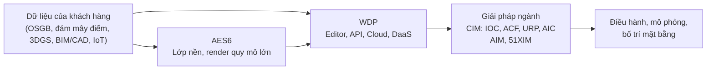
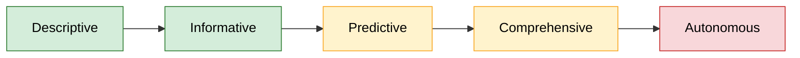

# 🌐 Báo cáo Digital Twin 51WORLD

> 📅 **Cập nhật:** 03/11/2026  |  ✍️ **Tác giả:** Hoàng Trung Hiếu  |  🔖 **Phiên bản:** 1.0  
> 🏷️ **Chủ đề:** Đánh giá năng lực công nghệ và khảo sát thực tế 51WORLD (51Aes) cho bản sao số tòa nhà, khuôn viên, công trình phức hợp (sân vận động)

> [!NOTE]
> **Đối tượng đánh giá:** Nền tảng 51Aes (AES6, WDP) và các giải pháp ngành CIM, AIM. Các mảng robot và xe tự lái (AperOne, SimOne) chỉ liệt kê, không đánh giá.  
> **Nguồn chính:** Trang chính thức của hãng, tài liệu API, sổ tay WDP5 và báo cáo giữa niên độ trên HKEX.  
> **Lưu ý:** Phần lớn nguồn bằng tiếng Trung; nội dung trích trong báo cáo do nhóm tự dịch.

---

## 📑 Mục lục

- [📏 Quy chuẩn mức bằng chứng A–B–C](#-quy-chuẩn-mức-bằng-chứng-abc)
- [🧭 Phần 1. Thông tin cần biết về 51WORLD](#-phần-1-thông-tin-cần-biết-về-51world)
  - [🎯 1.1. Định vị và chiến lược hiện tại](#-11-định-vị-và-chiến-lược-hiện-tại)
  - [🗺️ 1.2. Bản đồ sản phẩm](#-12-bản-đồ-sản-phẩm)
  - [🧱 1.3. Nền dữ liệu và cơ chế mở](#-13-nền-dữ-liệu-và-cơ-chế-mở)
  - [🏗️ 1.4. Khung tham chiếu 5 tầng](#-14-khung-tham-chiếu-5-tầng)
- [🔬 Phần 2. Đánh giá chuyên sâu](#-phần-2-đánh-giá-chuyên-sâu)
  - [🧮 2.1. Ma trận theo khung 5 tầng](#-21-ma-trận-theo-khung-5-tầng)
  - [📈 2.2. Level maturity và AI](#-22-level-maturity-và-ai)
  - [💰 2.3. Giá, mô hình triển khai và giả thuyết](#-23-giá-mô-hình-triển-khai-và-giả-thuyết)
  - [🔌 2.4. Khả năng mở rộng và ràng buộc](#-24-khả-năng-mở-rộng-và-ràng-buộc)
  - [🏟️ 2.5. Quy mô khu vực và dự án thực tế](#-25-quy-mô-khu-vực-và-dự-án-thực-tế)
- [✅ Phần 3. Kết luận và phù hợp cho dự án sân vận động](#-phần-3-kết-luận-và-phù-hợp-cho-dự-án-sân-vận-động)
  - [🧾 3.1. Kết luận chung](#-31-kết-luận-chung)
  - [🏁 3.2. Mức sẵn sàng theo giai đoạn dự án sân vận động](#-32-mức-sẵn-sàng-theo-giai-đoạn-dự-án-sân-vận-động)
  - [📅 3.3. Ngày có sự kiện và ngày thường](#-33-ngày-có-sự-kiện-và-ngày-thường)
  - [📡 3.4. Điểm nghẽn: phụ thuộc đám mây và dự phòng ngoại tuyến/edge](#-34-điểm-nghẽn-phụ-thuộc-đám-mây-và-dự-phòng-ngoại-tuyếnedge)

## 📏 Quy chuẩn mức bằng chứng A–B–C

| Cấp độ | Định nghĩa | Tiêu chí xác minh | Trạng thái trong báo cáo |
|---|---|---|---|
| 🟢 Mức A | Đã kiểm chứng trực tiếp qua trải nghiệm hệ thống, hoặc case study công khai có số liệu độc lập | Dùng thử thật trên môi trường live/sandbox, hoặc nguồn độc lập đối chiếu được | **Chưa có.** Chưa dùng thử hệ thống nào của hãng |
| 🔵 Mức B | Căn cứ trực tiếp trên tài liệu chính thức của 51WORLD; chỉ chứng minh điều hãng nói, không chứng minh hiệu quả thực tế | Trang sản phẩm, tài liệu nhà phát triển, FAQ, hồ sơ công bố, trang bán trên chợ ứng dụng | Phần lớn nội dung; mọi dự án và số liệu hiệu năng đều thuộc loại này |
| 🟠 Mức C | Suy luận của nhóm hoặc tổng hợp từ bên thứ ba, chưa có xác nhận trực tiếp của hãng | Đối chiếu của nhóm, báo chí | Cột "tầng", ma trận, maturity, giả thuyết |

## 🧭 Phần 1. Thông tin cần biết về 51WORLD

> [!IMPORTANT]
> **Tóm tắt nhanh**
> 1. **Bài toán cốt lõi hãng giải quyết:** dựng và vận hành bản sao số quy mô lớn (đô thị, khuôn viên, địa điểm, sân bay, thủy lợi, năng lượng) với trực quan hóa 3D theo thời gian thực, mô phỏng và điều hành tập trung. ([1](https://www.51aes.com), [2](https://www.51aes.com/faq/q7))
> 2. **Chiến lược tiếp cận:** nền tảng trọn gói do hãng tự phát triển, nhấn mạnh triển khai private, nội địa hóa toàn chuỗi và có bản Lite chạy offline trên một máy. ([3](https://www.51aes.com/faq/q12), [4](https://www.51aes.com/products/aes), [5](https://zaqa9535mw4.feishu.cn/wiki/wikcnmC72WN01k0vWsr54RbCWXg))
> 3. **Công thức cấu trúc giải pháp:** lớp nền AES6 + nền tảng phát triển WDP (Editor, API, Cloud, DaaS) + giải pháp theo ngành (CIM với IOC, ACF, URP, AIC; AIM; 51XIM).
> 4. **Khoảng trống:** chưa thấy module tài sản và bảo trì (EAM/CMMS), ontology, CSDL chuỗi thời gian, giao thức IoT, IFC và chuẩn OGC trong nguồn đã rà soát; giá không công khai; tài liệu tiếng Anh hạn chế.
> 5. **Thực tế tại dự án sân vận động:** chưa thấy sân vận động nào dùng hãng cho vận hành. Hãng có công cụ mô phỏng luồng người cho sự kiện và công cụ bố trí mặt bằng; khách hàng được nêu tên là nhà hội nghị và bảo tàng. ([6](https://www.51aes.com/solution/cim/acf), [7](https://www.51aes.com/solution/cim/aic), [8](https://www.51aes.com/cases/culture-health/smart-venue))

| Mạnh (theo tài liệu hãng, Mức B) | Chưa có (trong nguồn đã rà soát) |
|---|---|
| Render cảnh quy mô lớn thời gian thực và render đám mây tới nhiều loại thiết bị ([4](https://www.51aes.com/products/aes), [9](https://www.51aes.com/products/wdp)) | Module EAM/CMMS, giám sát kết cấu |
| Công cụ dựng cảnh và API JavaScript (300+ interface), có dịch vụ MCP cho trợ lý lập trình AI ([10](https://www.51aes.com/faq/q14), [11](https://wdpapidoc.51aes.com/apifunc/wdpapi)) | Ontology theo chuẩn (DTDL, Brick), CSDL chuỗi thời gian chuyên dụng |
| Mô phỏng luồng người và sơ tán cho sự kiện lớn ([6](https://www.51aes.com/solution/cim/acf)) | Giao thức IoT (MQTT, OPC-UA, BACnet, Modbus), danh mục thiết bị |
| Triển khai private, nền tảng nội địa hóa; bản Lite chạy offline trên một máy ([3](https://www.51aes.com/faq/q12), [5](https://zaqa9535mw4.feishu.cn/wiki/wikcnmC72WN01k0vWsr54RbCWXg)) | IFC, CityGML, OGC, I3S; cơ chế edge chưa thấy |
| Nhiều module ngành (đô thị, sân bay, năng lượng, thủy lợi) ([1](https://www.51aes.com)) | Giá, dùng thử, dự án Việt Nam, nguồn độc lập cho dự án |

### 🎯 1.1. Định vị và chiến lược hiện tại

Hãng tự mô tả 51Aes là nền tảng digital twin lấy AES6 và WDP làm lõi, phục vụ thành phố, công nghiệp và thủy lợi, và nêu đã phục vụ hơn một nghìn doanh nghiệp trên toàn cầu (số do hãng nêu, chưa kiểm chứng). ([12](https://www.51aes.com/faq)) AES6 được nêu là nền kỹ thuật thống nhất của toàn bộ năng lực 51Aes. ([2](https://www.51aes.com/faq/q7)) Trang sản phẩm xếp ba nhóm: lớp nền AES, nền tảng nhà phát triển WDP, và các giải pháp theo ngành (CIM cho đô thị và khuôn viên, WIM cho thủy lợi, GIM cho địa chất, điện, nhà máy và sân bay). ([1](https://www.51aes.com)) Hãng cũng định vị "AI vật lý" (physical AI) qua nhánh robot AperOne, nhưng nhánh này ngoài phạm vi tòa nhà. ([13](https://www.51world.com.cn), [14](https://www.51world.com.cn/aper/aperone))

*Nhận định:* sơ đồ là cách đọc chuỗi giá trị từ trang hãng, Mức C. Hãng bán cả lớp nền, công cụ dựng và ứng dụng ngành; các trang đã đọc không nêu đối tác phần cứng hay engine của bên khác.

### 🗺️ 1.2. Bản đồ sản phẩm

Cột "Tầng" (T1–T5) là đối chiếu của nhóm theo khung 5 tầng ở [mục 1.4](#️-14-khung-tham-chiếu-5-tầng) (Mức C).

| Thành phần | Làm gì | Dữ liệu vào | Kết quả ra | Tầng (🟠 Mức C) |
|---|---|---|---|---|
| **AES** (AES6, AES API, AES Data, AES Tools) ([4](https://www.51aes.com/products/aes)) | Lớp nền; render cảnh quy mô toàn Trái Đất; chỉnh sửa lúc chạy; triển khai private | Dữ liệu đa nguồn của khách hàng; OSGB, đám mây điểm, 3DGS (Geo Tool); định dạng chuẩn AES (Meta Tool) | Dịch vụ 3D Tiles; cảnh 3D cấp 1–5; API chuẩn hóa | T2, T3 |
| **WDP** (Editor, API, Cloud, DaaS) ([9](https://www.51aes.com/products/wdp)) | Nền tảng nhà phát triển low-code; render đám mây | 14 định dạng 3D/kỹ thuật (nêu FBX, RVT), BIM, CAD | Ứng dụng web 3D; hình ảnh render 8K, 30–120 FPS (số của hãng) | T2, T5 |
| **CIM 3.0** ([15](https://www.51aes.com/solution/cim/cim)) | Mô hình thông minh đô thị/khuôn viên trên "nền không-thời gian thống nhất" | BIM, GIS, cảm biến IoT, dữ liệu giao thông | Module IOC, ACF, URP, AIC | T4, T5 |
| **IOC** ([16](https://www.51aes.com/solution/cim/ioc)) | Giám sát toàn cảnh, cảnh báo sớm, diễn tập phương án | Dữ liệu đa nguồn (an ninh, năng lượng, ra vào, thiết bị) | Giao diện điều hành, cảnh báo | T5 |
| **ACF** ([6](https://www.51aes.com/solution/cim/acf)) | Mô phỏng luồng người và xe | Trang không nêu định dạng; có nhắc dữ liệu thời gian thực | Điểm ùn tắc, xếp hàng, đường và mật độ sơ tán, so sánh phương án | T3, T4 |
| **AIC** (智会精灵) ([7](https://www.51aes.com/solution/cim/aic)) | Tự động sinh phương án bố trí mặt bằng theo thời gian thực | Mô hình không gian địa điểm; ngôn ngữ tự nhiên | Phương án bố trí, sơ tán, xếp chỗ, kiểm tra phòng cháy chữa cháy | T4 |
| **URP** ([17](https://www.51aes.com/solution/cim/urp)) | Đổi mới đô thị, đường ống ngầm, công trường thông minh | Dữ liệu đa nguồn, AIoT, BIM | Trực quan hóa, so sánh phương án, giám sát | T4, T5 |
| **AIM** (sân bay) ([18](https://www.51aes.com/solution/gim/aim)) | Tích hợp dữ liệu khu bay (airside) và khu mặt đất (landside) | Không nêu | Điều phối vận hành, dịch vụ hành khách hàng, khẩn cấp | T4 |
| **51XIM** (năng lượng) ([19](https://marketplace.huaweicloud.com/intl/contents/662579b9-bdec-4973-8f6b-01464181faf6)) | Digital twin năng lượng; gồm 51AES và ISE (engine mô phỏng mở qua API) | Không nêu | Giám sát từ xa, điều phối, ứng phó khẩn cấp | T4 |
| **FIM** (nhà máy) ([20](https://www.51aes.com/solution/gim/fim)) | Digital twin nhà máy: mô hình thiết bị, dự đoán lỗi, mô phỏng vận hành | Không nêu | Giám sát, mô phỏng, cảnh báo | T4 |
| **AperOne** ([14](https://www.51world.com.cn/aper/aperone)) | Nền tảng ứng dụng embodied AI (robot) trong cảnh bản sao số | Dữ liệu cảm nhận đa phương thức | Chính sách huấn luyện, báo cáo đánh giá | Ngoài khung |
| **SimOne** (51Sim) ([21](https://www.51sim.com/products/simone?lang=zh)) | Mô phỏng lái xe tự động, 5 phiên bản | Dữ liệu cảm biến, bản đồ độ chính xác cao | Mô phỏng, đánh giá | Ngoài khung |
| **Dataverse** (51Sim) ([22](https://www.51sim.com/products/dataverse?lang=zh)) | Quản lý và khai thác dữ liệu lái xe tự động, có VLM | Dữ liệu thu thập thực tế | Cảnh WorldSim/LogSim | Ngoài khung |
| **51Earth** ([23](https://51earth.com)) | "Digital twin Earth" của hãng | Trang không nêu | Trang không nêu | Không xếp được |

Các thành phần khác trên trang chủ thuộc ngành ngoài tòa nhà và công trình nên không đưa vào bảng: WIM (thủy lợi), GIM và EIM (địa chất, năng lượng, điện), SimOne4 và Synthverse (lái xe tự động), AperData (robot), Clonova, See3, Star (tương tác không gian, du lịch, khám phá không gian). ([1](https://www.51aes.com), [13](https://www.51world.com.cn))

*Nhận định:* các sản phẩm đã đọc dồn ở T2, T3 và T5 (AES, WDP). T4 có mặt ở mức giải pháp ngành; trang Smart Building và Smart Park nêu chức năng vận hành, bảo trì, năng lượng và "tài sản" ở mức tên gọi, nhưng chưa thấy module EAM/CMMS, lệnh công việc hay giám sát kết cấu. ([24](https://www.51aes.com/cases/build/smart-building), [25](https://www.51aes.com/cases/build/smart-park)) T1 không có sản phẩm riêng trong nguồn đã đọc.

### 🧱 1.3. Nền dữ liệu và cơ chế mở

| Loại dữ liệu | Định dạng/chuẩn được nêu | Cách nạp | Giới hạn, chuẩn chưa thấy |
|---|---|---|---|
| **BIM/CAD** | WDP DaaS nhập 14 định dạng 3D/kỹ thuật, nêu FBX và RVT, cùng BIM, CAD ([9](https://www.51aes.com/products/wdp)); sổ tay WDP5 có hướng dẫn xuất FBX, RVT và cây cấu kiện BIM (chọn mô hình BIM, mở tab "cấu kiện", ẩn/hiện theo cấp) ([5](https://zaqa9535mw4.feishu.cn/wiki/wikcnmC72WN01k0vWsr54RbCWXg)); có BIM API ([10](https://www.51aes.com/faq/q14)) | Nhập trực tiếp "không cần công cụ chuyển đổi" (lời hãng) ([9](https://www.51aes.com/products/wdp)) | Danh sách đủ 14 định dạng chưa thấy; **IFC chưa thấy nêu tên**; mục BIM API trong bộ tài liệu API không có nội dung công khai ([11](https://wdpapidoc.51aes.com/apifunc/wdpapi)) |
| **GIS và 3D địa không gian** | Geo Tool nhận OSGB, đám mây điểm, 3DGS và xuất thẳng ra dịch vụ 3D Tiles ([4](https://www.51aes.com/products/aes)); CIM nhắc dữ liệu GIS ([15](https://www.51aes.com/solution/cim/cim)); có GIS API và CIM API ([10](https://www.51aes.com/faq/q14), [11](https://wdpapidoc.51aes.com/apifunc/wdpapi)) | Meta Tool đưa dữ liệu đa nguồn về "định dạng chuẩn AES" ([4](https://www.51aes.com/products/aes)) | **3D Tiles có tài liệu xác nhận (đầu ra).** CityGML, WMS/WFS và I3S chưa thấy; "định dạng chuẩn AES" là định dạng nội bộ, chưa thấy đặc tả |
| **IoT** | CIM nhận "dữ liệu cảm biến IoT" ([15](https://www.51aes.com/solution/cim/cim)); IOC nêu dữ liệu an ninh, năng lượng, ra vào, thiết bị ([16](https://www.51aes.com/solution/cim/ioc)); dự án MOMA tích hợp IBMS và AIoT ([8](https://www.51aes.com/cases/culture-health/smart-venue)) | Qua giải pháp của từng dự án; trang không nêu cơ chế | Giao thức (MQTT, OPC-UA, BACnet, Modbus) và danh mục thiết bị chưa thấy |
| **Dữ liệu thực tế (reality capture)** | OSGB, đám mây điểm, 3DGS ([4](https://www.51aes.com/products/aes)) | Geo Tool | Quy trình quét/chụp, giới hạn dung lượng chưa thấy |

**Mô hình thực thể số trong WDP5.** Sổ tay mô tả "danh mục", "phân loại" và "thực thể" số. Mỗi phân loại có bốn thuộc tính hệ thống (DTID là định danh duy nhất, bắt buộc; tên; model; DTID cha) và cho tự thêm thuộc tính với kiểu, mặc định, mô tả. Mỗi thực thể chỉ gắn được với một đối tượng trong cảnh, dữ liệu được mô tả là chảy hai chiều giữa thiết bị thật và thực thể số. ([5](https://zaqa9535mw4.feishu.cn/wiki/wikcnmC72WN01k0vWsr54RbCWXg)) *Nhận định:* đây là mô hình dữ liệu phân cấp cha-con với schema tự tạo; chưa thấy đối chiếu với DTDL hay Brick, chưa thấy quan hệ ngoài cha-con và chưa thấy CSDL chuỗi thời gian (danh sách dịch vụ chỉ có PostgreSQL và Redis). ([5](https://zaqa9535mw4.feishu.cn/wiki/wikcnmC72WN01k0vWsr54RbCWXg))

### 🏗️ 1.4. Khung tham chiếu 5 tầng

| Tầng | Vai trò | Module chuẩn |
|---|---|---|
| T5 | Trực quan hóa và điều hành (IOC) | Cổng web 3D; màn hình lớn trung tâm điều hành; ứng dụng di động cho kỹ thuật viên |
| T4 | Module nghiệp vụ chuyên dụng | Luồng người và an ninh; tài sản và bảo trì (EAM/CMMS/FM); năng lượng và môi trường; giám sát sức khỏe kết cấu; vận hành sự kiện |
| T3 | Lõi nền tảng và mô phỏng | CSDL quan hệ không gian (ontology như DTDL hay Brick); CSDL chuỗi thời gian; công cụ mô phỏng và AI/ML |
| T2 | Thu nạp và chuẩn hóa dữ liệu | Bộ chuyển đổi BIM, GIS, đám mây điểm; bus truyền tin cho dữ liệu IoT |
| T1 | Hạ tầng vật lý và biên | Cảm biến IoT, camera AI, cửa quay soát vé, bộ điều khiển BMS, cổng biên |

> [!NOTE]
> Đây là khung tổng hợp của nhóm, **không phải chuẩn đã công bố hay state-of-the-art**. Khung công khai khác là Digital Twin Consortium Platform Stack (6 thành phần, có Security/Trust/Governance) và ISO 23247-2 (4 domain, cho sản xuất công nghiệp); cả hai có phần bảo mật mà khung 5 tầng chưa có. DTDL và Brick là hai thứ khác nhau (RealEstateCore xây DTDL ontology trên nền Brick).

## 🔬 Phần 2. Đánh giá chuyên sâu

### 🧮 2.1. Ma trận theo khung 5 tầng

Thang ▰▱ là định tính, Mức C, không phải số đo.

| Tầng | Giải pháp cụ thể của hãng | Tự làm hay dựa bên ngoài | Mức bằng chứng | Nhận định |
|---|---|---|---|---|
| T5 | WDP Cloud (render đám mây tới điện thoại, máy tính bảng, AR/VR, màn hình lớn) ([9](https://www.51aes.com/products/wdp)); IOC ([16](https://www.51aes.com/solution/cim/ioc)) | Tự làm; hãng nêu engine render tự phát triển ([3](https://www.51aes.com/faq/q12)) | 🔵 B | ▰▰▰▰▱. Màn hình lớn và AR/VR được nêu; có bản Lite chạy offline trên một máy; ứng dụng di động riêng chưa thấy |
| T4 | ACF, AIC, URP, AIM, 51XIM ([6](https://www.51aes.com/solution/cim/acf), [7](https://www.51aes.com/solution/cim/aic), [17](https://www.51aes.com/solution/cim/urp), [18](https://www.51aes.com/solution/gim/aim), [19](https://marketplace.huaweicloud.com/intl/contents/662579b9-bdec-4973-8f6b-01464181faf6)) | Tự làm ở luồng người, bố trí mặt bằng, đô thị | 🔵 B | ▰▰▰▱▱. Có luồng người và vận hành sự kiện ở mức trang giải pháp; EAM/CMMS, kết cấu chưa thấy |
| T3 | AES6; ACF; ISE; quản lý thực thể số và blueprint trong WDP5 ([4](https://www.51aes.com/products/aes), [5](https://zaqa9535mw4.feishu.cn/wiki/wikcnmC72WN01k0vWsr54RbCWXg), [19](https://marketplace.huaweicloud.com/intl/contents/662579b9-bdec-4973-8f6b-01464181faf6)) | Tự làm (theo lời hãng) | 🔵 B | ▰▰▰▰▱. Có mô hình thực thể số (DTID, phân loại, thuộc tính tự tạo); ontology theo chuẩn và CSDL chuỗi thời gian chuyên dụng chưa thấy |
| T2 | AES Data, WDP DaaS ([4](https://www.51aes.com/products/aes), [9](https://www.51aes.com/products/wdp)) | Tự làm; xuất 3D Tiles | 🔵 B | ▰▰▰▰▱. Mạnh ở OSGB, đám mây điểm, 3DGS và FBX/RVT; IFC và chuẩn OGC chưa thấy |
| T1 | Không có sản phẩm riêng trong nguồn đã đọc | Nhận dữ liệu từ hệ thống của khách hàng (ví dụ IBMS và AIoT ở dự án MOMA) ([8](https://www.51aes.com/cases/culture-health/smart-venue)) | 🔵 B (mức dự án) | ▰▱▱▱▱. Hãng không được nêu bán cảm biến hay cổng biên |

### 📈 2.2. Level maturity và AI

Thang Verdantix: Descriptive, Informative, Predictive, Comprehensive, Autonomous (IBM gọi tương đương là "Dynamic"). Phần đối chiếu dưới đây là của nhóm, Mức C.

| Level | Kết quả | Mức bằng chứng | Căn cứ có nguồn |
|---|---|---|---|
| Descriptive | Đạt | 🔵 B | Cảnh 3D thời gian thực, hợp nhất dữ liệu đa nguồn ([4](https://www.51aes.com/products/aes), [16](https://www.51aes.com/solution/cim/ioc)) |
| Informative | Đạt | 🔵 B | IOC: giám sát thời gian thực và cảnh báo sớm ([16](https://www.51aes.com/solution/cim/ioc)) |
| Predictive | Một phần | 🔵 B | ACF nêu dự báo ngắn hạn (ví dụ 15 phút tới) khi có dữ liệu thời gian thực; không có chỉ số kỹ thuật ([6](https://www.51aes.com/solution/cim/acf)) |
| Comprehensive | Một phần | 🔵 B | IOC nêu mô phỏng toàn quy trình phương án trong cảnh bản sao số; chưa thấy demo hay số liệu ([16](https://www.51aes.com/solution/cim/ioc)) |
| Autonomous | Chưa thấy | — | Trong nhóm tòa nhà và khuôn viên chưa thấy. AperOne điều phối robot là phạm vi khác ([14](https://www.51world.com.cn/aper/aperone)) |

**AI công bố so với thực tế triển khai**

| Công cụ | Chức năng hãng nêu | Trạng thái trong nguồn |
|---|---|---|
| WDP AI Coding (MCP) | Mô tả bằng ngôn ngữ tự nhiên, AI gọi API WDP sinh mã giao diện; hãng nêu rút chu kỳ phát triển từ vài tuần xuống vài ngày (chưa kiểm chứng) ([11](https://wdpapidoc.51aes.com/apifunc/wdpapi)) | Có tài liệu và hướng dẫn cấu hình cho Cline, Copilot, Cursor; cần token xin từ bộ phận kinh doanh ([11](https://wdpapidoc.51aes.com/apifunc/wdpapi), [26](https://my.feishu.cn/docx/K3PDd60M0o7hWRx3NJIcafIDnc7)) |
| AES Data, AES Tools | Hợp nhất dữ liệu, dựng và chỉnh cảnh | Menu gắn nhãn Beta; AES6 gắn "Hot", AES API gắn "New" (nhãn tiếp thị) ([1](https://www.51aes.com)) |
| SuperGUI | Dựng bảng điều khiển nghiệp vụ, blueprint | Tên mục trong sổ tay ghi Beta ([5](https://zaqa9535mw4.feishu.cn/wiki/wikcnmC72WN01k0vWsr54RbCWXg)) |
| CIM: LLM, 3DGS | Liệt kê trong công nghệ của CIM | Không mô tả cách dùng; trạng thái chưa rõ ([15](https://www.51aes.com/solution/cim/cim)) |
| AIC | Bố trí, sơ tán, xếp chỗ, kiểm tra phòng cháy nhanh (30, 5, 10, 10 giây, số của hãng) | Có khách hàng nhận xét do hãng đăng; chưa có kiểm chứng độc lập ([7](https://www.51aes.com/solution/cim/aic)) |
| AperOne, AperData | Embodied AI | Báo cáo giữa niên độ: mới ra mắt, đang vào giai đoạn thương mại hóa ([27](https://www1.hkexnews.hk/listedco/listconews/sehk/2026/0810/2026081000218.pdf)) |

### 💰 2.3. Giá, mô hình triển khai và giả thuyết

| Hạng mục | Giá công khai? | Bằng chứng |
|---|---|---|
| AES, WDP, CIM, ACF, AIC, IOC | Chưa công khai, cần báo giá | Trang chỉ có liên hệ aes@51aes.com và số điện thoại ([28](https://www.51aes.com/faq/q13), [9](https://www.51aes.com/products/wdp)); tài liệu API nêu token xin qua kinh doanh ([11](https://wdpapidoc.51aes.com/apifunc/wdpapi)) |
| 51XIM trên chợ ứng dụng | Không công bố giá, "Contact Sales"; thời gian giao hàng 60 ngày | ([19](https://marketplace.huaweicloud.com/intl/contents/662579b9-bdec-4973-8f6b-01464181faf6)) |
| SimOne (51Sim) | Không có giá; có 5 phiên bản và nút đăng ký dùng thử | ([21](https://www.51sim.com/products/simone?lang=zh)) (ngoài phạm vi tòa nhà) |
| Cách ghi nhận doanh thu | Phần lớn ghi nhận khi bàn giao và nghiệm thu (121,5 triệu RMB); khoảng 2,2 triệu RMB ghi theo thời gian | ([27](https://www1.hkexnews.hk/listedco/listconews/sehk/2026/0810/2026081000218.pdf)) |

**Mô hình triển khai.** AES hỗ trợ triển khai private và sinh dữ liệu cục bộ ([4](https://www.51aes.com/products/aes)); WDP được nêu hỗ trợ triển khai private với nền tảng nội địa hóa ([3](https://www.51aes.com/faq/q12)); WDP5 lưu dữ liệu trên đám mây và có bàn giao offline: máy khách Lite chạy cục bộ, dùng "mã bàn giao offline" khớp phiên bản WDP; nếu không cần truyền dữ liệu thì gắn dịch vụ vào địa chỉ 127.0.0.1 và chạy hoàn toàn offline trên một máy. Cấu hình khuyến nghị là GPU NVIDIA RTX 30xx trở lên, Windows 10/11 Pro hoặc Server 2022; có phương án Linux (CPU Hygon, Kylin V10); phát 8K phải dùng trình duyệt riêng 51Browser; dữ liệu từ đám mây phải cập nhật thủ công bằng mã mới. ([5](https://zaqa9535mw4.feishu.cn/wiki/wikcnmC72WN01k0vWsr54RbCWXg)) Báo cáo giữa niên độ không đề cập SaaS hay on-premise ([27](https://www1.hkexnews.hk/listedco/listconews/sehk/2026/0810/2026081000218.pdf)).

**Giả thuyết gốc thiết kế (Mức C).** Doanh thu chủ yếu ghi nhận khi nghiệm thu phần mềm (và phần cứng nếu có) cho thấy hãng bán theo dự án tích hợp, không phải thuê bao tự phục vụ. Giả thuyết này cần hợp đồng thực tế để kiểm chứng.

**Cấu trúc chi phí.** Hãng không công bố đơn giá cho hạng mục nào, nhưng nguồn cho phép dựng các khoản chi phí sau; cột giá đều là "chưa công khai".

| Khoản chi phí | Căn cứ trong nguồn | Đơn vị tính / thời điểm | Giá |
|---|---|---|---|
| Giấy phép và triển khai nền tảng (AES, WDP, CIM) | Doanh thu ghi nhận khi bàn giao và khách hàng nghiệm thu ([27](https://www1.hkexnews.hk/listedco/listconews/sehk/2026/0810/2026081000218.pdf)) | Theo hợp đồng dự án; không thấy thuê bao | Chưa công khai, cần báo giá ([28](https://www.51aes.com/faq/q13), [9](https://www.51aes.com/products/wdp)) |
| Dựng cảnh theo dự án ("case dự án") | Sổ tay phân biệt "case dự án" (hãng làm riêng cho một dự án rồi giao khách hàng) với "case tự tạo" (nhà phát triển tự dựng trên WDP5) ([5](https://zaqa9535mw4.feishu.cn/wiki/wikcnmC72WN01k0vWsr54RbCWXg)) | Theo dự án | Chưa công khai |
| Phần cứng giao kèm | Doanh thu tính cho phần mềm và phần cứng "nếu có" ([27](https://www1.hkexnews.hk/listedco/listconews/sehk/2026/0810/2026081000218.pdf)) | Theo hợp đồng | Chưa công khai |
| Hạ tầng phía khách hàng cho triển khai private/offline | GPU NVIDIA RTX 30xx trở lên, Windows 10/11 Pro hoặc Server 2022, hoặc Linux (CPU Hygon, Kylin V10); cụm nhiều máy render khi nhiều người dùng ([5](https://zaqa9535mw4.feishu.cn/wiki/wikcnmC72WN01k0vWsr54RbCWXg)) | Mua hoặc thuê máy do khách hàng chịu | Không phải giá của hãng; chưa ước tính |
| Giao hàng offline và cập nhật dữ liệu | Mỗi case cần "mã bàn giao offline"; dữ liệu đổi thì phải nhận mã mới hoặc cập nhật qua máy khách ([5](https://zaqa9535mw4.feishu.cn/wiki/wikcnmC72WN01k0vWsr54RbCWXg)) | Theo case và theo lần cập nhật (🟠 Mức C) | Chưa thấy tính phí riêng |
| Công cụ AI Coding (MCP) | Token xin qua bộ phận kinh doanh ([11](https://wdpapidoc.51aes.com/apifunc/wdpapi)) | Theo token | Chưa công khai |
| Hạn mức tài khoản và nhóm trên WDP5 | Sổ tay có mục "quyền lợi" và "quản lý nhóm" ([5](https://zaqa9535mw4.feishu.cn/wiki/wikcnmC72WN01k0vWsr54RbCWXg)) | Chưa rõ đơn vị (🟠 Mức C) | Chưa công khai |
| Hỗ trợ và bảo trì sau triển khai | Chưa thấy | — | — |

*Nhận định:* cấu trúc chi phí là theo dự án (giấy phép, dựng cảnh, nghiệm thu), cộng thêm hạ tầng GPU phía khách hàng khi chạy private hoặc offline. Chưa có hạng mục nào có giá công khai nên chưa có cơ sở ước tính; phần duy nhất lượng hóa được là yêu cầu cấu hình máy.

### 🔌 2.4. Khả năng mở rộng và ràng buộc

| Khía cạnh | Ràng buộc đã ghi nhận | Nhãn |
|---|---|---|
| API và SDK | WdpApi là JavaScript SDK tương thích Vue, React, Angular ([9](https://www.51aes.com/products/wdp)); hãng nêu 300+ interface, gồm BIM API, GIS API, CIM API, WIM API ([10](https://www.51aes.com/faq/q14)); họ API trong tài liệu: WDP, GIS, ISE, CIM, BIM, TIM, EIM, WIM, AESRT (bản 2.5.0) ([11](https://wdpapidoc.51aes.com/apifunc/wdpapi)) | 🔵 B |
| Ngôn ngữ SDK khác | Chưa thấy | — |
| Tài liệu | Trang sản phẩm và case chủ yếu bằng tiếng Trung; tài liệu API có bản tiếng Anh và tiếng Trung ([11](https://wdpapidoc.51aes.com/apifunc/wdpapi)); sổ tay WDP5 và hướng dẫn MCP tiếng Trung ([5](https://zaqa9535mw4.feishu.cn/wiki/wikcnmC72WN01k0vWsr54RbCWXg), [26](https://my.feishu.cn/docx/K3PDd60M0o7hWRx3NJIcafIDnc7)); FAQ chỉ trả lời đầy đủ 1/14 câu ([12](https://www.51aes.com/faq)) | 🔵 B |
| Tài khoản và quyền truy cập | Dùng MCP cần token từ bộ phận kinh doanh; cần URL hiển thị (render) và mã truy cập của case đã phát hành ([11](https://wdpapidoc.51aes.com/apifunc/wdpapi)); không thấy đăng ký tự phục vụ | 🔵 B |
| Điểm cuối MCP | Địa chỉ ghi trong hướng dẫn là `http://aicode.51aes.com` (HTTP, không phải HTTPS) ([26](https://my.feishu.cn/docx/K3PDd60M0o7hWRx3NJIcafIDnc7)). Vì dịch vụ này dùng token xác thực ([11](https://wdpapidoc.51aes.com/apifunc/wdpapi)), cần kiểm tra token có đi qua kênh không mã hóa hay không | 🔵 B (địa chỉ); 🟠 C (rủi ro) |
| Nơi lưu dữ liệu | WDP5 lưu toàn bộ dữ liệu trên đám mây; bản Lite chạy cục bộ với PostgreSQL và Redis ([5](https://zaqa9535mw4.feishu.cn/wiki/wikcnmC72WN01k0vWsr54RbCWXg)); vùng đặt máy chủ đám mây chưa thấy | 🔵 B |
| Môi trường chạy bản Lite | GPU NVIDIA RTX 30xx trở lên có NVDEC; Windows 10/11 Pro hoặc Server 2022; Chrome 135 đến 148; 8K cần 51Browser; nên dùng driver GPU ổn định cũ khoảng 6 tháng ([5](https://zaqa9535mw4.feishu.cn/wiki/wikcnmC72WN01k0vWsr54RbCWXg)) | 🔵 B |
| Cập nhật dữ liệu offline | Phải nhận mã bàn giao offline mới hoặc dùng nút cập nhật dữ liệu case; không có đồng bộ tự động được nêu ([5](https://zaqa9535mw4.feishu.cn/wiki/wikcnmC72WN01k0vWsr54RbCWXg)) | 🔵 B |
| Bảo mật và tuân thủ | Hãng nêu tương thích toàn chuỗi CPU, GPU, hệ điều hành, CSDL nội địa và "chứng nhận tuân thủ 信创"; chưa thấy tên chứng nhận, cơ quan cấp, chứng nhận bảo mật quốc tế hay quy định dữ liệu xuyên biên giới ([3](https://www.51aes.com/faq/q12), [27](https://www1.hkexnews.hk/listedco/listconews/sehk/2026/0810/2026081000218.pdf)) | 🔵 B |
| Điều khoản bậc miễn phí, dùng thử WDP/AES | Chưa thấy | — |
| Hỗ trợ ngoài Trung Quốc | Chưa thấy nêu; doanh thu ngoài đại lục là 2,3 triệu RMB so với 121,4 triệu RMB trong đại lục (chưa kiểm toán) ([27](https://www1.hkexnews.hk/listedco/listconews/sehk/2026/0810/2026081000218.pdf)) | 🔵 B |

> [!WARNING]
> **Giả thuyết phụ thuộc hệ sinh thái (Mức C).** Cảnh dựng trên WDP chạy qua WDP Cloud và dùng "định dạng chuẩn AES" nội bộ, trong khi tài liệu chưa nêu cách xuất toàn bộ cảnh và dữ liệu thực thể sang định dạng mở. Nếu đúng, chuyển nền tảng về sau sẽ phải dựng lại. Cần kiểm chứng bằng thử nghiệm.

### 🏟️ 2.5. Quy mô khu vực và dự án thực tế

Toàn bộ dự án dưới đây do chính hãng đăng; chưa thấy nguồn độc lập xác nhận vai trò hay kết quả.

**Quy mô khu vực/đô thị**

| Dự án | Vai trò của hãng | Ai đăng nguồn | Có độc lập không | Mức xác thực |
|---|---|---|---|---|
| CBD Bắc Kinh, nền tảng đô thị độ chính xác cao "2000km²" ([15](https://www.51aes.com/solution/cim/cim)) | Hãng nêu "tái tạo nền tảng" | Hãng | Chưa thấy | 🔵 B |
| Gia Định, Thượng Hải (nền tảng xe-đường-thành phố) ([15](https://www.51aes.com/solution/cim/cim)) | Hãng nêu | Hãng | Chưa thấy | 🔵 B |
| Thương Châu, Hà Bắc (nông thôn số) ([15](https://www.51aes.com/solution/cim/cim)) | Hãng nêu | Hãng | Chưa thấy | 🔵 B |
| Nam Ninh (giải tỏa khu dân cư), Trùng Khánh (số hóa xây dựng), một trường đại học (đường ống) ([17](https://www.51aes.com/solution/cim/urp)) | Nhận xét khách hàng do hãng đăng | Hãng | Chưa thấy | 🔵 B |
| Huawei Park (IOC 2.0), khu danh thắng Hoàng Long ([16](https://www.51aes.com/solution/cim/ioc)) | Hãng nêu triển khai IOC | Hãng | Chưa thấy | 🔵 B |
| Huawei Lianqiuhu IOC 2.0: 9 module (an ninh, năng lượng, tài sản...), dữ liệu từ thiết bị quy mô hàng triệu (số của hãng); China Mobile South Base; Zhongjia Yingtan (IoT, năng lượng) ([25](https://www.51aes.com/cases/build/smart-park)) | Hãng nêu | Hãng | Chưa thấy | 🔵 B |
| Shenzhen Yetai Tower: quản lý, năng lượng, vận hành và bảo trì, an ninh trên nền BIM ([24](https://www.51aes.com/cases/build/smart-building)) | Hãng nêu | Hãng | Chưa thấy | 🔵 B |

**Châu Á, Việt Nam**

| Dự án | Vai trò của hãng | Ai đăng nguồn | Có độc lập không | Mức xác thực |
|---|---|---|---|---|
| Jakarta, Indonesia: nền tảng CIM cloud-native ([15](https://www.51aes.com/solution/cim/cim)) | Hãng nêu | Hãng | Chưa thấy nguồn độc lập | 🔵 B |
| Tokyo: trường hợp mô phỏng sơ tán hàng chục nghìn người ([6](https://www.51aes.com/solution/cim/acf)) | Hãng nêu, vai trò chưa rõ | Hãng | Chưa thấy | 🔵 B |
| Sydney, Úc (ngoài châu Á, ghi để tham khảo thị trường ngoài Trung Quốc): hệ thống tiếp thị địa ốc cho các dự án khu dân cư ven nước ([29](https://www.51aes.com/cases/build/smart-real-estate)) | Trực quan hóa bán hàng, không phải vận hành | Hãng | Chưa thấy | 🔵 B |
| Việt Nam | — | — | — | Chưa thấy dự án công khai tại Việt Nam trong nguồn đã rà soát |

**Sân vận động, khu thể thao, địa điểm sự kiện lớn**

| Dự án | Vai trò của hãng | Ai đăng nguồn | Có độc lập không | Mức xác thực |
|---|---|---|---|---|
| Nhà Hội nghị Quốc gia giai đoạn II, Bắc Kinh: trực quan hóa tổng hợp và xếp bàn ảo bằng AIC ([8](https://www.51aes.com/cases/culture-health/smart-venue), [7](https://www.51aes.com/solution/cim/aic)) | Hãng cung cấp; vận hành nêu nhận xét | Hãng | Chưa thấy | 🔵 B |
| Bảo tàng Lịch sử Đảng Cộng sản Trung Quốc: bản sao số 1:1 ([8](https://www.51aes.com/cases/culture-health/smart-venue)) | Hãng làm theo yêu cầu | Hãng | Chưa thấy | 🔵 B |
| Bảo tàng MOMA, Bắc Kinh: nền tảng quản lý tích hợp IBMS và AIoT ([8](https://www.51aes.com/cases/culture-health/smart-venue)) | Phối hợp cùng chủ đầu tư | Hãng | Chưa thấy | 🔵 B |
| Tô Châu: mô phỏng chiến lược đóng mở cổng và tuyến sơ tán cho sự kiện lớn ([6](https://www.51aes.com/solution/cim/acf)) | Hãng nêu | Hãng | Chưa thấy | 🔵 B |

> [!CAUTION]
> Chưa thấy sân vận động nào dùng 51WORLD cho vận hành. Trang ACF nêu kịch bản trận đấu và hòa nhạc nhưng trường hợp được nêu cụ thể là cổng và tuyến sơ tán ở Tô Châu; báo cáo giữa niên độ không nêu khách hàng nào và chỉ nhắc "quản lý địa điểm lớn" là kịch bản mục tiêu của AperOne. ([6](https://www.51aes.com/solution/cim/acf), [27](https://www1.hkexnews.hk/listedco/listconews/sehk/2026/0810/2026081000218.pdf))

## ✅ Phần 3. Kết luận và phù hợp cho dự án sân vận động

### 🧾 3.1. Kết luận chung

> [!IMPORTANT]
> Theo nguồn đã rà soát, 51WORLD hiện là **lớp trực quan và mô phỏng quy mô lớn do hãng tự phát triển** (lớp nền, công cụ dựng cảnh, render đám mây, mô phỏng luồng người), chưa thấy là nền dữ liệu vận hành tài sản.

| Điểm mạnh | Hạn chế |
|---|---|
| Render và dựng cảnh quy mô đô thị; nhập OSGB, đám mây điểm, 3DGS, FBX, RVT ([4](https://www.51aes.com/products/aes), [9](https://www.51aes.com/products/wdp)) | Chưa thấy EAM/CMMS, ontology, chuỗi thời gian, giao thức IoT |
| Công cụ mô phỏng luồng người và sơ tán có kịch bản sự kiện ([6](https://www.51aes.com/solution/cim/acf)) | Dự án chỉ do hãng đăng; không có sân vận động |
| Triển khai private, nội địa hóa và bản Lite chạy offline một máy; API JavaScript có tài liệu tiếng Anh ([3](https://www.51aes.com/faq/q12), [5](https://zaqa9535mw4.feishu.cn/wiki/wikcnmC72WN01k0vWsr54RbCWXg), [11](https://wdpapidoc.51aes.com/apifunc/wdpapi)) | Tài khoản và token qua kinh doanh; chưa thấy dùng thử công khai; hỗ trợ ngoài Trung Quốc chưa thấy |

**Level maturity:** Informative có bằng chứng rõ; Predictive và Comprehensive mới ở mức một phần; Autonomous chưa thấy (xem 2.2).

**Rủi ro phụ thuộc (Mức C):** *Nhận định:* với sân vận động có yêu cầu vận hành liên tục, ba điểm cần nhìn là cảnh nằm trên WDP Cloud và định dạng nội bộ (2.4), bản Lite offline có tài liệu nhưng cập nhật dữ liệu chỉ thủ công và chưa rõ có đủ tính năng như bản đám mây, và phần tài sản/bảo trì mới ở mức tên chức năng. Chỗ hãng nổi bật là bài toán ngày có sự kiện (luồng người, bố trí, sơ tán), không phải bảo trì hằng ngày.

### 🏁 3.2. Mức sẵn sàng theo giai đoạn dự án sân vận động

Thang: 🟢 có bằng chứng ứng dụng, 🟡 có công cụ còn hạn chế, 🟠 chưa phát hành rộng, 🔴 phải dựa hoàn toàn bên ngoài. Chưa khâu nào đạt 🟢 vì chưa có dự án sân vận động hay nguồn độc lập.

| Khâu dự án | Thành phần của hãng | Bằng chứng hiện có | Hạn chế cốt tử | Sẵn sàng |
|---|---|---|---|---|
| Thiết kế | WDP Editor, thư viện tài sản, nhập RVT/FBX ([9](https://www.51aes.com/products/wdp), [5](https://zaqa9535mw4.feishu.cn/wiki/wikcnmC72WN01k0vWsr54RbCWXg)); ACF so sánh phương án (nêu cả sân vận động) ([6](https://www.51aes.com/solution/cim/acf)) | Trang sản phẩm | IFC chưa thấy; chưa có trường hợp sân vận động | 🟡 |
| Mô phỏng đám đông và thoát hiểm | ACF; AIC (sơ tán nhanh) ([6](https://www.51aes.com/solution/cim/acf), [7](https://www.51aes.com/solution/cim/aic)) | Trường hợp Tô Châu, Tokyo do hãng nêu | Không có chỉ số kỹ thuật, không kiểm chứng độc lập | 🟡 |
| Bối cảnh địa không gian đô thị | AES Data (OSGB, đám mây điểm, 3DGS → 3D Tiles), CIM ([4](https://www.51aes.com/products/aes), [15](https://www.51aes.com/solution/cim/cim)) | CBD Bắc Kinh "2000km²" do hãng nêu | Chuẩn OGC chưa thấy | 🟡 |
| Giám sát hiện trường | IOC, nhận dữ liệu đa nguồn; Smart Park nêu 9 module gồm an ninh và năng lượng; tài liệu API có mục video thời gian thực ([16](https://www.51aes.com/solution/cim/ioc), [25](https://www.51aes.com/cases/build/smart-park), [11](https://wdpapidoc.51aes.com/apifunc/wdpapi)) | Dự án khuôn viên do hãng nêu | Giao thức IoT và thiết bị chưa thấy | 🟡 |
| Trải nghiệm truyền thông | WDP Cloud (8K, AR/VR, màn hình lớn), camera lộ trình, thời tiết ([9](https://www.51aes.com/products/wdp)) | Thông số hãng nêu | Phụ thuộc đám mây; chưa kiểm chứng | 🟡 |
| Quản lý tài sản và bảo trì dự đoán | Smart Building nêu chức năng vận hành và bảo trì và năng lượng; Smart Park có module "tài sản"; MOMA tích hợp IBMS và AIoT ([24](https://www.51aes.com/cases/build/smart-building), [25](https://www.51aes.com/cases/build/smart-park), [8](https://www.51aes.com/cases/culture-health/smart-venue)) | Tên chức năng trên trang hãng | Chưa thấy module EAM/CMMS, lệnh công việc hay bảo trì dự đoán có chi tiết | 🟡 |

### 📅 3.3. Ngày có sự kiện và ngày thường

Giả thuyết Mức C cho đến khi có nguồn.

| Nhu cầu vận hành | Công cụ của hãng | Bằng chứng | Khoảng trống cốt tử |
|---|---|---|---|
| **Ngày có sự kiện:** luồng khán giả vào, kiểm soát an ninh, nút nghẽn ở cổng | ACF (mô phỏng, dự báo ngắn hạn); IOC ([6](https://www.51aes.com/solution/cim/acf), [16](https://www.51aes.com/solution/cim/ioc)) | Trang hãng | Cần dữ liệu thời gian thực từ cổng soát vé, camera; nguồn dữ liệu chưa thấy |
| **Ngày có sự kiện:** sơ tán, ứng phó sự cố | ACF, AIC ([6](https://www.51aes.com/solution/cim/acf), [7](https://www.51aes.com/solution/cim/aic)) | Trang hãng | Không có chỉ số kỹ thuật |
| **Ngày có sự kiện:** bố trí khu vực, xếp chỗ, kiểm tra phòng cháy | AIC ([7](https://www.51aes.com/solution/cim/aic)) | Nhận xét khách hàng do hãng đăng | Hãng nêu có phủ địa điểm thể thao nhưng trường hợp được nêu là nhà hội nghị |
| **Ngày thường:** năng lượng, thiết bị, bảo trì | IOC; Smart Building và Smart Park (năng lượng, vận hành và bảo trì, tài sản); 51XIM là năng lượng công nghiệp ([16](https://www.51aes.com/solution/cim/ioc), [24](https://www.51aes.com/cases/build/smart-building), [25](https://www.51aes.com/cases/build/smart-park), [19](https://marketplace.huaweicloud.com/intl/contents/662579b9-bdec-4973-8f6b-01464181faf6)) | Trang hãng | Chi tiết EAM/CMMS và lệnh công việc chưa thấy |
| **Ngày thường:** tham quan, truyền thông, cho thuê | WDP Cloud, AIC ([9](https://www.51aes.com/products/wdp), [7](https://www.51aes.com/solution/cim/aic)) | Trang hãng | Chưa có trường hợp sân vận động |

### 📡 3.4. Điểm nghẽn: phụ thuộc đám mây và dự phòng ngoại tuyến/edge

Tài liệu xác nhận: AES hỗ trợ triển khai private và sinh dữ liệu cục bộ ([4](https://www.51aes.com/products/aes)); sổ tay WDP5 nêu bản Lite chạy cục bộ, có thể chạy hoàn toàn offline trên một máy khi gắn dịch vụ vào 127.0.0.1, kèm danh sách dịch vụ cục bộ (PostgreSQL, Redis, điều phối render nhiều máy, module dữ liệu) và yêu cầu GPU, hệ điều hành ([5](https://zaqa9535mw4.feishu.cn/wiki/wikcnmC72WN01k0vWsr54RbCWXg)); trong khi bản đám mây render bằng cụm GPU ([9](https://www.51aes.com/products/wdp)). **Chưa thấy** tài liệu về cơ chế edge hay hoạt động khi mất kết nối giữa chừng, và chưa rõ bản Lite có đủ tính năng như bản đám mây.

*Nhận định (Mức C):* chế độ offline có tài liệu nên điểm nghẽn đám mây ở mức đã được hãng tính đến; còn phải kiểm chứng ba điều trước khi coi là phương án dự phòng cho ngày thi đấu: (1) bản Lite có chạy được mô phỏng luồng người và bố trí hay chỉ là trình xem cảnh; (2) dữ liệu cảm biến thời gian thực vào bản Lite bằng đường nào, vì cập nhật dữ liệu case chỉ thủ công; (3) tải trên một máy GPU khi nhiều người xem cùng lúc.

## 📚 Danh mục tài liệu tham khảo

Đánh số theo thứ tự xuất hiện lần đầu. Tất cả nguồn truy cập ngày 03/11/2026; nhãn A/B/C theo quy chuẩn ở đầu báo cáo (chưa có nguồn Mức A).

1. 51Aes/51WORLD, *Trang chủ 51Aes (danh mục sản phẩm, giải pháp, menu)*, Trang chủ, Không ghi, [Link](https://www.51aes.com), nhãn B, ngôn ngữ nguồn: Trung (có nút EN).
2. 51Aes/51WORLD, *FAQ 7: AES6 空间智能底座*, FAQ, Không ghi, [Link](https://www.51aes.com/faq/q7), nhãn B, ngôn ngữ nguồn: Trung.
3. 51Aes/51WORLD, *FAQ 12: 国产化适配*, FAQ, Không ghi, [Link](https://www.51aes.com/faq/q12), nhãn B, ngôn ngữ nguồn: Trung.
4. 51Aes/51WORLD, *Sản phẩm AES*, Trang sản phẩm, Không ghi, [Link](https://www.51aes.com/products/aes), nhãn B, ngôn ngữ nguồn: Trung.
5. 51WORLD, *WDP5-数字孪生PaaS平台产品操作手册 (đọc các mục offline, yêu cầu môi trường, thực thể số, cây cấu kiện BIM; các mục còn lại chưa đọc)*, Sổ tay trên Feishu, Cập nhật 02/11 (không ghi năm), [Link](https://zaqa9535mw4.feishu.cn/wiki/wikcnmC72WN01k0vWsr54RbCWXg), nhãn B, ngôn ngữ nguồn: Trung.
6. 51Aes/51WORLD, *ACF 智能体群流仿真*, Trang giải pháp, Không ghi, [Link](https://www.51aes.com/solution/cim/acf), nhãn B, ngôn ngữ nguồn: Trung.
7. 51Aes/51WORLD, *AIC 智会精灵*, Trang giải pháp, Không ghi, [Link](https://www.51aes.com/solution/cim/aic), nhãn B, ngôn ngữ nguồn: Trung.
8. 51Aes/51WORLD, *Smart Venue 智慧场馆*, Trang case, Không ghi, [Link](https://www.51aes.com/cases/culture-health/smart-venue), nhãn B, ngôn ngữ nguồn: Trung.
9. 51Aes/51WORLD, *Sản phẩm WDP*, Trang sản phẩm, Không ghi, [Link](https://www.51aes.com/products/wdp), nhãn B, ngôn ngữ nguồn: Trung.
10. 51Aes/51WORLD, *FAQ 14: API调用*, FAQ, Không ghi, [Link](https://www.51aes.com/faq/q14), nhãn B, ngôn ngữ nguồn: Trung.
11. 51Aes, *WdpApi Dev Doc. (WDP AI Coding), bản 2.5.0*, Tài liệu nhà phát triển, 2026 (chân trang), [Link](https://wdpapidoc.51aes.com/apifunc/wdpapi), nhãn B, ngôn ngữ nguồn: Anh/Trung.
12. 51Aes/51WORLD, *FAQ (14 câu hỏi; câu 1: 51Aes là gì)*, FAQ, Không ghi, [Link](https://www.51aes.com/faq), nhãn B, ngôn ngữ nguồn: Trung.
13. 51WORLD, *Trang chủ 51WORLD*, Trang chủ, Không ghi, [Link](https://www.51world.com.cn), nhãn B, ngôn ngữ nguồn: Trung (có nút EN).
14. 51WORLD, *AperOne*, Trang sản phẩm, Không ghi, [Link](https://www.51world.com.cn/aper/aperone), nhãn B, ngôn ngữ nguồn: Trung.
15. 51Aes/51WORLD, *CIM 城市园区智能模型平台*, Trang giải pháp, Không ghi, [Link](https://www.51aes.com/solution/cim/cim), nhãn B, ngôn ngữ nguồn: Trung.
16. 51Aes/51WORLD, *IOC 智能运营中心*, Trang giải pháp, Không ghi, [Link](https://www.51aes.com/solution/cim/ioc), nhãn B, ngôn ngữ nguồn: Trung.
17. 51Aes/51WORLD, *URP 城市焕新平台*, Trang giải pháp, Không ghi, [Link](https://www.51aes.com/solution/cim/urp), nhãn B, ngôn ngữ nguồn: Trung.
18. 51Aes/51WORLD, *AIM 机场智能模型平台*, Trang giải pháp, Không ghi, [Link](https://www.51aes.com/solution/gim/aim), nhãn B, ngôn ngữ nguồn: Trung.
19. 51WORLD (Huawei Cloud Marketplace), *51WORLD Digital Twin Smart Energy Platform (51XIM)*, Trang bán trên chợ ứng dụng, 18/06/2025, [Link](https://marketplace.huaweicloud.com/intl/contents/662579b9-bdec-4973-8f6b-01464181faf6), nhãn B, ngôn ngữ nguồn: Anh.
20. 51Aes/51WORLD, *FIM 工厂智能模型平台*, Trang giải pháp, Không ghi, [Link](https://www.51aes.com/solution/gim/fim), nhãn B, ngôn ngữ nguồn: Trung.
21. 51Sim, *SimOne*, Trang sản phẩm, Không ghi, [Link](https://www.51sim.com/products/simone?lang=zh), nhãn B, ngôn ngữ nguồn: Trung.
22. 51Sim, *Dataverse*, Trang sản phẩm, Không ghi, [Link](https://www.51sim.com/products/dataverse?lang=zh), nhãn B, ngôn ngữ nguồn: Trung.
23. 51Earth, *Trang chủ 51Earth*, Trang chủ, Không ghi, [Link](https://51earth.com), nhãn B, ngôn ngữ nguồn: Trung/Anh.
24. 51Aes/51WORLD, *Smart Building 智慧建筑*, Trang case, Không ghi, [Link](https://www.51aes.com/cases/build/smart-building), nhãn B, ngôn ngữ nguồn: Trung.
25. 51Aes/51WORLD, *Smart Complex / Smart Park 智慧园区*, Trang case, Không ghi, [Link](https://www.51aes.com/cases/build/smart-park), nhãn B, ngôn ngữ nguồn: Trung.
26. 51Aes, *WDP AI Coding MCP配置教程*, Hướng dẫn trên Feishu, Cập nhật 30/07 (không ghi năm), [Link](https://my.feishu.cn/docx/K3PDd60M0o7hWRx3NJIcafIDnc7), nhãn B, ngôn ngữ nguồn: Trung.
27. Beijing 51WORLD Digital Twin Technology Co., Ltd., *Thông báo kết quả giữa niên độ 6 tháng đến 30/06/2026 (chưa kiểm toán)*, Hồ sơ HKEX, 10/08/2026, [Link](https://www1.hkexnews.hk/listedco/listconews/sehk/2026/0810/2026081000218.pdf), nhãn B, ngôn ngữ nguồn: Anh.
28. 51Aes/51WORLD, *FAQ 13: WDP产品文档*, FAQ, Không ghi, [Link](https://www.51aes.com/faq/q13), nhãn B, ngôn ngữ nguồn: Trung.
29. 51Aes/51WORLD, *Smart Real Estate 智慧地产*, Trang case, Không ghi, [Link](https://www.51aes.com/cases/build/smart-real-estate), nhãn B, ngôn ngữ nguồn: Trung.
