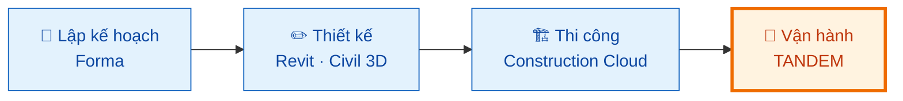
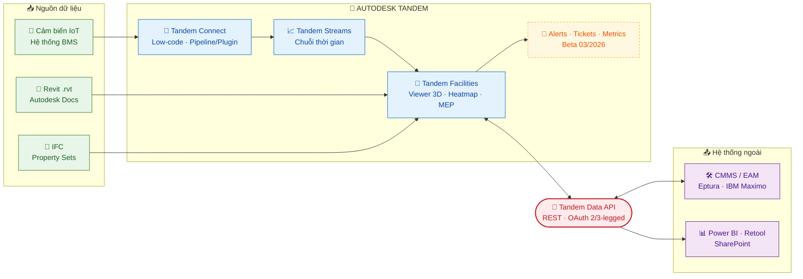
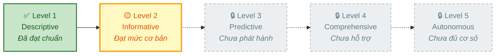
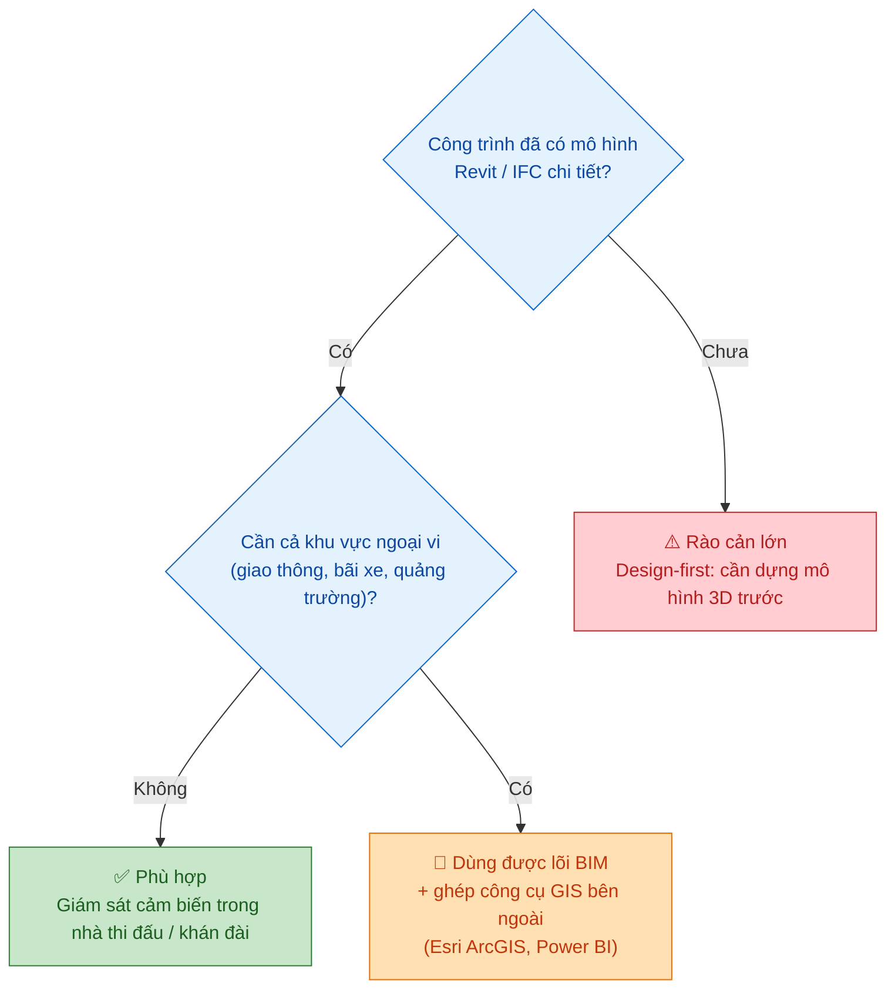

# 🏗️ Báo cáo Digital Twin Autodesk Tandem

  -yellow?style=for-the-badge) 

> 📅 **Cập nhật:** 02/11/2026  |  ✍️ **Tác giả:** Hoàng Trung Hiếu  |  🔖 **Phiên bản:** 2.0  
> 🏷️ **Chủ đề:** Đánh giá năng lực công nghệ và khảo sát thực tế Autodesk Tandem cho bản sao số tòa nhà, khuôn viên, công trình phức hợp (sân vận động)

> [!NOTE]
> **Đối tượng đánh giá:** Autodesk Tandem (Facilities, Streams, Connect, Data API) và các khâu liên quan trong hệ sinh thái Autodesk (Revit, Autodesk Construction Cloud, Forma).  
> **Nguồn chính:** Tài liệu chính thức của Autodesk và Autodesk Platform Services, các bài trình bày tại Autodesk University; báo cáo phân tích của Verdantix.

---

## 📑 Mục lục

- [📏 Quy chuẩn đánh giá mức độ bằng chứng (A - B - C)](#-quy-chuẩn-đánh-giá-mức-độ-bằng-chứng-a---b---c)
- [📘 1. Thông tin cần biết về Autodesk Tandem Digital Twin](#-1-thông-tin-cần-biết-về-autodesk-tandem-digital-twin)
  - [⚡ Tóm tắt nhanh](#-tóm-tắt-nhanh)
  - [🧭 1.1. Autodesk định vị Tandem là sản phẩm như thế nào?](#-11-autodesk-định-vị-tandem-là-sản-phẩm-như-thế-nào)
  - [📦 1.2. Kiến trúc Tandem](#-12-kiến-trúc-tandem)
  - [🧬 1.3. Cấu trúc dữ liệu làm việc](#-13-cấu-trúc-dữ-liệu-làm-việc)
  - [🔌 1.4. Cơ chế mở rộng và tích hợp thêm](#-14-cơ-chế-mở-rộng-và-tích-hợp-thêm)
- [🔍 2. Đánh giá chuyên sâu](#-2-đánh-giá-chuyên-sâu)
  - [🧱 2.1. So sánh Tandem với kiến trúc DTP tiêu chuẩn](#-21-so-sánh-tandem-với-kiến-trúc-dtp-tiêu-chuẩn)
  - [📈 2.2. Đánh giá mức độ trưởng thành (Maturity Level)](#-22-đánh-giá-mức-độ-trưởng-thành-maturity-level)
  - [💰 2.3. Cấu trúc chi phí](#-23-cấu-trúc-chi-phí)
  - [🔓 2.4. Khả năng mở rộng & Ràng buộc](#-24-khả-năng-mở-rộng--ràng-buộc)
  - [⚽ 2.5. Đánh giá qua các dự án thực tế](#-25-đánh-giá-qua-các-dự-án-thực-tế)
- [✅ 3. Kết luận chung](#-3-kết-luận-chung)
- [📚 Danh mục tài liệu tham khảo](#-danh-mục-tài-liệu-tham-khảo)

---

## 📏 Quy chuẩn đánh giá mức độ bằng chứng (A - B - C)

Nhằm bảo đảm tính khách quan và khả năng so sánh nhất quán giữa các giải pháp trong chuỗi khảo sát, nhóm áp dụng thang phân loại bằng chứng sau cho mọi nhận định trong báo cáo:

| Cấp độ | Định nghĩa | Tiêu chí xác minh | Trạng thái trong báo cáo |
| :---: | :--- | :--- | :---: |
| 🟢 **Mức A** | **Bằng chứng thực nghiệm / trực tiếp** | Nhóm tự vận hành thử nghiệm, hoặc case study độc lập có số liệu đo lường định lượng rõ ràng. | ⬜ *Chưa có* |
| 🔵 **Mức B** | **Bằng chứng tài liệu chính thức** | Tài liệu kỹ thuật, thông cáo báo chí, bài thuyết trình hoặc tài liệu đào tạo chính thức do Autodesk công bố. | ✅ **Đã đối chiếu** |
| 🟠 **Mức C** | **Suy luận chuyên môn / gián tiếp** | Báo cáo bên thứ ba chưa được Autodesk xác nhận, hoặc suy luận logic nội bộ của nhóm nghiên cứu. | 📝 **Đã ghi nhận** |

---

## 📘 1. Thông tin cần biết về Autodesk Tandem Digital Twin

### ⚡ Tóm tắt nhanh

> [!TIP]
> Autodesk Tandem là nền tảng Digital Twin trên đám mây, **mạnh ở tích hợp mô hình BIM (Revit/IFC), hiển thị 3D và có API mở**; yếu hơn ở phân tích/AI và **chưa tích hợp GIS nguyên bản**. Mức trưởng thành mới ở mức cơ bản (**Cấp độ 2/5**, xem [mục 2.2](#-22-đánh-giá-mức-độ-trưởng-thành-maturity-level)). **Chưa ghi nhận sân vận động nào dùng Tandem để vận hành.** Toàn bộ nhận định dựa trên bằng chứng Mức B hoặc Mức C.

---

### 🧭 1.1. Autodesk định vị Tandem là sản phẩm như thế nào?

Autodesk định vị Tandem là **mắt xích cuối cùng** trong chuỗi giá trị khép kín, đóng vai trò là kho dữ liệu tập trung (*Single Source of Truth*) phục vụ vận hành, **không phải** hệ thống điều khiển thiết bị (BMS/SCADA).

| 🔹 Khía cạnh | 📌 Nội dung | 💡 Ý nghĩa với câu hỏi "Tandem được định vị thế nào" |
| :--- | :--- | :--- |
| **Định vị sản phẩm** | Tiếp nhận tài nguyên số ngay từ giai đoạn xây dựng qua tệp Revit và IFC để bàn giao cho chủ sở hữu vận hành ([4](https://www.autodesk.com/products/tandem)). | Autodesk xem Tandem là nơi nhận thành quả của khâu thiết kế và thi công để biến nó thành công cụ vận hành, chứ không phải phần mềm để thiết kế. |
| **Góc nhìn Verdantix (2021)** | Được đánh giá là giải pháp *"BIM-centric Digital Twin"*, xóa nhòa khoảng cách bàn giao thông tin giữa nhà thầu và ban quản lý vận hành ([5](https://www.verdantix.com/venture/report/autodesk-sharpens-its-value-offering-for-building-operators-by-introducing-tandem-digital-twin-software)). | Bên ngoài cũng nhìn Tandem như cầu nối giữa nhà thầu và đơn vị vận hành, hơn là một hệ thống giám sát độc lập. |
| **Tích hợp trong hệ sinh thái AEC** | Tại Sân bay Denver, dữ liệu liên kết từ Autodesk Forma, Revit, Civil 3D đến Tandem trong Autodesk Construction Cloud (ACC), kết nối hơn **400 nhà thầu** trên một nền tảng ([6](https://adsknews.autodesk.com/en/stories/au25-denver/)). | Tandem là mắt xích cuối của chuỗi công cụ Autodesk, nhận dữ liệu từ các phần mềm phía trước thay vì đứng riêng lẻ. |
| **Cơ chế nạp dữ liệu** | Tải mô hình trực tiếp từ máy tính hoặc đồng bộ từ Forma Data Management trên trung tâm dữ liệu tại Mỹ, Châu Âu, Châu Á - Thái Bình Dương ([7](https://help.autodesk.com/cloudhelp/ENU/Tandem-Facilities/files/tandem-files.html)). | Tandem bắt đầu từ mô hình thiết kế có sẵn, chứ không phải từ dữ liệu vận hành. |
| **Khả năng mở rộng** | Tích hợp ít mã (Low-code) qua *Tandem Connect*, lập trình chuyên sâu qua *Tandem Data API* ([4](https://www.autodesk.com/products/tandem)). | Tandem muốn làm điểm tập trung dữ liệu, còn thiết bị và phần mềm khác kết nối vào, thay vì là hệ thống khép kín. |
| **Nhận định của nhóm** 🟠 *Mức C* | Chiến lược đi theo hướng **từ trên xuống (Design-first)**: bắt đầu từ mô hình hình học BIM chi tiết, sau đó gắn dần các luồng dữ liệu vận hành vào đối tượng không gian số. | Lợi thế tuyệt đối nếu công trình đã có mô hình BIM chuẩn; rào cản lớn với công trình hiện hữu chưa có dữ liệu thiết kế 3D. |

---

### 📦 1.2. Kiến trúc Tandem

Nền tảng quản lý tốt dữ liệu BIM và chuỗi thời gian IoT trong phạm vi khuôn viên công trình; lớp dữ liệu địa không gian (GIS) và ngoại cảnh diện rộng **chưa được tích hợp nguyên bản**.

| 🧩 Cấu phần | ⚙️ Vai trò kỹ thuật | 🔗 Nguồn |
| :--- | :--- | :---: |
| **Autodesk Tandem (Lõi)** | Quản lý cơ sở vật chất (Facilities), tạo Digital Twin từ Revit/IFC; hiển thị bản đồ nhiệt (Heatmap) dữ liệu cảm biến trên mô hình 3D; truy vết hệ thống cơ điện (MEP); dashboard đo độ hoàn thiện dữ liệu tài sản. | [4](https://www.autodesk.com/products/tandem) |
| **Tandem Streams** | Tiếp nhận và quản lý chuỗi dữ liệu thời gian thực (Time-series) từ cảm biến IoT hoặc BMS; cấu hình tần suất lấy mẫu và thời gian lưu trữ. | [8](https://intandem.autodesk.com/features/) |
| **Tandem Connect** | Tích hợp dữ liệu ít mã (Low-code), kiến trúc pipeline/plugin; có Sandbox thử nghiệm và Production chính thức; hỗ trợ Message Queue (MQTT Broker). | [9](https://www.autodesk.com/products/tandem/compare) |
| **Tandem Data API** | REST API chính thức (thuộc Autodesk Platform Services - APS): đọc cấu trúc BIM, đọc/ghi thuộc tính tùy biến, kết nối hai chiều với CMMS, EAM và nền tảng IoT. **GA ngày 12/12/2023.** | [10](https://aps.autodesk.com/developer/overview/tandem-data-api), [11](https://aps.autodesk.com/blog/autodesk-tandem-data-api-released) |
| **Alerts, Tickets & Metrics** 🧪 | Bộ tính năng vận hành nâng cao (**Beta từ 03/2026**), kết hợp Tandem Connect để tự động phát hiện vi phạm ngưỡng và tạo phiếu công việc. | [12](https://intandem.autodesk.com/resource/webinar-2026-march/) |
| **Plugin Eptura** | Liên kết với hệ thống quản lý tài sản Eptura để bàn giao dữ liệu số; tài liệu còn sơ khai, chưa nêu rõ chiều sâu đồng bộ hai chiều. | [13](https://knowledge.eptura.com/Asset/Integrations/Autodesk_Tandem_Integration) |

---

### 🧬 1.3. Cấu trúc dữ liệu làm việc

| 🗃️ Loại dữ liệu | 📋 Hiện trạng hỗ trợ kỹ thuật | 🏷️ Mức tin cậy |
| :--- | :--- | :---: |
| **🏛️ BIM** | Nhập trực tiếp từ Revit (.rvt) hoặc qua Autodesk Docs; nạp theo từng giai đoạn (Phase) thi công; vị trí mô hình phụ thuộc hoàn toàn vào hệ tọa độ chia sẻ (Shared Coordinates) của Revit ([7](https://help.autodesk.com/cloudhelp/ENU/Tandem-Facilities/files/tandem-files.html), [14](https://intandem.autodesk.com/?p=2667)). | 🔵 **Mức B** |
| **🧱 IFC** | Hỗ trợ chính thức nhập IFC qua module Tandem Facilities, cho phép chuyển đổi và ánh xạ Property Sets ([7](https://help.autodesk.com/cloudhelp/ENU/Tandem-Facilities/files/tandem-files.html), [14](https://intandem.autodesk.com/?p=2667)). *Thông tin "IFC sẽ bổ sung sau" trên trang tính năng cũ ([8](https://intandem.autodesk.com/features/)) là do tài liệu chưa cập nhật.* | 🔵 **Mức B** *(đã xác minh)* |
| **📡 IoT / Time-Series** | Xử lý qua Tandem Streams và Tandem Connect ([8](https://intandem.autodesk.com/features/)). Văn phòng Autodesk Toronto kết nối **82 bộ điều khiển VAV/FCU** với **230 luồng dữ liệu** từ BMS, chu kỳ ghi 1 phút/lần từ 08/2022 ([15](https://intandem.autodesk.com/resource/twinning-autodesk)). | 🔵 **Mức B** |
| **🧊 Không gian 3D** | Viewer 3D trực quan hóa bản đồ nhiệt, biểu đồ chuỗi thời gian; truy vết hệ thống cơ điện theo tầng và phòng ([4](https://www.autodesk.com/products/tandem)). | 🔵 **Mức B** |
| **🗺️ Bản đồ / GIS** | ❌ **Chưa hỗ trợ nguyên bản trong lõi sản phẩm.** Giải pháp trình diễn tại AU 2025 chỉ dừng ở kết nối ngoại vi qua Power BI hoặc Esri ArcGIS GeoBIM cho hạ tầng tuyến tính, chưa nhúng bản đồ GIS trực tiếp vào không gian Tandem ([16](https://www.autodesk.com/autodesk-university/class/Unlocking-the-Value-of-Construction-Cloud-Tandem-and-GIS-for-Infrastructure-2025)). | ⬜ *Chưa có tài liệu chính thức* |

> [!IMPORTANT]
> **Đánh giá đối với bài toán Sân vận động**
> - ✅ Nếu đã có mô hình Revit/IFC chi tiết của khối công trình chính, Tandem xử lý rất tốt việc hiển thị và giám sát cảm biến bên trong nhà thi đấu/khán đài.
> - ⚠️ Với bối cảnh ngoại vi diện rộng (luồng giao thông tiếp cận, bãi đỗ xe ngoài trời, quảng trường cảnh quan), việc thiếu GIS nguyên bản là hạn chế lớn, cần công cụ tích hợp bên ngoài.

---

### 🔌 1.4. Cơ chế mở rộng và tích hợp thêm

Hệ thống mở ở **tầng dữ liệu** (REST API) và **tầng luồng công việc** (Tandem Connect). Toàn bộ dùng chung kiến trúc định danh và cấp quyền OAuth của **Autodesk Platform Services (APS)**, thuận lợi cho đội đã quen Forge/APS.

| 🛠️ Cơ chế | 📝 Chi tiết |
| :--- | :--- |
| **Tandem Data API** | Truy vấn cấu trúc không gian; đọc/ghi thông số tùy biến; lọc và tô màu thành phần 3D theo phòng, tầng, hệ thống cơ điện; nạp chuỗi thời gian (nhiệt độ, độ ẩm, CO₂, mức chiếm dụng) ([10](https://aps.autodesk.com/developer/overview/tandem-data-api), [11](https://aps.autodesk.com/blog/autodesk-tandem-data-api-released)). Hỗ trợ OAuth **2-legged** (Service Account, máy-máy) và **3-legged** (ủy quyền người dùng). |
| **Endpoints** | Nhóm chính theo RESTful JSON: `/groups`, `/twins/{facilityId}`, `/twins/{facilityId}/elements/{objectId}`. `objectId` là khóa chính nối giữa phần tử BIM và bản ghi số của Digital Twin ([18](https://paulgovan.github.io/AutoDeskR-Book/tandem-overview.html)). |
| **Tandem Connect** | Pipeline/plugin ít mã. Bản **miễn phí**: 25 plugin chạy Sandbox (tự ngắt sau **3 giờ**), không chạy Production. Bản **trả phí**: 10 production plugin và tùy chọn Message Queue (MQTT Broker) ([9](https://www.autodesk.com/products/tandem/compare)). |
| **Nhúng ứng dụng** | Viewer của Tandem có thể đóng gói và nhúng vào Power BI, Retool, SharePoint hoặc cổng web nội bộ ([11](https://aps.autodesk.com/blog/autodesk-tandem-data-api-released)). |

---

## 🔍 2. Đánh giá chuyên sâu

### 🧱 2.1. So sánh Tandem với kiến trúc DTP tiêu chuẩn

Khung đánh giá 6 lớp do nhóm đề xuất, dựa trên việc tổng hợp các khung chuẩn quốc tế: *DTC Platform Stack Architectural Framework* ([1](https://media.digitaltwinconsortium.org/wp-content/uploads/2023/07/Platform-Stack-Architectural-Framework-2023-07-11.pdf)), *DTC Capabilities Periodic Table* ([2](https://media.digitaltwinconsortium.org/wp-content/uploads/2024/04/DTC_Capabilities-Periodic-Table-User-Guide-v1.1.pdf)) và *ISO/IEC 30188:2026* ([3](https://standards.iteh.ai/catalog/standards/iso/4564ab67-45ad-492b-b817-bd17fb02d433/iso-iec-30188-2026)). Các chuẩn đều quy tụ các trụ cột: thu nhận dữ liệu, mô hình hóa không gian, phân tích dữ liệu và giao diện người dùng.

> [!NOTE]
> Nhóm chủ động tách riêng **Lớp 3 (Quản lý tài sản)** và **Lớp 6 (Nền tảng phát triển mở)** thành hai trục độc lập. Dù chuẩn quốc tế không bắt buộc, cách tiếp cận này giúp phân định rõ năng lực cạnh tranh cốt lõi giữa 5 nền tảng trong phạm vi benchmark.

| 🧱 Lớp | 📐 Phạm vi chức năng thẩm định |
| :---: | :--- |
| **L1 📡** | **Thu nhận IoT & Dữ liệu hiện trường:** kết nối thời gian thực với cảm biến, BMS/SCADA, thiết bị trường. |
| **L2 🧊** | **Không gian số & Bản thể học:** hình học và dữ liệu ngữ nghĩa công trình (BIM, GIS, Semantic Models/Ontology). |
| **L3 🛠️** | **Quản lý vòng đời tài sản:** vòng đời thiết bị, lịch sử bảo trì, quy trình công việc (CMMS, EAM, Work Orders). |
| **L4 🧠** | **Phân tích, AI & Mô phỏng:** xu hướng, bảo trì dự đoán, mô phỏng kịch bản, tối ưu hóa thông minh. |
| **L5 🖥️** | **Trực quan hóa & Trải nghiệm UI:** 2D/3D tương tác, bản đồ nhiệt, thực tế ảo mở rộng (XR). |
| **L6 🔓** | **Khả năng mở rộng & Nền tảng mở:** API, SDK, kiến trúc PaaS, tích hợp mở rộng. |

#### 📊 Tổng quan mức đáp ứng của Tandem

> *Thang điểm trực quan là quy đổi định tính từ nhận xét bên dưới (Mức C), không phải số đo thực nghiệm.*

| Lớp | Mức đáp ứng | Xếp loại |
| :--- | :--- | :--- |
| **L1** IoT | 🟩🟩🟩🟩⬜ | 🟢 **Khá** (phụ thuộc hệ sinh thái ngoài) |
| **L2** Không gian & BIM | 🟩🟩🟩🟩🟩 | 🟢 **Rất mạnh về BIM** · 🔴 thiếu GIS |
| **L3** Tài sản | 🟨🟨🟨⬜⬜ | 🟡 **Trung bình** |
| **L4** Phân tích & AI | 🟥🟥⬜⬜⬜ | 🔴 **Yếu** |
| **L5** Trực quan hóa | 🟩🟩🟩🟩🟩 | 🟢 **Rất mạnh về 3D công trình** |
| **L6** Nền tảng mở | 🟩🟩🟩🟩⬜ | 🟢 **Mở ở tầng API & luồng dữ liệu** |

#### 🗂️ Ma trận chi tiết

| Lớp | Giải pháp của Autodesk Tandem | Đánh giá năng lực |
| :---: | :--- | :--- |
| **L1: IoT** | Tandem Streams, Tandem Connect, tùy chọn Message Queue (MQTT Broker), chương trình đối tác phần cứng *"Works with Autodesk Tandem"* ([8](https://intandem.autodesk.com/features/), [9](https://www.autodesk.com/products/tandem/compare), [20](https://intandem.autodesk.com/?p=5423)). | **Khá, phụ thuộc hệ sinh thái ngoài.** Tiếp nhận chuỗi dữ liệu rất tốt nhưng không cung cấp giải pháp điều khiển hay thiết bị phần cứng độc lập. |
| **L2: Không gian & BIM** | Nhập Revit và IFC; chuẩn hóa tham số (Parameters), phân loại (Classifications), mẫu cơ sở vật chất (Facility Templates) ([7](https://help.autodesk.com/cloudhelp/ENU/Tandem-Facilities/files/tandem-files.html), [8](https://intandem.autodesk.com/features/)). | **Rất mạnh về BIM, thiếu hụt GIS.** Tự chủ khâu xử lý mô hình kiến trúc; chưa tích hợp trực tiếp GIS diện rộng ([16](https://www.autodesk.com/autodesk-university/class/Unlocking-the-Value-of-Construction-Cloud-Tandem-and-GIS-for-Infrastructure-2025)). |
| **L3: Tài sản** | Danh mục thiết bị (Inventory), nhật ký thay đổi, dashboard mức hoàn thiện thông tin ([4](https://www.autodesk.com/products/tandem)); Tickets (Beta) ([12](https://intandem.autodesk.com/resource/webinar-2026-march/)); plugin Eptura ([13](https://knowledge.eptura.com/Asset/Integrations/Autodesk_Tandem_Integration)) và 3 plugin IBM Maximo (Connector, Service, Stream) ([30](https://intandem.autodesk.com/?p=4742)). | **Trung bình.** Tốt ở thuộc tính tĩnh và tài liệu bàn giao, nhưng chưa thay thế được CMMS/EAM chuyên nghiệp. Lập lịch bảo trì và quản lý Work Order bắt buộc tích hợp phần mềm chuyên dụng. |
| **L4: Phân tích & AI** | Heatmap, kiểm tra ngưỡng KPI; Alerts và Metrics đang Beta ([12](https://intandem.autodesk.com/resource/webinar-2026-march/)); phân tích dự đoán mới ở mức kế hoạch ([17](https://intandem.autodesk.com/?p=2126)). | **Yếu.** Chưa có công cụ ML/AI nội tại. "Physical AI" mới là mục tiêu hợp tác nghiên cứu cùng Globant ([21](https://www.globant.com/news/globant-autodesk-tandem-digital-twin-partnership)). |
| **L5: Trực quan hóa** | Viewer 3D nguyên bản, bản đồ nhiệt, lưu góc nhìn (Saved Views), định hướng không gian (Wayfinding) ([4](https://www.autodesk.com/products/tandem), [25](https://www.autodesk.com/autodesk-university/class/Boosting-Campus-Operational-Efficiency-Through-the-Power-of-Autodesk-Tandem-Digital-Twins-2024)). | **Rất mạnh về 3D công trình.** Bộ dựng hình WebGL mượt, tối ưu cho hình học phức tạp; chưa hỗ trợ XR hay mô phỏng động lực học luồng người. |
| **L6: Nền tảng mở** | Tandem Data API (RESTful), Tandem Connect, nền hạ tầng APS ([10](https://aps.autodesk.com/developer/overview/tandem-data-api), [11](https://aps.autodesk.com/blog/autodesk-tandem-data-api-released)). | **Mở ở tầng API và luồng dữ liệu.** Tương thích tốt với hệ sinh thái APS; chưa có ngôn ngữ truy vấn đồ thị (Graph Query) chuyên sâu hay SDK phân tích dữ liệu riêng. |

---

### 📈 2.2. Đánh giá mức độ trưởng thành (Maturity Level)

Verdantix (2021) phân loại Tandem là *"Digital Twin sẵn sàng cho vận hành từ dữ liệu thi công"* nhưng **chưa xếp hạng cấp độ chính thức** ([5](https://www.verdantix.com/venture/report/autodesk-sharpens-its-value-offering-for-building-operators-by-introducing-tandem-digital-twin-software)). Dưới đây là phân tích của nhóm dựa trên lộ trình của hãng ([17](https://intandem.autodesk.com/?p=2126)):

| Cấp độ | Trạng thái | Căn cứ |
| :--- | :---: | :--- |
| **Level 1 - Descriptive** | ✅ Đã đạt chuẩn | Cấu trúc hóa và xác thực đầy đủ thông tin tài sản, tích hợp bản vẽ thành mô hình mô tả tĩnh chuẩn xác ([17](https://intandem.autodesk.com/?p=2126)). |
| **Level 2 - Informative** | 🟡 Đạt mức cơ bản | Hiển thị dữ liệu cảm biến thời gian thực, tô màu Heatmap theo ngưỡng. Alerts và Tickets xuất hiện ở bản **Beta (03/2026)** ([12](https://intandem.autodesk.com/resource/webinar-2026-march/)). |
| **Level 3 - Predictive** | 🔒 Chưa phát hành | Dự báo hỏng hóc, học máy dự đoán xu hướng mới nằm ở danh mục *"kế hoạch tương lai"* ([17](https://intandem.autodesk.com/?p=2126)). |
| **Level 4 - Comprehensive** | 🔒 Chưa hỗ trợ | Chưa có tài liệu về mô phỏng kịch bản động, vi khí hậu hay luồng người di chuyển. |
| **Level 5 - Autonomous** | 🔒 Chưa đủ cơ sở | Điều khiển ngược thiết bị trường (Closed-loop Control) chỉ là định hướng dài hạn, chưa có ứng dụng thực tế. |

---

### 💰 2.3. Cấu trúc chi phí

Autodesk tính phí theo **dung lượng tài nguyên sử dụng (Capacity-based)**, **không giới hạn số tài khoản** người dùng ([29](https://www.autodesk.com/in/products/Tandem/buy)).

| 📊 Hạng mục | 🆓 Gói Miễn phí (Free Tier) | 💳 Gói Trả phí (Paid) |
| :--- | :--- | :--- |
| **Truy cập** | Autodesk ID thông thường | Theo thỏa thuận đăng ký |
| **Số cơ sở vật chất (Facilities)** | Tối đa **3** | Không giới hạn |
| **Mô hình** | 10 mô hình/cơ sở · tối đa 500 MB/mô hình | Không giới hạn dung lượng tệp nạp |
| **Tài sản gắn thẻ (Tagged Assets)** | 500 | 10.000 (cấu hình cơ sở) |
| **Điểm dữ liệu** | 100 triệu · lưu trữ tối đa 5 năm | 1 tỷ |
| **Tandem Connect** | 25 plugin, chỉ Sandbox (tối đa 3 giờ/phiên) | Module trả phí ~**625 USD/tháng**: 10 production plugin, hỗ trợ Connect Outpost cho mạng nội bộ |
| **Giá khởi điểm** | **0 USD** | ~**405 USD/tháng** (tùy khu vực và cam kết năm); có thể mua thêm Add-ons |

> *Nguồn: ([9](https://www.autodesk.com/products/tandem/compare), [19](https://help.autodesk.com/cloudhelp/ENU/Tandem-About/files/Tandem_About_access_tandem_free_html.html), [29](https://www.autodesk.com/in/products/Tandem/buy)).*

---

### 🔓 2.4. Khả năng mở rộng & Ràng buộc

| ⚙️ Khía cạnh | 🚧 Ràng buộc đã ghi nhận | 🏷️ Xác thực |
| :--- | :--- | :---: |
| **Mô hình BIM** | Chỉ nạp **một giai đoạn thiết kế (Phase)** mỗi phiên tải; tên Phase và tên View phân biệt hoa/thường; vị trí và hướng mô hình phụ thuộc hoàn toàn vào hệ tọa độ chia sẻ của Revit và **không thể căn chỉnh lại** trong Tandem ([7](https://help.autodesk.com/cloudhelp/ENU/Tandem-Facilities/files/tandem-files.html)). | 🔵 **Mức B** |
| **Phân quyền & Môi trường** | Mô hình nạp qua Forma Data Management phụ thuộc vị trí trung tâm dữ liệu đám mây (US, EU, APAC) ([7](https://help.autodesk.com/cloudhelp/ENU/Tandem-Facilities/files/tandem-files.html)). | 🔵 **Mức B** |
| **Tích hợp Tandem Connect** | Bản miễn phí không thể chạy kết nối thời gian thực dài hạn do Sandbox timeout 3 giờ và không có sẵn Message Queue ([9](https://www.autodesk.com/products/tandem/compare)). | 🔵 **Mức B** |

> [!WARNING]
> **Giả thuyết về sự phụ thuộc vào hệ sinh thái Autodesk** 🟠 *Mức C*  
> Độ mượt khi triển khai Tandem gắn chặt với việc tổ chức dữ liệu ngay từ Revit và Autodesk Docs. Hỗ trợ IFC đã giảm rủi ro bị khóa vào nhà cung cấp (*Vendor Lock-in*), nhưng để khai thác tối đa tự động hóa thuộc tính và tọa độ liên kết, khách hàng vẫn phải giữ phần lớn quy trình trong hệ sinh thái Autodesk.

---

### ⚽ 2.5. Đánh giá qua các dự án thực tế

Dự án quy mô lớn nhất được công bố là **Sân bay Quốc tế Denver**; trên phân khúc sân vận động và công trình thể thao lớn **chưa ghi nhận trường hợp triển khai thực tế**.

#### 🏢 Các dự án thực tế tiêu biểu

| 🌍 Dự án | 📌 Quy mô & Vai trò của Tandem | 🏷️ Mức xác thực |
| :--- | :--- | :---: |
| **✈️ Sân bay Quốc tế Denver (DEN)** | Khuôn viên ~**137 km²** (53 dặm vuông), hơn 82 triệu lượt khách/năm. Tandem hợp nhất hàng trăm mô hình thiết kế thành một môi trường dữ liệu chung phục vụ mở rộng nhà ga mà không gián đoạn vận hành ([6](https://adsknews.autodesk.com/en/stories/au25-denver/), [24](https://intandem.autodesk.com/?p=6081)). | 🔵 **Mức B** *(định tính; trọng tâm là điều phối thi công, không phải vận hành thiết bị hằng ngày)* |
| **🎓 Đại học Florida (UF)** | Một tòa nhà học thuật (Malachowsky Hall), tích hợp cảm biến môi trường và van điều khiển qua Tandem Connect. Định hướng "Campusverse" cho cả khuôn viên mới ở mức kế hoạch ([25](https://www.autodesk.com/autodesk-university/class/Boosting-Campus-Operational-Efficiency-Through-the-Power-of-Autodesk-Tandem-Digital-Twins-2024)). | 🔵 **Mức B** *(giới hạn trong một tòa nhà)* |
| **🏙️ Văn phòng Autodesk Toronto** | 82 bộ điều khiển VAV/FCU, 230 luồng dữ liệu thời gian thực từ BMS, cập nhật 1 phút/lần từ 08/2022 ([15](https://intandem.autodesk.com/resource/twinning-autodesk)). | 🔵 **Mức B** *(thử nghiệm nội bộ của hãng)* |

#### 🏟️ Khảo sát thực tế trong phân khúc Sân vận động

> [!CAUTION]
> **Không ghi nhận bất kỳ sân vận động nào trên thế giới triển khai Autodesk Tandem cho quản lý vận hành.** Một số dự án thể thao có dùng công nghệ Autodesk nhưng ở phạm vi khác:

| 🏟️ Sân vận động | Autodesk tham gia ở vai trò | Có dùng Tandem vận hành? |
| :--- | :--- | :---: |
| **Huntington Bank Field** (Cleveland Browns) | "Design and Make Platform" bằng Autodesk Construction Cloud (ACC) cho sân mới trị giá **2,4 tỷ USD** (dự kiến hoàn thành 2029). Thông cáo không nhắc Tandem hay vận hành Digital Twin ([26](https://adsknews.autodesk.com/en/news/autodesk_cleveland_browns/)). | ❌ Không |
| **Lusail** (Qatar) · **Jeddah Central** | Chuyên đề AU 2025 chỉ đề cập Revit, Navisworks, ReCap để bàn giao dữ liệu số cho đơn vị quản lý tài sản ([27](https://www.autodesk.com/autodesk-university/class/Digital-First-Stadiums-Paperless-BIM-and-Twin-Enabled-Operations-2025)). | ❌ Không |

---

## ✅ 3. Kết luận chung

Autodesk Tandem là lựa chọn mạnh khi công trình **đã có mô hình Revit/IFC chi tiết**, nhưng **chưa phải giải pháp trọn gói** cho vận hành sân vận động. Mọi nhận định dựa trên bằng chứng Mức B hoặc Mức C; chưa có Mức A do nhóm chưa tự triển khai thử.

| 💪 Điểm mạnh | ⚠️ Hạn chế |
| :--- | :--- |
| ✅ Quản lý BIM và trực quan hóa 3D rất tốt (L2, L5) | ❌ Phân tích và AI còn yếu (L4); dự báo mới ở mức kế hoạch |
| ✅ Mở ở tầng dữ liệu qua Tandem Data API và nền APS (L6) | ❌ Quản lý tài sản chưa thay thế được CMMS/EAM (L3) |
| ✅ Tiếp nhận chuỗi cảm biến qua Streams và Connect (L1) | ❌ Chưa tích hợp GIS nguyên bản |
| ✅ Có gói Miễn phí để thử nghiệm | ❌ Alerts, Tickets, Metrics vẫn ở bản Beta; Connect miễn phí chỉ chạy Sandbox 3 giờ |

- **📈 Mức trưởng thành:** mức cơ bản của Cấp độ 2 (Informative); chưa có bằng chứng đạt Cấp độ 3 trở lên.
- **⚽ Bài toán sân vận động:** chưa ghi nhận sân vận động nào dùng Tandem để vận hành; dự án lớn nhất là Sân bay Denver, thiên về điều phối thi công.
- **🔒 Rủi ro phụ thuộc** 🟠 *(Mức C)*: hiệu quả cao nhất khi cả quy trình nằm trong hệ sinh thái Autodesk (Revit, Autodesk Docs); IFC giảm nhưng không xóa rủi ro khóa nhà cung cấp.

**Bước tiếp theo hợp lý:** dùng cùng khung 6 lớp để đánh giá các nền tảng còn lại, rồi chạy thử Tandem (gói Miễn phí) trên một mô hình Revit/IFC thật để nâng bằng chứng lên Mức A.

---

## 📚 Danh mục tài liệu tham khảo

> *Toàn bộ tài liệu và đường dẫn dưới đây đã được truy cập và đối chiếu nội dung trong giai đoạn thẩm định đầu tháng 11/2026.*

1. Digital Twin Consortium, *Platform Stack Architectural Framework*, White Paper, 07/2023. [Link](https://media.digitaltwinconsortium.org/wp-content/uploads/2023/07/Platform-Stack-Architectural-Framework-2023-07-11.pdf)
2. Digital Twin Consortium, *Capabilities Periodic Table User Guide v1.1*, 04/2024. [Link](https://media.digitaltwinconsortium.org/wp-content/uploads/2024/04/DTC_Capabilities-Periodic-Table-User-Guide-v1.1.pdf)
3. ISO/IEC JTC 1/SC 41, *ISO/IEC 30188:2026: Digital twin - Reference architecture*, ISO, 2026. [Link](https://standards.iteh.ai/catalog/standards/iso/4564ab67-45ad-492b-b817-bd17fb02d433/iso-iec-30188-2026)
4. Autodesk Inc., *What is Autodesk Tandem? Product Overview*, 2026. [Link](https://www.autodesk.com/products/tandem)
5. Verdantix, *Autodesk Sharpens Its Value Offering For Building Operators By Introducing Tandem Digital Twin Software*, Research Report, 22/06/2021. [Link](https://www.verdantix.com/venture/report/autodesk-sharpens-its-value-offering-for-building-operators-by-introducing-tandem-digital-twin-software)
6. Autodesk News, *AU25: Denver International Airport plans for a bigger, bolder future*, 16/09/2025. [Link](https://adsknews.autodesk.com/en/stories/au25-denver/)
7. Autodesk Knowledge Network, *Tandem Files and Facilities Management Help Documentation*, 2026. [Link](https://help.autodesk.com/cloudhelp/ENU/Tandem-Facilities/files/tandem-files.html)
8. Autodesk Tandem Team, *Autodesk Tandem Features & Capabilities*, 2026. [Link](https://intandem.autodesk.com/features/)
9. Autodesk Inc., *Autodesk Tandem Plan Comparison: Free vs. Paid Subscriptions*, 2026. [Link](https://www.autodesk.com/products/tandem/compare)
10. Autodesk Platform Services, *Tandem Data API Developer Guide & Documentation*, 2026. [Link](https://aps.autodesk.com/developer/overview/tandem-data-api)
11. Autodesk Platform Services Blog, *Autodesk Tandem Data API Officially Released*, 12/12/2023. [Link](https://aps.autodesk.com/blog/autodesk-tandem-data-api-released)
12. Autodesk Tandem Resources, *Webinar: Operational Intelligence with Alerts, Tickets, and Metrics*, 18/03/2026. [Link](https://intandem.autodesk.com/resource/webinar-2026-march/)
13. Eptura Knowledge Base, *Autodesk Tandem and Eptura Asset Lifecycle Integration Guide*, 2025. [Link](https://knowledge.eptura.com/Asset/Integrations/Autodesk_Tandem_Integration)
14. Autodesk Tandem Blog, *Enhanced Interoperability: Tandem Now with IFC Import Capabilities*, 2024. [Link](https://intandem.autodesk.com/?p=2667)
15. Autodesk Tandem Case Study, *Twinning Autodesk: Toronto Office Deployment & BMS Integration*, 2023. [Link](https://intandem.autodesk.com/resource/twinning-autodesk)
16. Autodesk University 2025, *Unlocking the Value of Construction Cloud, Tandem, and GIS for Infrastructure*, Class AU25, 2025. [Link](https://www.autodesk.com/autodesk-university/class/Unlocking-the-Value-of-Construction-Cloud-Tandem-and-GIS-for-Infrastructure-2025)
17. Autodesk Tandem Team, *The Autodesk Tandem Official Product Roadmap*, 2026. [Link](https://intandem.autodesk.com/?p=2126)
18. P. Govan, *Autodesk Tandem API Architecture and REST Endpoints Overview*, AutoDeskR Documentation, 2024. [Link](https://paulgovan.github.io/AutoDeskR-Book/tandem-overview.html)
19. Autodesk Help, *Getting Started: Accessing and Managing Tandem Free Account*, 2026. [Link](https://help.autodesk.com/cloudhelp/ENU/Tandem-About/files/Tandem_About_access_tandem_free_html.html)
20. Autodesk Tandem Directory, *Tandem Certified Partner Ecosystem*, 2026. [Link](https://intandem.autodesk.com/?p=5423)
21. Globant Press Release, *Globant and Autodesk Announce Strategic Digital Twin Partnership for Physical AI*, 13/04/2026. [Link](https://www.globant.com/news/globant-autodesk-tandem-digital-twin-partnership)
22. Barvea Insights, *Digital Twin in Modern Smart Buildings: The Autodesk Tandem Ecosystem*, 2026. [Link](https://barvea.com/en/blog/digital-twin-building-autodesk-tandem-2026)
23. Autodesk Tandem Resources, *Global Customer Stories and Enterprise Case Studies*, 2026. [Link](https://intandem.autodesk.com/?p=5881)
24. Autodesk Tandem Blog, *Denver International Airport's Long-Term Digital Facility Strategy*, 11/03/2026. [Link](https://intandem.autodesk.com/?p=6081)
25. Autodesk University 2024, *Boosting Campus Operational Efficiency Through the Power of Autodesk Tandem Digital Twins*, Class AU24, 2024. [Link](https://www.autodesk.com/autodesk-university/class/Boosting-Campus-Operational-Efficiency-Through-the-Power-of-Autodesk-Tandem-Digital-Twins-2024)
26. Autodesk Newsroom, *Autodesk Selected as Official Design and Make Platform for the Cleveland Browns Stadium*, 05/12/2025. [Link](https://adsknews.autodesk.com/en/news/autodesk_cleveland_browns/)
27. Autodesk University 2025, *Digital-First Stadiums: Paperless BIM and Twin-Enabled Operations for Mega Venues*, Class AU25, 2025. [Link](https://www.autodesk.com/autodesk-university/class/Digital-First-Stadiums-Paperless-BIM-and-Twin-Enabled-Operations-2025)
28. Autodesk Online Store, *Autodesk Tandem Commercial Subscription Details (Canada/Global Portal)*, 2026. [Link](https://www.autodesk.com/ca-en/products/tandem/product-details)
29. Autodesk Store, *Autodesk Tandem Capacity-Based Licensing and Purchase Options*, 2026. [Link](https://www.autodesk.com/in/products/Tandem/buy)
30. Autodesk Tandem Directory, *Enterprise Integrations: IBM Maximo Connectors for Tandem Connect*, 2025. [Link](https://intandem.autodesk.com/?p=4742)
