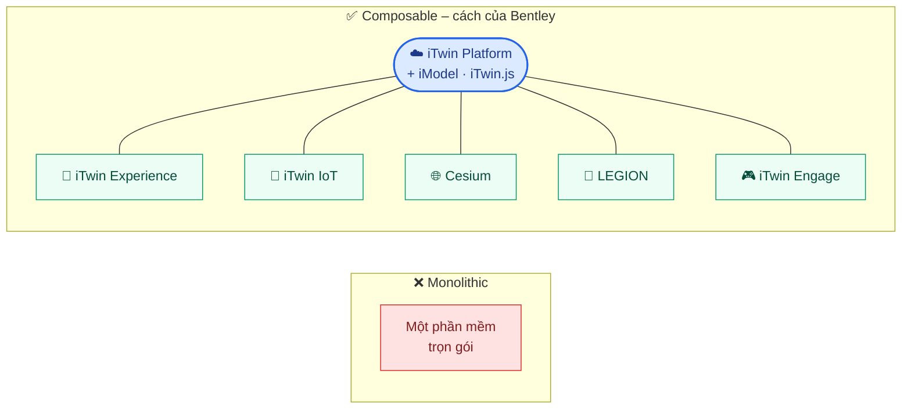
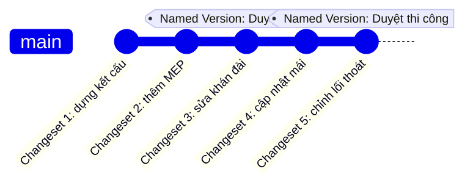
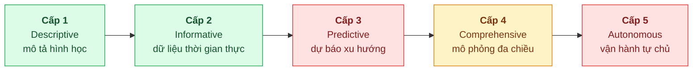
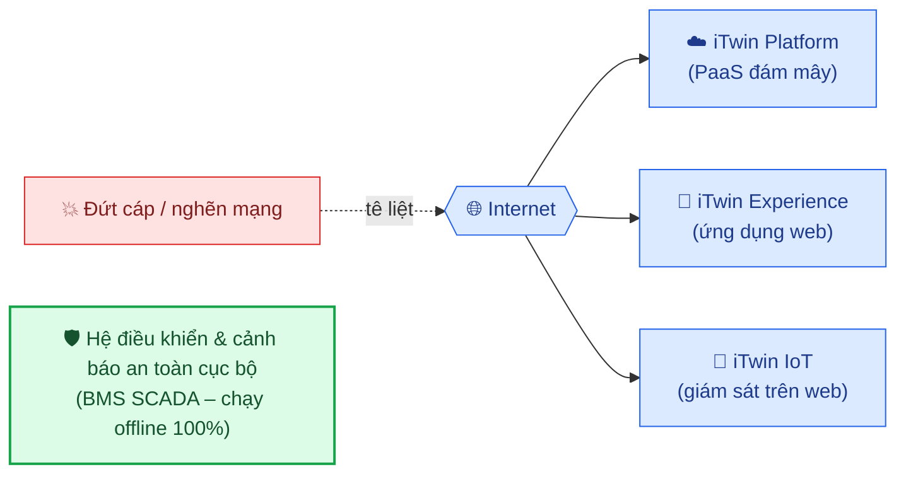

<div align="center">

# 🏟️ Bentley iTwin Digital Twin

### Báo cáo thẩm định chiến lược & kiến trúc kỹ thuật
**Phân tích sâu nền tảng Bentley iTwin cho dự án sân vận động và công trình phức hợp**

`🧩 Kiến trúc lắp ghép` · `🏗️ Khung 5 tầng` · `📊 Maturity` · `💰 Chi phí` · `🏟️ Al Thumama`

</div>

---

## 📑 Mục lục

- [📏 Quy chuẩn đánh giá mức độ bằng chứng (A – B – C)](#-quy-chuẩn-đánh-giá-mức-độ-bằng-chứng-a--b--c)
- [1️⃣ 1. Thông tin cần biết về Bentley iTwin Digital Twin](#1️⃣-thông-tin-cần-biết-về-bentley-itwin-digital-twin)
  - [⚡ Tóm tắt nhanh](#-tóm-tắt-nhanh)
  - [🧱 1.1. Nền tảng Bentley](#11--nền-tảng-bentley)
    - [Composable Ecosystem thay vì Monolithic Application](#composable-ecosystem-thay-vì-monolithic-application-b)
    - [Lớp nền tảng mới: Bentley Infrastructure Cloud Connect (2025)](#️-lớp-nền-tảng-mới-bentley-infrastructure-cloud-connect-2025-b)
  - [🧰 1.2. Các sản phẩm chủ lực](#12--các-sản-phẩm-chủ-lực-b)
    - [1.2.1. Cấu trúc dữ liệu làm việc và cơ chế Changeset Ledger](#121-️-cấu-trúc-dữ-liệu-làm-việc-và-cơ-chế-changeset-ledger-b)
    - [1.2.2. Khung phối công nghệ 5 tầng](#122-️-khung-phối-công-nghệ-5-tầng)
- [2️⃣ 2. Đánh giá chuyên sâu](#2️⃣-đánh-giá-chuyên-sâu)
  - [2.1. So sánh đối chiếu 5 tầng: mức độ tự chủ của Bentley](#21-️-so-sánh-đối-chiếu-5-tầng-mức-độ-tự-chủ-của-bentley)
  - [2.2. Đánh giá mức độ trưởng thành (Maturity Level)](#22--đánh-giá-mức-độ-trưởng-thành-maturity-level)
  - [2.3. Cấu trúc chi phí](#23--cấu-trúc-chi-phí)
  - [2.4. Đánh giá qua các dự án thực tế](#24-️-đánh-giá-qua-các-dự-án-thực-tế-bc)
- [3️⃣ 3. Kết luận chung](#3️⃣-kết-luận-chung)
  - [3.1. Mức độ sẵn sàng theo giai đoạn vòng đời dự án sân vận động](#31-️-mức-độ-sẵn-sàng-theo-giai-đoạn-vòng-đời-dự-án-sân-vận-động-c)
  - [3.2. Vận hành lưỡng cực: Ngày sự kiện và Ngày bình thường](#32-️-vận-hành-lưỡng-cực-ngày-sự-kiện-và-ngày-bình-thường-c)
  - [3.3. Điểm nghẽn: phụ thuộc đám mây và thiếu dự phòng ngoại tuyến](#33--điểm-nghẽn-phụ-thuộc-đám-mây-và-thiếu-dự-phòng-ngoại-tuyến-c)
- [📚 Danh mục tài liệu tham khảo](#-danh-mục-tài-liệu-tham-khảo)

---

## 📏 Quy chuẩn đánh giá mức độ bằng chứng (A – B – C)

Nhằm bảo đảm tính khách quan và khả năng so sánh nhất quán với Báo cáo 1 `[10]` và Báo cáo 2 `[11]`, mọi nhận định trong báo cáo được phân loại theo thang bằng chứng sau:

| Cấp độ | Định nghĩa | Tiêu chí xác minh | Trạng thái trong báo cáo |
|:------:|-----------|-------------------|:------------------------:|
| 🟢 **Mức A** | **Bằng chứng thực nghiệm / trực tiếp** | Nhóm tự vận hành thử nghiệm, hoặc case study độc lập có số liệu đo lường định lượng rõ ràng. | ⬜ *Chưa có* |
| 🔵 **Mức B** | **Bằng chứng tài liệu chính thức** | Tài liệu kỹ thuật, thông cáo báo chí, bài thuyết trình hoặc tài liệu đào tạo chính thức do Bentley công bố. | ✅ **Đã đối chiếu** |
| 🟠 **Mức C** | **Suy luận chuyên môn / gián tiếp** | Báo cáo bên thứ ba chưa được Bentley xác nhận, hoặc suy luận logic nội bộ của nhóm nghiên cứu. | 📝 **Đã ghi nhận** |

---

## 1️⃣ Thông tin cần biết về Bentley iTwin Digital Twin

### ⚡ Tóm tắt nhanh

> [!IMPORTANT]
> Bentley **không bán một giải pháp Digital Twin trọn gói** mà theo **kiến trúc lắp ghép**: nền tảng đám mây mở **iTwin Platform** làm xương sống, kết hợp nền tảng 3D địa không gian **Cesium** (mua lại 09/2024), các ứng dụng **iTwin Experience, iTwin IoT, iTwin Engage**, cùng công cụ mô phỏng đám đông **LEGION** `[1]–[7]`.

| 💪 Mạnh | ⚠️ Chưa có |
|---------|------------|
| Thu nạp & chuẩn hóa dữ liệu · Trực quan hóa · Mô phỏng đám đông | AI dự đoán hỏng hóc · Tài liệu xác nhận chạy ngoại tuyến · Quản lý tài sản phải dựa hệ thống ngoài `[1] [4] [5] [6] [8]` |

Với sân vận động, mới chỉ có **Al Thumama** dùng LEGION ở giai đoạn thiết kế `[9]`; báo cáo **chưa có dữ kiện Mức A** `[C]`.

---

### 1.1. 🧱 Nền tảng Bentley

#### Composable Ecosystem thay vì Monolithic Application `[B]`

Bentley tập trung tháo gỡ tình trạng **dữ liệu hạ tầng bị phân mảnh** `[B]`. Hãng không làm một phần mềm trọn gói vì công trình hạ tầng có vòng đời dài và cần phối hợp nhiều phần mềm chuyên ngành *(nhận định của nhóm)* `[C]`.

Bentley xây một **nền tảng dữ liệu mở** (iModel, iTwin.js, dịch vụ đám mây) để các ứng dụng chuyên ngành và tổng thầu tích hợp (SI) tự ghép theo từng dự án `[16]`.



#### ☁️ Lớp nền tảng mới: Bentley Infrastructure Cloud Connect (2025) `[B]`

Tại Year in Infrastructure 2025, Bentley ra mắt **Bentley Infrastructure Cloud Connect**, lớp dữ liệu nền tảng mới của hãng `[8]`. Lớp này nhập dữ liệu từ **hơn 50 định dạng** tệp kỹ thuật và kết nối với các phần mềm quản trị doanh nghiệp `[8]`.

> [!NOTE]
> **🎯 Nhận định chiến lược `[C]`:** do Bentley bán nền tảng và các module độc lập, mọi dự án sân vận động đều phải **tự cấu hình hoặc chỉ định nhà thầu tích hợp** để nối các mắt xích còn thiếu, đặc biệt **tầng thiết bị hiện trường** và **hệ thống quản trị bảo trì**.

---

### 1.2. 🧰 Các sản phẩm chủ lực `[B]`

| Sản phẩm | Chức năng kỹ thuật cốt lõi | Đầu vào → Đầu ra | Tầng | Mức |
|----------|----------------------------|------------------|:----:|:---:|
| ☁️ **iTwin Platform** `[1]` | PaaS đám mây; REST APIs & microservices để xây ứng dụng Digital Twin; bảo mật, hợp nhất dữ liệu | CAD/BIM, dữ liệu quét, IoT → môi trường phát triển "iTwin Enabled" (không có giao diện dựng sẵn) | T2–T3 | 🔵 B |
| 🥽 **iTwin Experience** `[4]` | Cổng web trực quan hóa; xem, đo, phân tích, chia sẻ mô hình; phân quyền đa vai trò | Mô hình 2D/3D, GIS, IoT → giao diện thời gian thực trên trình duyệt, không cần cài đặt | T5 | 🔵 B |
| 📡 **iTwin IoT** `[5]` | Giám sát cảm biến trên web; cảnh báo ngưỡng an toàn trong không gian 3D | API, CSV, MQTT, OPC-UA, FTP; Device Registry >100 loại cảm biến → dashboard, cảnh báo email/web push, AI bất thường cơ bản | T2 (T5 ở giao diện) | 🔵 B |
| 📸 **iTwin Capture** (trong Cesium ion) `[8]` | Tái tạo thực tế số từ ảnh (photogrammetry) & LiDAR | Ảnh UAV/mặt đất, point cloud → Reality Mesh, Point Cloud, Gaussian Splatting gán nhãn AI | T2 | 🔵 B |
| 🎮 **iTwin Engage** `[6]` | Môi trường tương tác 3D chân thực cao (Early Access) với iTwin + Cesium + Unreal Engine | Mô hình từ iTwin Platform → trải nghiệm không gian đa chiều thời gian thực | T5 | 🟠 C |
| 🌐 **Cesium** `[3]` | Nền tảng 3D địa không gian chuẩn mở: 3D Tiles (OGC), Cesium ion, CesiumJS, plugin Unreal/Unity/Omniverse (mua lại 09/2024) | Dữ liệu địa không gian, ảnh vệ tinh, mô hình 3D → hiển thị 3D trong ngữ cảnh địa lý | T2 (ion) / T5 (CesiumJS) | 🔵 B |
| 👥 **LEGION** `[7]` | Mô phỏng động học người đi bộ; kiểm chứng luồng di chuyển, vận hành, sơ tán; tích hợp OpenBuildings Station Designer `[17]` | CAD/IFC, ma trận O-D → bản đồ nhiệt mật độ, thời gian giải tỏa, điểm nghẽn, video thoát hiểm | T4 | 🔵 B |
| 📂 **ProjectWise** `[18]` | Môi trường dữ liệu chung (CDE); kiểm soát phiên bản, phối hợp đa bộ môn | Hơn 50 định dạng, IFC, PDF → PDF duyệt tự động, clash detection, ghi chú 2D/3D | T2 | 🔵 B |
| 🏗️ **SYNCHRO** `[19]` | Quản lý thi công: tiến độ 4D, kiểm soát sản lượng (Perform), ứng dụng hiện trường (Field) | 3D/4D, P6/MS Project, nghiệm thu → báo cáo sản lượng, Earned Value, phân tích xung đột lịch & carbon | T4 | 🔵 B |
| 🛠️ **AssetWise** `[20]` | Quản lý hiệu năng tài sản (APM) giai đoạn vận hành | Danh mục thiết bị, kiểm định, quan trắc (qua Sensemetrics) → RCM, rủi ro hư hỏng, bảo trì phòng ngừa | T4 (T2 ở Sensemetrics) | 🔵 B |
| 🔄 **iTwin Synchronization** `[21]` | API & Connectors chuyển hình học/thuộc tính từ tệp thiết kế sang iModel | Tệp từ Azure Blob, SharePoint, ProjectWise → Changesets trong iModel (chỉ cập nhật phần chênh lệch) | T2 | 🔵 B |

---

#### 1.2.1. 🗃️ Cấu trúc dữ liệu làm việc và cơ chế Changeset Ledger `[B]`

Khả năng mở và chuẩn hóa dữ liệu dựa trên **4 trụ cột** `[B]`:

| Trụ cột | Cách Bentley xử lý |
|---------|--------------------|
| 🏛️ **BIM / CAD** | MicroStation là môi trường thiết kế chuyên sâu `[16]`; iTwin Platform nạp dữ liệu qua bộ kết nối hỗ trợ IFC (IFC2x3, IFC4, IFC4.3) `[1] [22]` |
| 🗺️ **GIS** | Chuẩn 3D Tiles (OGC phê duyệt từ 2019, do Cesium phát triển) `[3]`; MicroStation 2025 hỗ trợ trực tiếp 3D Tiles `[8]`; iTwin IoT hiển thị lớp ArcGIS, WMS, WMTS trên địa hình 3D `[5]` |
| 📡 **IoT** | Thu nạp qua API, CSV, MQTT, OPC-UA, FTP `[5]`. iTwin IoT đã công bố **Bentley MCP server** cho phép các mô hình ngôn ngữ lớn (như Claude) truy vấn trực tiếp dữ liệu cảm biến `[5]` |
| 📸 **Dữ liệu thực tế** | Tự động chuyển ảnh photogrammetry và point cloud laser sang Reality Mesh & Gaussian Splatting qua iTwin Capture `[8]` |

**iModel và Changeset Ledger là gì?** Tài liệu nhà phát triển xác định iModel là một *thùng chứa thông tin chuyên biệt* để trao đổi dữ liệu kỹ thuật gắn liền với vòng đời tài sản hạ tầng `[15]`. Cách hiểu dễ nhất là so với **Git**:

| Git / GitHub | Bentley iTwin | Ý nghĩa |
|--------------|---------------|---------|
| 📦 Repository | **iModel** | Kho chứa dữ liệu công trình (bên trong là cơ sở dữ liệu quan hệ **SQLite** nhúng) `[15]` |
| ✏️ Commit | **Changeset** | Bản ghi vi sai: mỗi lần chỉnh sửa chỉ ghi phần đã thay đổi `[15]` |
| 📜 `git log` | **Changeset Ledger** | Sổ ghi lịch sử các thay đổi, nằm trên iModelHub `[15]` |
| ☁️ GitHub | **iModelHub** | Nơi lưu trữ & đồng bộ trung tâm `[15]` |
| 🏷️ Tag / Release | **Named Version** | Mốc duyệt thiết kế đóng băng, mở lại đúng trạng thái đã duyệt `[15]` |



> [!NOTE]
> Phép so sánh với Git là **cách diễn giải của nhóm** `[C]`; tài liệu `[15]` không nêu khái niệm nhánh (branch) hay pull request.

> [!WARNING]
> **🔍 Đánh giá phản biện `[C]`:** cơ chế Changeset tiết kiệm băng thông, nhưng tài liệu chính thức **chưa công bố benchmark độc lập** về tốc độ dựng hình khi nạp mô hình hàng chục gigabyte như sân vận động quy mô lớn.

---

#### 1.2.2. 🏗️ Khung phối công nghệ 5 tầng

##### Cơ sở xác lập khung 5 tầng `[C]`

Hiện **chưa có kiến trúc tham chiếu Digital Twin chuẩn hóa duy nhất**; số tầng thay đổi theo mục tiêu ứng dụng. Ví dụ, tổng quan hệ thống arXiv 2308.15168 dùng kiến trúc 4 lớp (Physical, Communication, Digital, Application) `[12]`.

Khung 5 tầng của báo cáo lấy ý tưởng từ 4 miền chức năng của **ISO 23247-2** `[13] [14]` và **tách miền Core thành hai tầng** (T3 core nền tảng, T4 module nghiệp vụ) để phân biệt nhà cung cấp hạ tầng dữ liệu với phần mềm chuyên ngành. Cách tách này **do nhóm lựa chọn, không phải chuẩn quốc tế** `[C]`.

##### Sơ đồ khung 5 tầng và sản phẩm Bentley

```text
 T5  Trực quan hóa & Điều hành (IOC)   iTwin Experience · iTwin Engage · CesiumJS · iTwin.js
  ▲
  │  T4  Module nghiệp vụ chuyên dụng   LEGION · SYNCHRO · AssetWise · OpenSite+ / Copilot
  │
  │  T3  Core nền tảng & dữ liệu       iTwin Platform APIs · iModel · Changeset Ledger
  │
  │  T2  Thu nạp & chuẩn hóa dữ liệu   Synchronization API · Cesium ion · iTwin Capture · ProjectWise
  │
  │  T1  Hạ tầng vật lý & biên         Cảm biến · Camera · BMS · Cổng soát vé (đối tác cung cấp)
  
  ▲  Dữ liệu chảy từ Tầng 1 (Vật lý) lên Tầng 5 (Điều hành IOC)
```

##### Ánh xạ với ISO 23247-2 `[C]`

| Tầng của khung | ↔ | Miền ISO 23247-2 | Ghi chú |
|----------------|:-:|------------------|---------|
| **T1** Hạ tầng vật lý & biên | ↔ | Observable Manufacturing Element (OME) Domain | Các thực thể vật lý hữu hình |
| **T2** Thu nạp & chuẩn hóa | ↔ | Data Collection & Device Control Domain | Thu nhận dữ liệu cảm biến, truyền lệnh điều khiển |
| **T3** Core nền tảng + **T4** Module nghiệp vụ | ↔ | Core Domain (Digital Twin Core) | Mô hình số, CSDL quan hệ, thuật toán phân tích. *Nhóm chủ động tách T3/T4* |
| **T5** Trực quan hóa & Điều hành | ↔ | User Domain | Giao diện tương tác, 3D, báo cáo điều hành |

##### Mô tả chức năng từng tầng

| Tầng | Vai trò |
|:----:|---------|
| **T1** | Điểm khởi phát mọi dữ liệu vật lý: cảm biến quan trắc, camera an ninh, thiết bị BMS, cổng quay soát vé `[15]` |
| **T2** | Chuyển định dạng CAD/BIM đa nguồn, phân luồng dữ liệu IoT công nghiệp `[16] [6]` |
| **T3** | Quản trị "chân lý dữ liệu" không gian, theo dõi vi sai lịch sử (Changeset Ledger), định nghĩa lược đồ quan hệ ngữ nghĩa `[16]` |
| **T4** | Phần mềm chuyên môn hóa thực thi logic nghiệp vụ cho từng bài toán công trình `[8] [1] [4]` |
| **T5** | Giao diện người dùng, góc nhìn đồng bộ thời gian thực phục vụ chỉ huy điều hành `[16]` |

---

## 2️⃣ Đánh giá chuyên sâu

### 2.1. 🎚️ So sánh đối chiếu 5 tầng: mức độ tự chủ của Bentley

> Bentley **tự chủ mạnh ở T2 và T5**, **phụ thuộc hoàn toàn đối tác ở T1**, và **mạnh cục bộ ở T4** `[C]`.

*Thang tự chủ dưới đây là minh họa định tính của nhóm, không phải số đo.*

| Tầng | Giải pháp cụ thể của Bentley | Mức tự chủ | Nhận định kỹ thuật & mức bằng chứng |
|------|------------------------------|:----------:|-------------------------------------|
| **T1** Hạ tầng vật lý & Biên | Không sản xuất cảm biến hay bộ điều khiển BMS. iTwin IoT có Device Registry >100 loại cảm biến đã kiểm chuẩn `[5]` | `▱▱▱▱▱`<br/>🔴 Phụ thuộc 100% đối tác | **Mỏng** `[B]`: chỉ thu nhận tín hiệu; thiết bị trường do nhà thầu MEP hoặc hãng BMS cung cấp |
| **T2** Thu nạp & Chuẩn hóa | Cesium + 3D Tiles `[3]`; Cloud Connect nạp >50 định dạng `[8]`; Synchronization API (Revit, Civil 3D, IFC, MicroStation) `[1] [21]` | `▰▰▰▰▰`<br/>🟢 Tự chủ cực cao | **Rất mạnh** `[B]`: năng lực cốt lõi mạnh nhất của Bentley, xóa bỏ phân mảnh định dạng đồ họa kỹ thuật |
| **T3** Core nền tảng, mô phỏng & tài sản | iTwin Platform APIs (Digital Twin Management, Synchronization, Reality Capture, Visualization) `[26]` | `▰▰▰▱▱`<br/>🟡 Tự chủ một phần | Tốt về core dữ liệu không gian (iModel); chưa thấy tài liệu lưu trữ chuỗi thời gian vận hành quy mô lớn trong các trang đã rà soát `[C]` |
| **T4** Module nghiệp vụ | LEGION `[7]`; OpenSite+, Bentley Copilot `[6]`; iTwin IoT bất thường cơ bản `[5]`; AssetWise qua AWEIS sang CMMS ngoài `[27] [28]` | `▰▰▰▱▱`<br/>🟡 Mạnh cục bộ | Rất mạnh ở mô phỏng người đi bộ (LEGION); EAM/CMMS phải tích hợp phần mềm ngoài; chưa có module BEMS hay dự đoán bảo trì |
| **T5** Trực quan hóa & Điều hành | iTwin Experience `[4]`; iTwin Engage + Cesium + Unreal `[6]`; iTwin.js & CesiumJS tích hợp game engine `[3] [26]` | `▰▰▰▰▰`<br/>🟢 Tự chủ hoàn toàn, tính mở cao | **Xuất sắc** `[B]`: giao diện web nhẹ lẫn xuất mô hình sang engine đồ họa điện ảnh, không khóa chặt nền tảng |

---

### 2.2. 📈 Đánh giá mức độ trưởng thành (Maturity Level)

#### Đối chiếu theo thang Verdantix `[C]`

Chỉ **Cấp 1–2 đạt đầy đủ**; Cấp 3 và 5 chưa đạt; Cấp 4 đạt một phần nhờ LEGION. Đối chiếu tài liệu sản phẩm Bentley với 5 cấp độ chuẩn Verdantix (từ Báo cáo 2) `[11]`:



| Cấp độ | Kết quả | Mức | Giải thích |
|--------|:-------:|:---:|------------|
| **1 – Descriptive** (mô tả hình học tĩnh) | ✅ Đạt trọn vẹn | 🔵 B | Hợp nhất mô hình 3D, bản đồ GIS và dữ liệu thực tế trên một giao diện qua iTwin Experience và Cesium `[4] [3]` |
| **2 – Informative** (thông tin thời gian thực) | ✅ Đạt | 🔵 B | Cảnh báo vượt ngưỡng an toàn, hiển thị thông số cảm biến trên ngữ cảnh 3D qua iTwin IoT `[5]` |
| **3 – Predictive** (dự báo xu hướng) | ❌ Chưa đạt | 🟠 C | iTwin IoT có nêu AI phát hiện bất thường nhưng không công bố thuật toán `[5]`. Tài liệu 2025 chưa công bố AI dự đoán hỏng hóc hay dự báo tải vận hành `[8]` |
| **4 – Comprehensive** (mô phỏng đa chiều) | 🟡 Đạt một phần | 🔵🟠 B/C | Đạt riêng trên bài toán động học đám đông nhờ LEGION (thử nhiều kịch bản tải người đi bộ) `[7]`; chưa đạt trên mô phỏng năng lượng toàn diện `[C]` |
| **5 – Autonomous** (vận hành tự chủ) | ❌ Chưa đạt | 🟠 C | Chưa có tài liệu nào công bố điều khiển vòng lặp kín (closed-loop) gửi lệnh xuống bộ điều khiển cơ điện `[C]` |

#### 🤖 Hiện trạng năng lực AI công bố năm 2025 `[B/C]`

Tại **Year in Infrastructure 2025** (Amsterdam, 15/10/2025), chiến lược AI tập trung vào **hỗ trợ thiết kế và tìm kiếm tài liệu**, phần lớn ở giai đoạn thử nghiệm sớm `[8] [6]`:

| Công cụ AI | Chức năng | Trạng thái |
|------------|-----------|:----------:|
| **OpenSite+** | Thiết kế mặt bằng tích hợp trợ lý AI đổi hình học mô hình theo lệnh văn bản `[6]` | 🟡 Limited Availability |
| **Synchro+** & **OpenUtilities Substation+** | AI hỗ trợ lập kế hoạch thi công và thiết kế trạm điện `[6]` | 🟡 Early Access (cuối 2025) |
| **Bentley Copilot** | Trợ lý ảo xây trên LLM thương mại; người dùng không được chọn mô hình nền `[6]` | 🔵 Đã công bố |
| **AI Search** (ProjectWise) | Tìm kiếm ngữ nghĩa, tóm tắt văn bản kỹ thuật `[8]` | 🔵 Đã công bố |

> [!CAUTION]
> **Nhận định cốt lõi `[C]`:** danh mục AI hiện tại phục vụ **kỹ sư thiết kế và quản lý hồ sơ**, không phục vụ **dự đoán hỏng hóc thiết bị** hay **dự báo lưu lượng khán giả ngày thi đấu**. Nếu dự án nhắm mục tiêu vận hành dự đoán, chủ đầu tư phải bổ sung giải pháp AI chuyên dụng từ bên thứ ba `[C]`.

---

### 2.3. 💰 Cấu trúc chi phí

#### 💳 Biểu phí công khai của iTwin Platform (PaaS) `[B]`

Bentley **chỉ công khai biểu phí cho iTwin Platform** trên cổng lập trình viên `[2]`. Các sản phẩm ứng dụng chuyên dụng (iTwin IoT, LEGION) **không có giá niêm yết**, phải liên hệ trực tiếp `[5] [7]`.

| Gói dịch vụ | Mức phí | Credits/tháng | Dữ liệu đám mây | Dữ liệu thực tế | Hỗ trợ kỹ thuật |
|-------------|--------:|:-------------:|:---------------:|:---------------:|-----------------|
| 🆓 **Community** | Miễn phí | 100 | 10 GB | 100 GB | Diễn đàn cộng đồng (chỉ dùng thử cá nhân, **cấm thương mại**) |
| 🥈 **Standard** | **199 USD**/tháng | 200 | 50 GB | 1 TB | Diễn đàn cộng đồng |
| 🥇 **Premium** | **499 USD**/tháng | 500 | 50 GB | 1 TB | Hỗ trợ ưu tiên (trả phí thêm, tùy chọn) |
| 🏢 **Enterprise** | Thỏa thuận riêng | Tùy biến | Tùy biến | Tùy biến | Hỗ trợ doanh nghiệp 24/7 |

*(Nguồn toàn bảng: `[2]`)*

**Quy định tiêu hao credit** `[B]`:

| 🔧 Dịch vụ | Mức tiêu hao |
|------------|--------------|
| Xử lý iModels | **1 credit** / 2 GB dữ liệu nạp vào hoặc xuất ra |
| Trực quan hóa (Visualization) | **1 credit** / 1 giờ phiên truy cập |
| Lưu trữ dữ liệu thực tế (Reality Management) | **50 credits** / 1 TB lưu trữ hàng tháng |
| Vượt mức | **1,20 USD** / credit phụ trội; credit không bảo lưu sang tháng sau, không quy đổi cho phần mềm khác của hãng |

#### 🏢 Cấp phép doanh nghiệp E365 và các module chuyên dụng `[B]`

- 👥 **LEGION** phân phối theo 3 hình thức: thuê bao 12 tháng qua eStore (kèm tín dụng đào tạo), bản quyền vĩnh viễn kèm phí bảo trì SELECT hàng năm, hoặc gói doanh nghiệp lớn; giá biến động theo khu vực và **không công bố** `[7]`.
- 📜 **Enterprise 365 (E365)**: đơn vị đăng ký dùng không giới hạn danh mục E365. Phí tính theo mức sử dụng thực tế hàng ngày dựa trên 5 căn cứ: tài khoản Named User theo ngày/quý, phí cố định, đơn vị xử lý dữ liệu và dung lượng lưu trữ đỉnh; có **ngưỡng cam kết tối thiểu theo quý** (Quarterly Floor). Danh mục phần mềm thuộc E365 không công bố `[23]`.

#### 🕳️ Chi phí ẩn và giả thuyết TCO `[C]`

Từ bảng giá công khai chỉ xác định được **cận dưới** cho tầng iTwin Platform (phép nhân thuần túy, chưa tính credit vượt hạn mức và chưa gồm phần mềm ứng dụng):

| Gói | Phép tính (cận dưới/năm) | Kết quả |
|-----|--------------------------|--------:|
| Standard | 199 USD × 12 tháng | **2.388 USD** |
| Premium | 499 USD × 12 tháng | **5.988 USD** |

> [!WARNING]
> **Kết luận chi phí `[C]`:** các module quan trọng nhất với sân vận động là **LEGION** và **iTwin IoT** đều giấu giá, nên **không thể ước tính TCO** của dự án sân vận động nếu chỉ dựa vào dữ liệu công khai của Bentley.

---

### 2.4. 🏟️ Đánh giá qua các dự án thực tế `[B/C]`

| Dự án | Nội dung | Mức |
|-------|----------|:---:|
| 🇶🇦 **Sân vận động Al Thumama** (Doha, Qatar) | Trên cổng Year in Infrastructure 2026, đơn vị tư vấn thiết kế dùng **LEGION** mô phỏng động học người đi bộ cho kịch bản vào sân, ra sân, giữa hiệp, sơ tán khẩn cấp `[9]`. **Chỉ tiêu:** toàn bộ khán giả rời khuôn viên trong **90 phút** sau trận và giải tỏa khán đài trong **8 phút**. Sân từng phục vụ World Cup 2022, lọt chung khảo hạng mục Cities and Facilities tại YII 2026 `[9]` | 🔵 B |
| ⚠️ *Tính chất dữ liệu* | Thông tin do **chính đơn vị tham gia giải tự mô tả** trên cổng truyền thông của Bentley, chưa phải báo cáo thẩm định độc lập từ bên thứ ba | 🟠 C |
| 🚇 **Case study khác của LEGION** | Ga London Underground, mở rộng ga Gare du Nord (SYSTRA), ga Corinthians-Itaquera (trận khai mạc World Cup 2014) `[7]`. Tất cả là **công trình giao thông công cộng**, chưa phải sân vận động vận hành thường nhật | 🔵 B |
| 🇮🇩 **Jakarta International Stadium** (WIKA Gedung) | Thắng giải kỹ thuật kết cấu 2026 với hệ mái che đóng mở `[24]`, nhưng tài liệu **không nêu rõ có dùng iTwin để quản lý vận hành hay không**. Các dự án Madurai và nền tảng WSP tại Ấn Độ dừng ở mức vinh danh giải thưởng | 🔵 B |
| 🇻🇳 **Hiện trạng tại Việt Nam** | Trong cổng đối tác Bentley đã rà soát, **chưa thấy dự án Digital Twin công cộng nào** được công bố `[25]`; kết luận dựa trên việc *không tìm thấy* nên chỉ ở Mức C | 🟠 C |

---

## 3️⃣ Kết luận chung

> [!IMPORTANT]
> **Bentley iTwin phù hợp làm nền dữ liệu và lớp trực quan hóa cho dự án sân vận động, nhưng không phải giải pháp trọn gói.**
>
> ✅ **Điểm mạnh:** thu nạp & chuẩn hóa dữ liệu (T2), trực quan hóa mở (T5), mô phỏng đám đông bằng LEGION — đã dùng ở giai đoạn thiết kế tại Al Thumama `[B]`.
>
> 🧩 **Khoảng trống phải bù bằng đối tác:** thiết bị hiện trường (T1), quản lý tài sản/CMMS, AI dự đoán hỏng hóc, quản lý năng lượng và hệ điều khiển offline cho an toàn ngày sự kiện `[C]`.
>
> 💰 Giá các module ứng dụng không công khai nên **chưa ước tính được TCO**, và báo cáo **chưa có dữ kiện Mức A**. Để nâng bằng chứng lên Mức A cần **thử nghiệm trực tiếp** và **xin báo giá LEGION, iTwin IoT**.

### 3.1. 🚦 Mức độ sẵn sàng theo giai đoạn vòng đời dự án sân vận động `[C]`

| Khâu dự án | Thành phần Bentley | Bằng chứng hiện có | Hạn chế cốt tử | Sẵn sàng |
|------------|--------------------|--------------------|----------------|:--------:|
| **1. Thiết kế công trình** | MicroStation & phần mềm kết cấu `[16]` | Tài liệu của hãng `[B]` | Chưa có bộ công cụ đóng gói riêng cho tiêu chuẩn thiết kế sân vận động `[C]` | 🟡 |
| **2. Mô phỏng đám đông & thoát hiểm** | LEGION `[7]` | Sân Al Thumama `[9]` | Ma trận nhu cầu di chuyển do dự án tự ước lượng; chạy độc lập, chưa liên kết thời gian thực với iTwin `[C]` | 🟢 |
| **3. Bối cảnh địa không gian đô thị** | Cesium ion, 3D Tiles; iTwin Experience `[4] [3]` | Thông cáo mua Cesium & tài liệu sản phẩm `[B]` | Chưa tìm thấy sân vận động nào kết nối không gian đô thị bằng Cesium của Bentley `[C]` | 🟡 |
| **4. Giám sát quan trắc hiện trường** | iTwin IoT `[5]` | Đa giao thức, cảnh báo ngưỡng an toàn `[B]` | Giá xin báo riêng; chưa có case study sân vận động `[C]` | 🟡 |
| **5. Trải nghiệm tương tác truyền thông** | iTwin Engage `[6]` | Bài kỹ thuật tại sự kiện 2025 `[B]` | Đang Early Access, chưa phát hành thương mại rộng rãi `[C]` | 🟠 |
| **6. Quản lý tài sản & dự đoán bảo trì** | AssetWise + CMMS ngoài `[27] [28]` | Chứng nhận tích hợp AssetWise v7.2 & lớp AWEIS `[B]` | Chưa có sản phẩm thương mại chính thức; bắt buộc có đối tác thứ ba cung cấp thuật toán dự đoán `[C]` | 🔴 |

*Chú giải: 🟢 có bằng chứng ứng dụng · 🟡 có công cụ, còn hạn chế · 🟠 chưa phát hành rộng · 🔴 phải dựa hoàn toàn đối tác. (Mức sẵn sàng là đánh giá định tính của nhóm.)*

### 3.2. ⚖️ Vận hành lưỡng cực: Ngày sự kiện và Ngày bình thường `[C]`

| Tiêu chí | 🔥 **Ngày sự kiện** (Event Day) | 🌤️ **Ngày bình thường** (Non-Event Day) |
|---|---|---|
| **Nhu cầu vận hành** | Kiểm soát luồng **60.000–80.000** khán giả vào sân, giải tỏa giữa hiệp, thoát hiểm khẩn cấp; giám sát an ninh, phát hiện nghẽn cửa soát vé, theo dõi biến dạng kết cấu mái vòm thời gian thực | Tối ưu năng lượng HVAC, bảo dưỡng mặt cỏ, kiểm tra rò rỉ cơ điện; bảo trì định kỳ hàng chục nghìn ghế, van cấp thoát nước, thang cuốn, thiết bị PCCC |
| **Công cụ Bentley** | LEGION · iTwin IoT · iTwin Experience | iTwin IoT · AssetWise APM + CMMS ngoài |
| **Bằng chứng** | LEGION dùng tốt cho mô phỏng thiết kế tại Al Thumama `[9]`; iTwin IoT có dashboard thời gian thực & cảnh báo tức thì `[5]` | iTwin IoT nhận dữ liệu qua nhiều giao thức công nghiệp `[5]`; AssetWise đẩy yêu cầu sang CMMS ngoài `[28]` |
| **🕳️ Khoảng trống cốt tử** | Chưa có bằng chứng LEGION nhận dữ liệu camera AI để chạy mô phỏng luồng người động ngay ngày thi đấu | Thiếu module quản lý năng lượng chuyên sâu (BEMS) và thuật toán AI dự báo hỏng hóc |

### 3.3. 🔌 Điểm nghẽn: phụ thuộc đám mây và thiếu dự phòng ngoại tuyến `[C]`



| Nội dung | Chi tiết | Mức |
|----------|----------|:---:|
| ☁️ **Bản chất thuần đám mây** | iTwin Platform là PaaS đám mây `[1]`; iTwin Experience là ứng dụng web `[4]`; iTwin IoT là dịch vụ giám sát trên web `[5]`. Tài liệu chính thức của ba cấu phần này **chưa từng công bố** chế độ ngoại tuyến (Offline Mode), bộ nhớ đệm cục bộ (Local Caching) hay tính toán biên độc lập (Edge Computing Gateway) | 🔵 B / 🟠 C |
| 🔍 **Phân biệt cơ chế** | Tài liệu iModels có nhắc bản sao cục bộ (local copy) trên máy cá nhân khi kỹ sư chỉnh sửa `[15]`. Đây thuần túy là cơ chế **đồng bộ tệp đồ họa**, không phải dự phòng vận hành cho trung tâm chỉ huy IOC | 🔵 B / 🟠 C |
| 🚨 **Rủi ro an toàn sinh mạng** | Ngày có 70.000 khán giả, nghẽn mạng hoặc đứt cáp Internet có thể làm tê liệt cổng hiển thị web của iTwin. | 🟠 C |

> [!CAUTION]
> Chủ đầu tư **bắt buộc** duy trì hệ thống điều khiển và cảnh báo an toàn cục bộ chạy **offline 100%** (như BMS SCADA của Siemens hoặc Johnson Controls), **không được phụ thuộc duy nhất** vào giao diện web của Bentley.

---

## 📚 Danh mục tài liệu tham khảo

**22 nguồn Mức B · 6 nguồn Mức C · chưa có nguồn nào đạt Mức A** (thực nghiệm đo đạc độc lập tại hiện trường).

| # | Mức | Nguồn |
|:-:|:---:|-------|
| 1 | 🔵 B | Bentley Developer Portal (truy cập 2026). *What is the iTwin Platform? Core PaaS Architectural Overview* (developer.bentley.com/itwinplatform/). |
| 2 | 🔵 B | Bentley Developer Portal (truy cập 2026). *iTwin Platform Pricing Plans, Credit Allocation, and Consumption Thresholds* (developer.bentley.com/pricing/). |
| 3 | 🔵 B | Business Wire (06/09/2024). *Bentley Systems Acquires Cesium, the Foundational Open Platform for 3D Geospatial Applications*. |
| 4 | 🔵 B | Bentley Systems (truy cập 2026). *iTwin Experience: Visualize, Analyze, and Coordinate Digital Twins* (bentley.com/en/products/itwin-experience/). |
| 5 | 🔵 B | Bentley Systems (truy cập 2026). *iTwin IoT: Cloud-based Sensor Management and Structural Health Monitoring* (bentley.com/en/products/itwin-iot/). |
| 6 | 🟠 C | Engineering.com (2025). *Bentley bets big on AI for infrastructure: OpenSite+, Synchro+, and Copilot capabilities*. |
| 7 | 🔵 B | Bentley Systems (truy cập 2026). *LEGION: Pedestrian Simulation and Crowd Evacuation Modeling Software* (bentley.com/software/legion/). |
| 8 | 🔵 B | GeoWeek News (15/10/2025). *Bentley Systems Announces New AI Programs and Capabilities at its Year in Infrastructure Event*. |
| 9 | 🔵 B | Year in Infrastructure 2026 (truy cập 2026). *Al Thumama Stadium Project Showcase: LEGION Pedestrian Egress Simulation*. |
| 10 | 🟠 C | Nhóm Nghiên cứu (2026). *Báo cáo 1: So sánh nền tảng Digital Twin (Bentley, 51World, Siemens, Esri ArcGIS, Autodesk)*. |
| 11 | 🟠 C | Nhóm Nghiên cứu (2026). *Báo cáo 2: Digital Twin Maturity – So sánh các khung đánh giá độ trưởng thành*. |
| 12 | 🟠 C | Karabulut, E., Pileggi, S.F., Groth, P., Degeler, V. (2023). *Ontologies in Digital Twins: A Systematic Literature Review*. arXiv:2308.15168. |
| 13 | 🔵 B | ISO (2021). *ISO 23247-2:2021 Automation systems and integration — Digital twin framework for manufacturing — Part 2: Reference architecture*. |
| 14 | 🟠 C | Cao, H. et al. (2025). *Implementation of ISO 23247 for digital twins of production systems: Towards AI-based Sustainable and XR-based Human-Centric Manufacturing*. arXiv:2508.14580. |
| 15 | 🔵 B | Bentley Developer Portal (truy cập 2026). *iModels API v0.2: Changesets, Named Versions, and Briefcases Technical Reference* (developer.bentley.com/apis/imodels-v2/). |
| 16 | 🔵 B | Bentley Systems (truy cập 2026). *Bentley Products: Comprehensive Infrastructure Engineering Catalog* (bentley.com/en/products/). |
| 17 | 🟠 C | PBC Today (08/06/2020). *Simulating Social Distancing: Integrating LEGION Simulator with OpenBuildings Station Designer*. |
| 18 | 🔵 B | Bentley Systems (truy cập 2026). *ProjectWise: Infrastructure Project Delivery and Collaborative CDE Software*. |
| 19 | 🔵 B | Bentley Systems (truy cập 2026). *SYNCHRO: 4D/5D Virtual Construction Planning, Scheduling, and Field Management*. |
| 20 | 🔵 B | Bentley Systems (truy cập 2026). *Asset Performance: AssetWise Reliability and Lifecycle Information Management*. |
| 21 | 🔵 B | Bentley Developer Portal (truy cập 2026). *iTwin Platform: Synchronization API and Connector Framework* (developer.bentley.com/apis/synchronization/). |
| 22 | 🔵 B | Bentley Developer Portal (truy cập 2026). *iTwin Platform Synchronization: Officially Supported Formats and Connectors* (developer.bentley.com/apis/synchronization/supported-formats/). |
| 23 | 🔵 B | Bentley Systems (truy cập 2026). *Enterprise 365 (E365) Program Agreement: Terms of Daily Consumption Licensing* (bentley.com/en/legal/enterprise-365/). |
| 24 | 🔵 B | Bentley Systems (07/10/2026). *Bentley Systems Announces Winners of the 2026 Year in Infrastructure Awards*. |
| 25 | 🔵 B | Bentley Systems (truy cập 2026). *iTwin Brand Portal and Global Partner Directory* (bentley.com/en/products/brands/itwin). |
| 26 | 🔵 B | Bentley Developer Portal (truy cập 2026). *iTwin Platform REST APIs and Open Source iTwin.js Core Repository Documentation* (developer.bentley.com/apis/). |
| 27 | 🔵 B | GeoWeek News (30/07/2014). *Bentley's Enhanced AssetWise APM V7.2 Features Certified Interoperability with SAP, IBM Maximo, and Oracle*. |
| 28 | 🔵 B | Bentley Documentation Portal (truy cập 2026). *AssetWise: Introduction to Enterprise Integration Services (AWEIS) for CMMS Interoperability* (help-apm.bentley.com/7/en/eam/AWEIS_Introduction.html). |

---

<div align="center">

*Bản preview Markdown dựng từ báo cáo gốc · Ký hiệu `[B]` / `[C]` = mức bằng chứng · `[n]` = số thứ tự trong danh mục tài liệu tham khảo*

</div>
