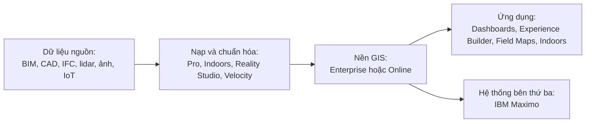
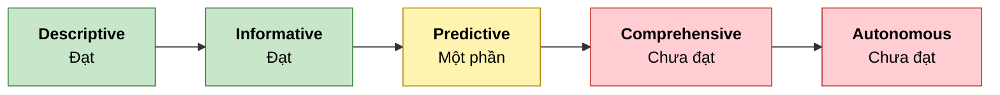

# 🗺️ Báo cáo Digital Twin Esri (ArcGIS)

> 📅 **Cập nhật:** 03/11/2026  |  ✍️ **Tác giả:** Hoàng Trung Hiếu  |  🔖 **Phiên bản:** 1.0  
> 🏷️ **Chủ đề:** Đánh giá năng lực công nghệ và khảo sát thực tế Esri (ArcGIS) cho bản sao số tòa nhà, khuôn viên, công trình phức hợp (sân vận động)

> [!NOTE]
> **Phạm vi nghiên cứu:** Báo cáo chỉ đánh giá Esri (ArcGIS), không so sánh hãng khác. Việc so sánh nhiều hãng thuộc Báo cáo 1 (tài liệu nội bộ). Quan hệ với IBM Maximo được nêu ở mục 2.6 đúng mức bằng chứng về tích hợp chính thức của Esri.

---

## 📑 Mục lục

- [🧭 Quy chuẩn bằng chứng A–B–C](#-quy-chuẩn-bằng-chứng-abc)
- [📌 Phần 1. Thông tin cần biết về Esri (ArcGIS)](#-phần-1-thông-tin-cần-biết-về-esri-arcgis)
  - [🎯 1.1. Định vị và chiến lược hiện tại](#-11-định-vị-và-chiến-lược-hiện-tại)
  - [🧩 1.2. Bản đồ sản phẩm](#-12-bản-đồ-sản-phẩm)
  - [💾 1.3. Nền dữ liệu và cơ chế mở](#-13-nền-dữ-liệu-và-cơ-chế-mở)
  - [🏗️ 1.4. Khung tham chiếu 5 tầng](#-14-khung-tham-chiếu-5-tầng)
- [🔬 Phần 2. Đánh giá chuyên sâu](#-phần-2-đánh-giá-chuyên-sâu)
  - [🧱 2.1. Ma trận theo khung 5 tầng](#-21-ma-trận-theo-khung-5-tầng)
  - [📈 2.2. Level maturity và AI](#-22-level-maturity-và-ai)
  - [💰 2.3. Giá, mô hình triển khai và giả thuyết](#-23-giá-mô-hình-triển-khai-và-giả-thuyết)
  - [🔗 2.4. Khả năng mở rộng và ràng buộc](#-24-khả-năng-mở-rộng-và-ràng-buộc)
  - [🏟️ 2.5. Quy mô khu vực và dự án thực tế](#-25-quy-mô-khu-vực-và-dự-án-thực-tế)
  - [🛠️ 2.6. Quan hệ với IBM Maximo](#-26-quan-hệ-với-ibm-maximo)
- [✅ Phần 3. Kết luận và phù hợp cho dự án sân vận động](#-phần-3-kết-luận-và-phù-hợp-cho-dự-án-sân-vận-động)
  - [🧾 3.1. Kết luận chung](#-31-kết-luận-chung)
  - [🚦 3.2. Mức sẵn sàng theo giai đoạn dự án sân vận động](#-32-mức-sẵn-sàng-theo-giai-đoạn-dự-án-sân-vận-động)
  - [📅 3.3. Ngày có sự kiện và ngày thường](#-33-ngày-có-sự-kiện-và-ngày-thường)
  - [📡 3.4. Điểm nghẽn: phụ thuộc đám mây và dự phòng ngoại tuyến/edge](#-34-điểm-nghẽn-phụ-thuộc-đám-mây-và-dự-phòng-ngoại-tuyếnedge)
- [📚 Danh mục tài liệu tham khảo](#-danh-mục-tài-liệu-tham-khảo)

---

## 🧭 Quy chuẩn bằng chứng A–B–C

| Cấp độ | Định nghĩa | Tiêu chí xác minh | Trạng thái trong báo cáo |
|:---:|---|---|:---:|
| 🟢 **Mức A** | Đã kiểm chứng trực tiếp qua trải nghiệm hệ thống, hoặc case study công khai có số liệu độc lập | Đã thao tác thật trên hệ thống, hoặc có số liệu do bên thứ ba độc lập công bố | ⬜ *Chưa có* |
| 🔵 **Mức B** | Căn cứ trực tiếp trên tài liệu chính thức của Esri (trang sản phẩm, tài liệu nhà phát triển, thông cáo) | Trang chính thức hiện tại đã đọc, có [n] trỏ đúng trang | ✅ **Phần lớn dữ kiện** |
| 🟠 **Mức C** | Suy luận của nhóm hoặc tổng hợp từ bên thứ ba, chưa có xác nhận trực tiếp trong tài liệu của hãng | Ghi rõ là nhận định hoặc giả thuyết; nguồn bên thứ ba có nhãn C | 📝 **Đã ghi nhận** |

---

## 📌 Phần 1. Thông tin cần biết về Esri (ArcGIS)

### ⚡ Tóm tắt nhanh

1. **Nền tảng ArcGIS:** đặt dữ liệu tòa nhà, tài sản và dữ liệu thời gian thực lên một nền bản đồ/GIS chung để xem, phân tích, chia sẻ. Trang Indoors mô tả sản phẩm là phần mềm lập bản đồ trong nhà cho quản lý không gian và tòa nhà ([1](https://esri.com/en-us/arcgis/products/arcgis-indoors/overview)); trang Enterprise nêu bản đồ 2D/3D và digital twin phục vụ lập kịch bản ([2](https://esri.com/en-us/arcgis/products/arcgis-enterprise/overview)).
2. **Chiến lược tiếp cận:** một nền GIS dùng chung, triển khai theo hai hướng: ArcGIS Enterprise tự lưu trữ (tại chỗ, đám mây, Kubernetes) ([2](https://esri.com/en-us/arcgis/products/arcgis-enterprise/overview)) và ArcGIS Online dạng dịch vụ tính theo credit ([3](https://www.esri.com/en-us/arcgis/products/credits/overview)), mở rộng bằng các extension và ứng dụng.
3. **Công thức cấu trúc giải pháp:** *Nhận định (Mức C):* nạp/chuẩn hóa (ArcGIS Pro, Indoors, Reality Studio, Velocity) → nền GIS (Enterprise hoặc Online) → ứng dụng (Dashboards, Experience Builder, Field Maps, ứng dụng Indoors) + tích hợp Maximo cho tài sản.
4. **Khoảng trống:** chưa thấy sản phẩm mô phỏng luồng đám đông; chức năng đếm đám đông của giải pháp sự kiện đã bị gỡ ([4](https://doc.arcgis.com/en/arcgis-solutions/reference/introduction-to-special-event-operations.htm)). Chưa thấy ontology kiểu DTDL hay Brick, và chưa thấy phần cứng cảm biến do hãng cung cấp trong nguồn đã đọc.
5. **Sân vận động:** chưa thấy sân nào có nguồn độc lập. Ví dụ gần nhất là Gillette Stadium, do đối tác tư vấn đăng, nói ArcGIS Online là một trong nhiều đích nhận dữ liệu ([5](https://www.symetri.us/insights/cases/the-kraft-group/)).

---

### 🎯 1.1. Định vị và chiến lược hiện tại

Esri hiện cung cấp ArcGIS như một nền GIS gồm phần máy chủ/dịch vụ, ứng dụng và extension. ArcGIS Enterprise là phần mềm GIS tự lưu trữ, chạy tại chỗ, trên đám mây hoặc trên Kubernetes, có thể kết nối hoặc ngắt kết nối khỏi internet ([2](https://esri.com/en-us/arcgis/products/arcgis-enterprise/overview)). ArcGIS Online là dịch vụ dạng SaaS, tính phí theo gói người dùng cùng credit cho các dịch vụ cao cấp như lưu trữ feature và công cụ phân tích ([15](https://www.esri.com/en-us/arcgis/products/credits/buy)). Theo trang giá, thời gian thực là tính năng mở rộng của ArcGIS Online, có trong ba loại người dùng Creator, Professional, Professional Plus ([16](https://www.esri.com/en-us/arcgis/products/arcgis-online/buy)).

> *Nhận định:* Sơ đồ trên là tổng hợp của nhóm từ các trang sản phẩm đã đọc (Mức C), không phải sơ đồ do Esri công bố.

---

### 🧩 1.2. Bản đồ sản phẩm

Cột Tầng là đối chiếu của nhóm theo khung 5 tầng ở mục 1.4 (Mức C).

| Thành phần | Làm gì | Dữ liệu vào | Kết quả ra | Tầng (Mức C) |
|---|---|---|---|:---:|
| **ArcGIS Enterprise** ([2](https://esri.com/en-us/arcgis/products/arcgis-enterprise/overview)) | GIS tự lưu trữ: bản đồ 2D/3D, phân tích, quản lý dữ liệu, branch versioning | Dữ liệu GIS, qua ArcGIS Pro | Dịch vụ bản đồ, scene, ứng dụng | T3, T2 |
| **ArcGIS Online** ([3](https://www.esri.com/en-us/arcgis/products/credits/overview)), ([16](https://www.esri.com/en-us/arcgis/products/arcgis-online/buy)) | Nền SaaS, tính credit theo lưu trữ, phân tích, nội dung cao cấp | Dữ liệu người dùng tải lên | Bản đồ web, dịch vụ, ứng dụng | T3, T5 |
| **ArcGIS Pro (hỗ trợ BIM)** ([6](https://doc.esri.com/en/arcgis-pro/latest/help/data/revit/what-is-bim-data-.html)) | Đọc tệp BIM như nguồn dữ liệu GIS; chuyển sang geodatabase | Revit 2021–2026; IFC (IFC2X3 đến IFC4X3) | Building layer, building scene layer, multipatch | T2 |
| **ArcGIS Indoors** ([1](https://esri.com/en-us/arcgis/products/arcgis-indoors/overview)), ([17](https://doc.esri.com/en/arcgis-pro/latest/help/data/indoors/arcgis-indoors-information-model.html)) | Lập bản đồ trong nhà và quản lý không gian; ứng dụng Viewer, Kiosk, Mobile; Space Planner | CAD, BIM, lidar, đám mây điểm | Bản đồ theo tầng 2D/3D, chỉ đường, ảnh 360, liên kết tài sản với hệ thống bên thứ ba | T2, T5 |
| **ArcGIS IPS** ([18](https://doc.arcgis.com/en/ips/latest/get-started/fulfill-requirements-for-arcgis-ips.htm)) | Định vị trong nhà bằng Bluetooth hoặc Wi-Fi | Tín hiệu BLE hoặc Wi-Fi, ứng dụng IPS Setup | Vị trí trong nhà cho Indoors và Field Maps | T1, T2 |
| **ArcGIS Velocity** ([13](https://doc.esri.com/en/arcgis-velocity/latest/reference/faq.html)), ([19](https://doc.esri.com/en/arcgis-velocity/latest/ingest/what-is-a-feed-.html)) | Thu nhận, lọc, làm giàu, geofencing, cảnh báo dữ liệu thời gian thực | Feed: MQTT, Kafka, HTTP, WebSocket, gRPC, AWS IoT, Azure Event Hub... | Feed và analytic chạy liên tục, cảnh báo | T2, T3 |
| **GeoEvent Server** ([20](https://www.esri.com/arcgis-blog/products/ext-server-geoevent/announcements/announcement-deprecation-of-arcgis-geoevent-server)) | Xử lý sự kiện thời gian thực trên Enterprise; đang bị ngừng | Dữ liệu sự kiện | Xem thông báo ngừng hỗ trợ ([20](https://www.esri.com/arcgis-blog/products/ext-server-geoevent/announcements/announcement-deprecation-of-arcgis-geoevent-server)) | T2, T3 |
| **ArcGIS Reality Studio** ([10](https://esri.com/en-us/arcgis/products/arcgis-reality/products/arcgis-reality-studio)) | Dựng sản phẩm thực tế từ ảnh drone/máy bay, có thể thêm lidar | Ảnh, điểm kiểm soát, lidar | True ortho, 3D mesh, đám mây điểm, DSM, Gaussian splat | T2 |
| **ArcGIS CityEngine** ([21](https://doc.arcgis.com/en/cityengine/latest/get-started/get-started-about-cityengine.htm)) | Dựng thành phố 3D theo thủ tục (luật CGA, Python) | Đường, footprint, hình học 3D, mass model | Mô hình đa giác, xuất tệp | T3 |
| **ArcGIS Urban** ([22](https://doc.esri.com/en/arcgis-urban/latest/get-started/get-started-what-is-urban.html)) | Ứng dụng web quy hoạch đô thị: kịch bản, phân tích tác động | Mô hình 3D, zoning, thửa đất | Quy hoạch 3D, kịch bản, chỉ số | T5, T4 |
| **ArcGIS Dashboards** ([23](https://developers.arcgis.com/documentation/app-builders/no-code/arcgis-dashboards/introduction-to-arcgis-dashboards/)) | Dashboard bản đồ, biểu đồ, chỉ báo KPI, dữ liệu gần thời gian thực | Web map, dịch vụ dữ liệu | Dashboard chia sẻ được | T5 |
| **ArcGIS Experience Builder** ([24](https://doc.arcgis.com/en/experience-builder/latest/get-started/what-is-arcgis-experience-builder.htm)) | Dựng ứng dụng web không code, 2D và 3D trong cùng một app | Bản đồ web, scene | Ứng dụng web đáp ứng nhiều thiết bị | T5 |
| **ArcGIS Field Maps** ([14](https://doc.arcgis.com/en/field-maps/get-started/get-started.htm)) | Ứng dụng di động cho nhân viên hiện trường; dùng online, offline, trong nhà | Bản đồ cấu hình từ Designer | Dữ liệu thu thập, vị trí, cảnh báo geofence | T5, T1 |
| **Special Event Operations** ([4](https://doc.arcgis.com/en/arcgis-solutions/reference/introduction-to-special-event-operations.htm)) | Giải pháp bản đồ vận hành sự kiện cho cảnh sát, cứu hỏa | Dữ liệu sự kiện, nhân sự, chặn đường | Ba ứng dụng Experience Builder: Planner, Maps, Special Event Maps | T4 |

> *Nhận định:* Thành phần đã đọc dồn ở T2 (nạp và chuẩn hóa dữ liệu không gian) và T5 (bản đồ, dashboard, ứng dụng). T3 có nền dịch vụ và phân tích nhưng chưa thấy ontology hay công cụ mô phỏng đám đông. T4 chỉ có giải pháp sự kiện thiên về an toàn công cộng và tích hợp Maximo cho tài sản. T1 gần như phải dựa bên ngoài (cảm biến, beacon, thiết bị GNSS).

---

### 💾 1.3. Nền dữ liệu và cơ chế mở

| Loại dữ liệu | Định dạng và chuẩn mở có tài liệu xác nhận | Cách nạp | Giới hạn |
|---|---|---|---|
| **BIM / CAD** | Revit 2021–2026; IFC2X2_FINAL, IFC2X3, IFC2X_FINAL, IFC4, IFC4X1, IFC4X2, IFC4X3 (phần công trình và hạ tầng) ([6](https://doc.esri.com/en/arcgis-pro/latest/help/data/revit/what-is-bim-data-.html)). Indoors có công cụ nhập Revit, IFC, CAD ([17](https://doc.esri.com/en/arcgis-pro/latest/help/data/indoors/arcgis-indoors-information-model.html)) | Tệp BIM là nguồn dữ liệu GIS chỉ đọc trong ArcGIS Pro; công cụ chuyển sang geodatabase ([6](https://doc.esri.com/en/arcgis-pro/latest/help/data/revit/what-is-bim-data-.html)). Trong dự án Schiphol, BIM dạng IFC được xử lý bằng ArcGIS Data Interoperability (chạy trên FME) rồi thành scene layer ([25](https://www.esri.com/about/newsroom/arcuser/digital-twin-helps-airport-optimize-operations)) | Dữ liệu gốc chỉ đọc; chỉ dùng mô hình chính (không dùng mô hình liên kết); cần hệ tọa độ hợp lệ; lớp Floorplan chưa có trong hỗ trợ IFC ban đầu ([6](https://doc.esri.com/en/arcgis-pro/latest/help/data/revit/what-is-bim-data-.html)). Với nguồn CAD, SOURCE_ID là Null ([17](https://doc.esri.com/en/arcgis-pro/latest/help/data/indoors/arcgis-indoors-information-model.html)) |
| **GIS và 3D địa không gian** | I3S (scene layer) và 3D Tiles được bài của Esri gọi là hai chuẩn OGC ([7](https://www.esri.com/arcgis-blog/products/arcgis-online/3d-gis/i3s-or-3d-tiles-what-data-source-to-use-for-3d-layer-in-arcgis)). OGC API – Features và WFS xuất bản được; WMS, WMTS, WCS chỉ tiêu thụ ([8](https://doc.esri.com/en/arcgis-enterprise/latest/share/ogc.html)) | Xuất bản dịch vụ từ ArcGIS Pro lên Enterprise hoặc Online | ArcGIS Online host được 3D Tiles; ArcGIS Enterprise chỉ hỗ trợ scene layer (I3S) ([7](https://www.esri.com/arcgis-blog/products/arcgis-online/3d-gis/i3s-or-3d-tiles-what-data-source-to-use-for-3d-layer-in-arcgis)). Trang OGC không nhắc KML hay 3D ([8](https://doc.esri.com/en/arcgis-enterprise/latest/share/ogc.html)) |
| **IoT** | Feed MQTT, Kafka, HTTP, WebSocket, gRPC, RabbitMQ, TCP, AWS IoT, Azure Event Hub, Azure Service Bus ([19](https://doc.esri.com/en/arcgis-velocity/latest/ingest/what-is-a-feed-.html)) | Tạo feed trong Velocity | Trang không liệt kê Azure IoT Hub ([19](https://doc.esri.com/en/arcgis-velocity/latest/ingest/what-is-a-feed-.html)). Velocity cho Enterprise: site một máy, cần Enterprise nền, không gồm big data analytics ([13](https://doc.esri.com/en/arcgis-velocity/latest/reference/faq.html)). Mô hình dữ liệu Indoors không có khái niệm cảm biến; chỉ có TrackingZones ([17](https://doc.esri.com/en/arcgis-pro/latest/help/data/indoors/arcgis-indoors-information-model.html)) |
| **Dữ liệu thực tế, đám mây điểm** | Reality Studio nhận ảnh nhiều chuyến bay, lidar; xuất "open standard formats" ([10](https://esri.com/en-us/arcgis/products/arcgis-reality/products/arcgis-reality-studio)). Indoors nhận đám mây điểm ([1](https://esri.com/en-us/arcgis/products/arcgis-indoors/overview)) | Xử lý trong Reality Studio | Trang không liệt kê định dạng xuất cụ thể ([10](https://esri.com/en-us/arcgis/products/arcgis-reality/products/arcgis-reality-studio)); chưa thấy danh sách định dạng của CityEngine trên trang đã đọc ([21](https://doc.arcgis.com/en/cityengine/latest/get-started/get-started-about-cityengine.htm)) |

> *Nhận định:* Chuẩn mở có tài liệu xác nhận gồm IFC (đọc), I3S, 3D Tiles (ở ArcGIS Online), OGC API – Features và WFS (xuất bản), MQTT (feed). Chưa thấy trong nguồn đã đọc: DTDL, Brick, tiêu chuẩn mở cho dữ liệu chuỗi thời gian, và danh sách định dạng xuất của Reality Studio.

---

### 🏗️ 1.4. Khung tham chiếu 5 tầng

| Tầng | Vai trò | Module chuẩn |
|:---:|---|---|
| **T5** | **Trực quan hóa và điều hành (IOC)** | Cổng web 3D; màn hình lớn trung tâm điều hành; ứng dụng di động cho kỹ thuật viên |
| **T4** | **Module nghiệp vụ chuyên dụng** | Luồng người và an ninh; tài sản và bảo trì (EAM/CMMS/FM); năng lượng và môi trường; giám sát sức khỏe kết cấu; vận hành sự kiện |
| **T3** | **Lõi nền tảng và mô phỏng** | CSDL quan hệ không gian (ontology như DTDL hay Brick); CSDL chuỗi thời gian; công cụ mô phỏng và AI/ML |
| **T2** | **Thu nạp và chuẩn hóa dữ liệu** | Bộ chuyển đổi BIM, GIS, đám mây điểm; bus truyền tin cho dữ liệu IoT |
| **T1** | **Hạ tầng vật lý và biên** | Cảm biến IoT, camera AI, cửa quay soát vé, bộ điều khiển BMS, cổng biên |

> [!NOTE]
> Đây là khung tổng hợp của nhóm ([26]), **không phải** chuẩn đã công bố hay state-of-the-art. Khung công khai khác là Digital Twin Consortium Platform Stack (6 thành phần, có Security/Trust/Governance) và ISO 23247-2 (4 domain, cho sản xuất công nghiệp); khung 5 tầng chưa có tầng bảo mật. DTDL và Brick là hai thứ khác nhau (RealEstateCore xây DTDL ontology trên nền Brick).

---

## 🔬 Phần 2. Đánh giá chuyên sâu

### 🧱 2.1. Ma trận theo khung 5 tầng

Ma trận dưới đây đặt các cấu phần của Esri vào khung tham chiếu 5 tầng ở mục 1.4. Đây là khung tổng hợp của nhóm (Mức C), không phải chuẩn đã công bố:

| Tầng | Giải pháp cụ thể của Esri | Tự làm hay dựa bên ngoài | Thang tự chủ | Mức bằng chứng | Nhận định kỹ thuật |
|:---:|---|---|:---:|:---:|---|
| **T5** | Dashboards ([23](https://developers.arcgis.com/documentation/app-builders/no-code/arcgis-dashboards/introduction-to-arcgis-dashboards/)), Experience Builder ([24](https://doc.arcgis.com/en/experience-builder/latest/get-started/what-is-arcgis-experience-builder.htm)), ứng dụng Indoors Viewer/Kiosk/Mobile ([1](https://esri.com/en-us/arcgis/products/arcgis-indoors/overview)), Field Maps ([14](https://doc.arcgis.com/en/field-maps/get-started/get-started.htm)) | Tự làm | ▰▰▰▰▱ | 🔵 B | Là tầng mạnh nhất trong nguồn đã đọc. Chưa thấy trang nói về màn hình lớn trung tâm điều hành; dashboard chạy trên web |
| **T4** | Special Event Operations ([4](https://doc.arcgis.com/en/arcgis-solutions/reference/introduction-to-special-event-operations.htm)); Space Planner của Indoors ([17](https://doc.esri.com/en/arcgis-pro/latest/help/data/indoors/arcgis-indoors-information-model.html)); liên kết Maximo cho tài sản ([11](https://www.esri.com/about/newsroom/announcements/esris-arcgis-enterprise-on-kubernetes-integrated-with-ibm-maximo-is-now-available)) | Một phần tự làm; tài sản dựa bên ngoài (Maximo) | ▰▰▱▱▱ | 🔵 B | Giải pháp sự kiện nhắm tới cảnh sát, cứu hỏa, không có đếm đám đông ([4](https://doc.arcgis.com/en/arcgis-solutions/reference/introduction-to-special-event-operations.htm)). Mô hình Indoors thiên về không gian văn phòng (đặt chỗ, phân công) ([17](https://doc.esri.com/en/arcgis-pro/latest/help/data/indoors/arcgis-indoors-information-model.html)) |
| **T3** | Enterprise (dịch vụ, phân tích, knowledge graph, công cụ AI/ML) ([2](https://esri.com/en-us/arcgis/products/arcgis-enterprise/overview)); Velocity ([13](https://doc.esri.com/en/arcgis-velocity/latest/reference/faq.html)); CityEngine ([21](https://doc.arcgis.com/en/cityengine/latest/get-started/get-started-about-cityengine.htm)); Urban ([22](https://doc.esri.com/en/arcgis-urban/latest/get-started/get-started-what-is-urban.html)) | Tự làm một phần | ▰▰▰▱▱ | 🔵 B | Chưa thấy ontology DTDL/Brick, chưa thấy công cụ mô phỏng đám đông trong nguồn đã đọc |
| **T2** | ArcGIS Pro BIM ([6](https://doc.esri.com/en/arcgis-pro/latest/help/data/revit/what-is-bim-data-.html)); Indoors Pro ([1](https://esri.com/en-us/arcgis/products/arcgis-indoors/overview)); Reality Studio ([10](https://esri.com/en-us/arcgis/products/arcgis-reality/products/arcgis-reality-studio)); feed của Velocity ([19](https://doc.esri.com/en/arcgis-velocity/latest/ingest/what-is-a-feed-.html)); Data Interoperability/FME trong dự án Schiphol ([25](https://www.esri.com/about/newsroom/arcuser/digital-twin-helps-airport-optimize-operations)) | Tự làm | ▰▰▰▰▱ | 🔵 B | Đây là tầng có nhiều bằng chứng nhất về chuẩn mở (IFC, I3S, OGC) |
| **T1** | Camera: Indoors nêu tích hợp nguồn camera an ninh ([1](https://esri.com/en-us/arcgis/products/arcgis-indoors/overview)); IPS dùng beacon Bluetooth hoặc Wi-Fi ([18](https://doc.arcgis.com/en/ips/latest/get-started/fulfill-requirements-for-arcgis-ips.htm)); Field Maps nối thiết bị GNSS ngoài ([14](https://doc.arcgis.com/en/field-maps/get-started/get-started.htm)) | Dựa bên ngoài | ▰▱▱▱▱ | 🔵 B | Esri không bán phần cứng cảm biến trong nguồn đã đọc |

> *Ghi chú:* Thang tự chủ (▰ càng nhiều càng tự làm) là thang định tính, Mức C, không phải số đo thực nghiệm.

---

### 📈 2.2. Level maturity và AI

Thang maturity theo Verdantix: Descriptive, Informative, Predictive, Comprehensive, Autonomous (IBM gọi tương đương là "Dynamic") ([26]). Bảng dưới là đối chiếu của nhóm (Mức C), không phải đánh giá do Esri hay Verdantix công bố:

| Level | Kết quả | Mức bằng chứng | Căn cứ có nguồn |
|---|:---:|:---:|---|
| **Descriptive** | Đạt | 🔵 B | Bản đồ và mô hình 3D từ BIM, Reality Studio, Indoors ([6](https://doc.esri.com/en/arcgis-pro/latest/help/data/revit/what-is-bim-data-.html)), ([10](https://esri.com/en-us/arcgis/products/arcgis-reality/products/arcgis-reality-studio)), ([1](https://esri.com/en-us/arcgis/products/arcgis-indoors/overview)) |
| **Informative** | Đạt | 🔵 B | Dashboard gần thời gian thực ([23](https://developers.arcgis.com/documentation/app-builders/no-code/arcgis-dashboards/introduction-to-arcgis-dashboards/)); feed và cảnh báo của Velocity ([13](https://doc.esri.com/en/arcgis-velocity/latest/reference/faq.html)); liên kết với hệ thống quản lý tài sản ([1](https://esri.com/en-us/arcgis/products/arcgis-indoors/overview)) |
| **Predictive** | Một phần | 🟠 C | Trang Enterprise và trang giá nêu công cụ AI/ML và quy trình AI ([2](https://esri.com/en-us/arcgis/products/arcgis-enterprise/overview)), ([16](https://www.esri.com/en-us/arcgis/products/arcgis-online/buy)); chưa thấy case có số liệu về dự báo bảo trì cho tòa nhà hay sân vận động |
| **Comprehensive** | Chưa | 🟠 C | Urban có kịch bản và so sánh, nhưng cho quy hoạch đô thị ([22](https://doc.esri.com/en/arcgis-urban/latest/get-started/get-started-what-is-urban.html)); chưa thấy mô phỏng what-if cho vận hành tòa nhà trong nguồn đã đọc |
| **Autonomous** | Chưa | 🟠 C | Chưa thấy nguồn nào về điều khiển tự động vòng kín |

#### 🤖 AI công bố so với thực tế triển khai

| Công cụ | Chức năng (theo nguồn) | Trạng thái |
|---|---|---|
| **Công cụ AI/ML trong Enterprise** ([2](https://esri.com/en-us/arcgis/products/arcgis-enterprise/overview)) | Phân tích dữ liệu, ảnh viễn thám | Trang không nêu GA, Beta hay Early Access |
| **Quy trình AI đầu cuối trong Professional Plus** ([16](https://www.esri.com/en-us/arcgis/products/arcgis-online/buy)) | Liệt kê trong gói | Trang không nêu trạng thái phát hành |
| **Add-on Maximo** ([11](https://www.esri.com/about/newsroom/announcements/esris-arcgis-enterprise-on-kubernetes-integrated-with-ibm-maximo-is-now-available)) | Thông cáo nêu tự động hóa kiểm tra tài sản, tối ưu hiệu suất, lập lịch bảo trì | Thông cáo 15/07/2024 ghi "Now Available"; chưa có bằng chứng triển khai thực tế |
| **Phân tích dự báo cho quảng cáo tại địa điểm thể thao** ([27](https://www.esri.com/en-us/industries/media-entertainment/segments/sports-entertainment-venues)) | Claim marketing của Esri | Không có số liệu |

---

### 💰 2.3. Giá, mô hình triển khai và giả thuyết

| Hạng mục | Thông tin công khai | Giá |
|---|---|:---:|
| **Creator, Professional, Professional Plus** | Giấy phép hằng năm; 500 credit mỗi người dùng ([16](https://www.esri.com/en-us/arcgis/products/arcgis-online/buy)) | Chưa công khai, cần báo giá |
| **Mobile Worker, Contributor** | 250 credit; Viewer 0 credit ([16](https://www.esri.com/en-us/arcgis/products/arcgis-online/buy)) | Chưa công khai, cần báo giá |
| **Credit bổ sung** | Bán theo khối 1.000, hiệu lực 24 tháng ([3](https://www.esri.com/en-us/arcgis/products/credits/overview)) | Trang không nêu số tiền |
| **Dùng thử ArcGIS Online** | 21 ngày, 2 Creator và 3 Viewer, 400 credit, cần email doanh nghiệp hoặc chính phủ ([28](https://www.esri.com/en-us/arcgis/trial)) | Miễn phí trong thời gian dùng thử |
| **ArcGIS Enterprise** | Ba gói: Standard, Advanced, on Kubernetes ([2](https://esri.com/en-us/arcgis/products/arcgis-enterprise/overview)) | Chưa công khai, cần báo giá |
| **ArcGIS Indoors** | Trang chỉ có mục liên hệ bán hàng ([1](https://esri.com/en-us/arcgis/products/arcgis-indoors/overview)) | Chưa công khai, cần báo giá |
| **ArcGIS IPS** | Cần extension IPS cấp phép riêng cho tổ chức và cho ArcGIS Pro ([18](https://doc.arcgis.com/en/ips/latest/get-started/fulfill-requirements-for-arcgis-ips.htm)) | Chưa công khai, cần báo giá |
| **ArcGIS Urban** | Có trong Professional Plus, không có trong Creator và Professional ([9](https://esri.com/en-us/arcgis/products/arcgis-urban/buy)) | Chưa công khai, cần báo giá |
| **Reality Studio** | Trang chỉ có kênh liên hệ bán hàng ([10](https://esri.com/en-us/arcgis/products/arcgis-reality/products/arcgis-reality-studio)) | Chưa công khai, cần báo giá |
| **Velocity** | FAQ không nêu mô hình tính credit ([13](https://doc.esri.com/en/arcgis-velocity/latest/reference/faq.html)); từ 06/2026 khách có đăng ký hoặc bảo trì GeoEvent nhận giấy phép Velocity Server ([20](https://www.esri.com/arcgis-blog/products/ext-server-geoevent/announcements/announcement-deprecation-of-arcgis-geoevent-server)) | Chưa công khai |

Professional Plus gồm nhiều ứng dụng: CityEngine, Urban, Experience Builder, Field Maps, Dashboards, Navigator và các SDK. Danh sách của trang giá không liệt kê Indoors, Velocity hay IPS ([16](https://www.esri.com/en-us/arcgis/products/arcgis-online/buy)); *Nhận định (Mức C):* ba thành phần này có thể cần giấy phép riêng, cần xác nhận khi xin báo giá.

* **Giả thuyết gốc thiết kế (Mức C):** Mô hình giá của ArcGIS Online dựa trên người dùng có tên và credit tiêu thụ theo lưu trữ, công cụ phân tích và nội dung cao cấp ([15](https://www.esri.com/en-us/arcgis/products/credits/buy)), cộng các extension riêng. *Nhận định:* chi phí vì vậy gắn với số người dùng và lượng dữ liệu hơn là diện tích công trình; với sân vận động đông người xem dashboard, nhóm cần làm rõ loại người dùng cho phần xem công khai.
* **Ước tính chi phí:** Chưa lập được cận dưới vì chưa có thành phần nào có giá bằng tiền công khai.

---

### 🔗 2.4. Khả năng mở rộng và ràng buộc

| Khía cạnh | Ràng buộc đã ghi nhận | Nhãn |
|---|---|:---:|
| **API, SDK** | Gói Professional Plus liệt kê Maps SDK cho JavaScript, game engine và ứng dụng native ([16](https://www.esri.com/en-us/arcgis/products/arcgis-online/buy)). Maximo Spatial gọi REST API của ArcGIS Server qua Maximo Integration Framework ([12](https://architecture.arcgis.com/en/framework/architecture-pillars/integration/providers/ibm.html)) | 🔵 B |
| **Hạn mức credit** | Credit tiêu thụ cho lưu trữ feature, công cụ phân tích, nội dung cao cấp; credit bổ sung hết hạn sau 24 tháng ([15](https://www.esri.com/en-us/arcgis/products/credits/buy)), ([3](https://www.esri.com/en-us/arcgis/products/credits/overview)) | 🔵 B |
| **Vùng dữ liệu** | ArcGIS Online có ba vùng US, EU, APAC; chọn khi tạo tổ chức, không đổi được; chứng nhận ISO/IEC 27001 hiện chỉ áp dụng vùng EU; xác thực tài khoản xử lý tại Hoa Kỳ ([29](https://trust.arcgis.com/en/security/regional-hosting.htm)) | 🔵 B |
| **Velocity** | Site một máy, cần Enterprise nền, bản Enterprise không gồm big data analytics ([13](https://doc.esri.com/en/arcgis-velocity/latest/reference/faq.html)) | 🔵 B |
| **Vòng đời GeoEvent** | Bản cuối là Enterprise 12.3 (dự kiến 05/2027), gỡ khỏi Enterprise từ 12.4 (dự kiến 11/2027), ngừng hoàn toàn dự kiến 05/2031; thay bằng Velocity ([20](https://www.esri.com/arcgis-blog/products/ext-server-geoevent/announcements/announcement-deprecation-of-arcgis-geoevent-server)) | 🔵 B |
| **BIM** | Dữ liệu gốc chỉ đọc, chỉ mô hình chính, cần hệ tọa độ hợp lệ ([6](https://doc.esri.com/en/arcgis-pro/latest/help/data/revit/what-is-bim-data-.html)) | 🔵 B |
| **Indoors** | Trường ID không được geodatabase đảm bảo duy nhất ([17](https://doc.esri.com/en/arcgis-pro/latest/help/data/indoors/arcgis-indoors-information-model.html)) | 🔵 B |
| **IPS** | Không gian rộng, trần cao, đông người có thể làm giảm độ chính xác Bluetooth ([18](https://doc.arcgis.com/en/ips/latest/get-started/fulfill-requirements-for-arcgis-ips.htm)) | 🔵 B |
| **Giải pháp sự kiện** | Chỉ yêu cầu ArcGIS Online ([4](https://doc.arcgis.com/en/arcgis-solutions/reference/introduction-to-special-event-operations.htm)) | 🔵 B |
| **Dashboards** | Không hỗ trợ trên ArcGIS Location Platform ([23](https://developers.arcgis.com/documentation/app-builders/no-code/arcgis-dashboards/introduction-to-arcgis-dashboards/)) | 🔵 B |
| **Điều khoản dùng thử** | Dùng thử cần email doanh nghiệp hoặc chính phủ ([28](https://www.esri.com/en-us/arcgis/trial)). Trang điều khoản chỉ là mục lục tài liệu pháp lý, không nêu bậc miễn phí có dùng production được không ([30](https://developers.arcgis.com/documentation/terms-of-use/)) | 🔵 B |

> [!WARNING]
> **Giả thuyết phụ thuộc hệ sinh thái (Mức C):** Dữ liệu 3D lưu dạng scene layer (I3S) trên Enterprise ([7](https://www.esri.com/arcgis-blog/products/arcgis-online/3d-gis/i3s-or-3d-tiles-what-data-source-to-use-for-3d-layer-in-arcgis)), tích hợp Maximo bán qua mã add-on của IBM với một kênh hỗ trợ ([11](https://www.esri.com/about/newsroom/announcements/esris-arcgis-enterprise-on-kubernetes-integrated-with-ibm-maximo-is-now-available)), và nhiều ứng dụng nằm trong gói Professional Plus ([16](https://www.esri.com/en-us/arcgis/products/arcgis-online/buy)). *Nhận định:* đi sâu vào các thành phần này có thể làm chi phí chuyển đổi tăng. Mức độ khóa nhà cung cấp chưa được kiểm chứng; đây là giả thuyết cần kiểm tra bằng thử nghiệm xuất dữ liệu ra định dạng mở.

---

### 🏟️ 2.5. Quy mô khu vực và dự án thực tế

| Nhóm | Dự án | Vai trò của hãng | Ai đăng nguồn | Có độc lập không | Mức xác thực |
|---|---|---|---|:---:|:---:|
| **Quy mô khu vực / đô thị** | Sân bay Schiphol, khuôn viên 7.000 acre, hơn 80.000 tài sản | ArcGIS Enterprise, Data Interoperability/FME, scene layer; Maximo và cảm biến đi kèm ([25](https://www.esri.com/about/newsroom/arcuser/digital-twin-helps-airport-optimize-operations)) | Esri (ArcUser, 01/12/2019), trích lời nhân sự Schiphol | Không | 🔵 B *(kết quả chỉ định tính)* |
| **Quy mô khu vực / đô thị** | Schiphol (nguồn khác) | Trang của đơn vị làm FME không nhắc ArcGIS; nêu hơn 50.000 tài sản và khoảng 50 triệu USD chi hàng năm cho bảo trì ([31](https://fme.safe.com/solutions/customers/amsterdam-airport-schiphol/)) | Safe Software, cập nhật 20/09/2023 | Bán độc lập, là nhà cung cấp phần mềm | 🟠 C *(hai nguồn nêu số tài sản khác nhau: 80.000 vs 50.000)* |
| **Châu Á & Việt Nam** | Hệ thống cảng Cái Mép–Thị Vải | Portcoast dùng ArcGIS Pro, ArcGIS Online, ArcGIS Earth, Scene Viewer, Maps SDK for Unity; bài không nêu rõ vai trò hợp đồng của Esri ([32](https://www.esri.com/about/newsroom/arcnews/a-3d-living-digital-twin-guides-improvements-for-a-vietnam-port-system)) | Esri (ArcNews, 02/04/2024) | Không | 🔵 B *(dự án cảng, không phải sân vận động)* |
| **Châu Á** | Sân bay quốc tế Hong Kong | Hai nguồn đã đọc nói về digital twin BIM và GIS nhưng không nhắc ArcGIS hay Esri ([33](https://cdaward.cic.hk/content/dam/cd-award/winner-documents/2024/Empowering%20Smart%20Airport%20City%20with%20Digital%20Twin.pdf.coredownload.pdf)), ([34](https://archive.opengovasia.com/2019/10/03/hkia-develops-digital-twin/)) | Airport Authority Hong Kong qua giải thưởng CIC; bài OpenGovAsia 2019 | Có | Chưa dùng làm bằng chứng ArcGIS |
| **Việt Nam** | (Tòa nhà, sân vận động) | Chưa thấy dự án công khai tại Việt Nam trong nguồn đã rà soát, ngoài dự án cảng ở trên | — | — | — |
| **Sân vận động** | Gillette Stadium và Patriot Place (The Kraft Group) | Dữ liệu BIM và tài liệu xây dựng từ một nền dữ liệu bên thứ ba chia sẻ sang nhiều đích, trong đó có ArcGIS Online; mục đích tìm, dùng, chia sẻ dữ liệu và lập kế hoạch sự kiện; dự án bắt đầu năm 2024; không số liệu cụ thể ([5](https://www.symetri.us/insights/cases/the-kraft-group/)) | Symetri (đối tác tư vấn) | Không | 🟠 C |
| **Sân vận động** | Gillette Stadium (podcast) | Người nói của Symetri nói về "BIM to ArcGIS digital twin foundation"; không nêu sản phẩm cụ thể, không số liệu ([35](https://informedinfrastructure.com/post/podcast-from-esri-uc-2025-a-digital-twin-for-gillette-stadium)) | Informed Infrastructure, 21/07/2025 | Một phần | 🟠 C |
| **Sân vận động** | Atlanta Braves, Super Bowl 2019, NCAA Final Four | Trang ngành của Esri nêu các ví dụ về giao thông, drone, ứng phó khẩn cấp; không số liệu ([27](https://www.esri.com/en-us/industries/media-entertainment/segments/sports-entertainment-venues)) | Esri | Không | 🔵 B |

> [!CAUTION]
> Chưa thấy sân vận động nào có nguồn độc lập xác nhận dùng ArcGIS để vận hành bản sao số. Ví dụ gần nhất là Gillette Stadium, nhưng nguồn chỉ nói ArcGIS Online là một trong nhiều đích nhận dữ liệu, không nói về IoT, thời gian thực hay mô phỏng đám đông.

---

### 🛠️ 2.6. Quan hệ với IBM Maximo

* **Bằng chứng hiện có (Mức B):**
  - Thông cáo của Esri ngày 15/07/2024: ArcGIS Enterprise on Kubernetes tích hợp với IBM Maximo Application Suite dưới dạng add-on; tận dụng nền Red Hat OpenShift đã triển khai cho Maximo; bán như giải pháp tích hợp qua mã add-on của IBM, một kênh hỗ trợ thống nhất. Thông cáo không nhắc Maximo Spatial ([11](https://www.esri.com/about/newsroom/announcements/esris-arcgis-enterprise-on-kubernetes-integrated-with-ibm-maximo-is-now-available)).
  - Tài liệu kiến trúc của Esri: Maximo Spatial dùng Maximo Integration Framework gọi REST API của ArcGIS Server; bản đồ hiển thị qua REST feature service; đồng bộ bằng cron job ArcGISDataSync, cấu hình một chiều hoặc hai chiều; dùng offline với Maximo Mobile cần bật replica tracking; phiên bản ArcGIS hỗ trợ phụ thuộc phiên bản Maximo và Maximo Spatial ([12](https://architecture.arcgis.com/en/framework/architecture-pillars/integration/providers/ibm.html)).
  - Indoors có thể liên kết vị trí tài sản với hệ thống quản lý tài sản và công việc bên thứ ba, trang không nêu tên hệ thống ([1](https://esri.com/en-us/arcgis/products/arcgis-indoors/overview)). Dự án Schiphol có dùng Maximo bên cạnh ArcGIS ([25](https://www.esri.com/about/newsroom/arcuser/digital-twin-helps-airport-optimize-operations)).
* **Khung giả thuyết (Mức C):** *Nhận định:* Maximo đóng vai System of Record (tài sản, lệnh công việc), ArcGIS đóng vai System of Engagement (bản đồ, dashboard, ứng dụng hiện trường). Khung này là cách đọc của nhóm, chưa thấy tài liệu của Esri dùng thuật ngữ đó.
* **Câu hỏi mở:**
  - Add-on của thông cáo năm 2024 và Maximo Spatial là hai đường tích hợp khác nhau hay liên quan nhau? Tài liệu đã đọc không nói.
  - Giao thức và ranh giới đồng bộ: trường nào thuộc bên nào, đồng bộ hai chiều xử lý xung đột ra sao.
  - Tích hợp có áp dụng cho dữ liệu 3D và Indoors (tầng, phòng) hay chỉ cho feature service 2D? Chưa thấy nguồn.

---

## ✅ Phần 3. Kết luận và phù hợp cho dự án sân vận động

### 🧾 3.1. Kết luận chung

> [!IMPORTANT]
> *Nhận định:* ArcGIS phù hợp nhất ở vai trò nền dữ liệu không gian và lớp trực quan (T2 và T5), có đường tích hợp chính thức với Maximo cho tài sản; **chưa phải giải pháp trọn gói** để vận hành sân vận động.

| Điểm mạnh | Hạn chế |
|---|---|
| Nạp trực tiếp Revit và IFC vào GIS, có chuẩn mở I3S, OGC ([6](https://doc.esri.com/en/arcgis-pro/latest/help/data/revit/what-is-bim-data-.html)), ([7](https://www.esri.com/arcgis-blog/products/arcgis-online/3d-gis/i3s-or-3d-tiles-what-data-source-to-use-for-3d-layer-in-arcgis)), ([8](https://doc.esri.com/en/arcgis-enterprise/latest/share/ogc.html)) | Nguồn BIM gốc chỉ đọc; chỉ mô hình chính; lớp Floorplan chưa có trong IFC ban đầu ([6](https://doc.esri.com/en/arcgis-pro/latest/help/data/revit/what-is-bim-data-.html)) |
| Chạy được ở chế độ ngắt kết nối với Enterprise, Velocity, Field Maps ([2](https://esri.com/en-us/arcgis/products/arcgis-enterprise/overview)), ([13](https://doc.esri.com/en/arcgis-velocity/latest/reference/faq.html)), ([14](https://doc.esri.com/en/field-maps/get-started/get-started.htm)) | Velocity một máy; GeoEvent đang bị ngừng ([13](https://doc.esri.com/en/arcgis-velocity/latest/reference/faq.html)), ([20](https://www.esri.com/arcgis-blog/products/ext-server-geoevent/announcements/announcement-deprecation-of-arcgis-geoevent-server)) |
| Tích hợp chính thức với Maximo ([11](https://www.esri.com/about/newsroom/announcements/esris-arcgis-enterprise-on-kubernetes-integrated-with-ibm-maximo-is-now-available)), ([12](https://architecture.arcgis.com/en/framework/architecture-pillars/integration/providers/ibm.html)) | Giá không công khai; dự án sân vận động chưa có nguồn độc lập |
| Nhiều ứng dụng trong một gói (Professional Plus) ([16](https://www.esri.com/en-us/arcgis/products/arcgis-online/buy)) | Indoors, Velocity, IPS không thấy trong danh sách gói đó ([16](https://www.esri.com/en-us/arcgis/products/arcgis-online/buy)) |

- **Level maturity:** Informative đạt, Predictive một phần, Comprehensive và Autonomous chưa (mục 2.2, Mức C).
- **Nhận định bổ sung:**  
  1. Mô hình dữ liệu Indoors được thiết kế quanh không gian làm việc (đặt chỗ, phân công) ([17](https://doc.esri.com/en/arcgis-pro/latest/help/data/indoors/arcgis-indoors-information-model.html)), nên phần quản lý khán đài, chỗ ngồi, cổng soát vé sẽ phải mô hình hóa thêm; chưa thấy mẫu sẵn.  
  2. IPS bằng Bluetooth là điểm cần thử riêng vì chính trang yêu cầu cảnh báo về không gian rộng và đông người ([18](https://doc.arcgis.com/en/ips/latest/get-started/fulfill-requirements-for-arcgis-ips.htm)).  
  3. Hướng IoT thời gian thực của Esri đang chuyển từ GeoEvent sang Velocity ([20](https://www.esri.com/arcgis-blog/products/ext-server-geoevent/announcements/announcement-deprecation-of-arcgis-geoevent-server)), nên kế hoạch dùng ArcGIS cho dữ liệu cảm biến nên bám Velocity.
- **Rủi ro phụ thuộc (Mức C):** Xem callout ở mục 2.4: phụ thuộc scene layer, add-on Maximo qua IBM và gói Professional Plus; chưa kiểm chứng.

---

### 🚦 3.2. Mức sẵn sàng theo giai đoạn dự án sân vận động

Mức sẵn sàng là đối chiếu của nhóm (Mức C), dựa trên bằng chứng đã đọc:  
*Chú giải: 🟢 có bằng chứng ứng dụng · 🟡 có công cụ còn hạn chế · 🟠 chưa phát hành rộng · 🔴 phải dựa hoàn toàn bên ngoài.*

| Khâu dự án | Thành phần của hãng | Bằng chứng hiện có | Hạn chế cốt tử | Sẵn sàng |
|---|---|---|---|:---:|
| **Thiết kế** | ArcGIS Pro BIM, Indoors Pro, CityEngine ([6](https://doc.esri.com/en/arcgis-pro/latest/help/data/revit/what-is-bim-data-.html)), ([17](https://doc.esri.com/en/arcgis-pro/latest/help/data/indoors/arcgis-indoors-information-model.html)), ([21](https://doc.esri.com/en/cityengine/latest/get-started/get-started-about-cityengine.htm)) | Tài liệu đọc Revit, IFC; công cụ nhập vào Indoor dataset | Dữ liệu gốc chỉ đọc; Floorplan chưa có trong IFC ban đầu ([6](https://doc.esri.com/en/arcgis-pro/latest/help/data/revit/what-is-bim-data-.html)) | 🟡 |
| **Mô phỏng đám đông và thoát hiểm** | Chưa thấy sản phẩm | Giải pháp sự kiện đã gỡ chức năng đếm đám đông ([4](https://doc.arcgis.com/en/arcgis-solutions/reference/introduction-to-special-event-operations.htm)) | Phải dựa hoàn toàn bên ngoài | 🔴 |
| **Bối cảnh địa không gian đô thị** | Enterprise, Urban, Reality Studio, Online ([2](https://esri.com/en-us/arcgis/products/arcgis-enterprise/overview)), ([22](https://doc.esri.com/en/arcgis-urban/latest/get-started/get-started-what-is-urban.html)), ([10](https://esri.com/en-us/arcgis/products/arcgis-reality/products/arcgis-reality-studio)) | Dự án cảng Cái Mép–Thị Vải, Schiphol do Esri đăng ([32](https://www.esri.com/about/newsroom/arcnews/a-3d-living-digital-twin-guides-improvements-for-a-vietnam-port-system)), ([25](https://www.esri.com/about/newsroom/arcuser/digital-twin-helps-airport-optimize-operations)) | Bằng chứng do hãng đăng, không số liệu | 🟢 |
| **Giám sát hiện trường** | Velocity, Dashboards, Field Maps ([13](https://doc.esri.com/en/arcgis-velocity/latest/reference/faq.html)), ([23](https://developers.arcgis.com/documentation/app-builders/no-code/arcgis-dashboards/introduction-to-arcgis-dashboards/)), ([14](https://doc.esri.com/en/field-maps/get-started/get-started.htm)) | Tài liệu sản phẩm; trang ngành nêu dashboard thời gian thực cho địa điểm thể thao ([27](https://www.esri.com/en-us/industries/media-entertainment/segments/sports-entertainment-venues)) | Chưa có sân vận động độc lập; Velocity một máy ([13](https://doc.esri.com/en/arcgis-velocity/latest/reference/faq.html)) | 🟡 |
| **Trải nghiệm truyền thông** | Experience Builder, bản đồ công chúng, ứng dụng Indoors (chỉ đường) ([24](https://doc.arcgis.com/en/experience-builder/latest/get-started/what-is-arcgis-experience-builder.htm)), ([4](https://doc.arcgis.com/en/arcgis-solutions/reference/introduction-to-special-event-operations.htm)), ([1](https://esri.com/en-us/arcgis/products/arcgis-indoors/overview)) | Tài liệu sản phẩm | Ứng dụng sự kiện nhắm tới an toàn công cộng; chưa thấy mẫu cho khán giả | 🟡 |
| **Quản lý tài sản và bảo trì dự đoán** | Add-on Maximo ([11](https://www.esri.com/about/newsroom/announcements/esris-arcgis-enterprise-on-kubernetes-integrated-with-ibm-maximo-is-now-available)), ([12](https://architecture.arcgis.com/en/framework/architecture-pillars/integration/providers/ibm.html)) | Thông cáo và tài liệu kiến trúc | Chưa thấy case bảo trì dự đoán có số liệu; tích hợp 3D/Indoors chưa rõ | 🟡 |

---

### 📅 3.3. Ngày có sự kiện và ngày thường

Giả thuyết Mức C cho đến khi có nguồn kiểm chứng thực tế:

| Kịch bản | Nhu cầu vận hành | Công cụ của hãng | Bằng chứng | Khoảng trống cốt tử |
|---|---|---|---|---|
| **Ngày có sự kiện** | Theo dõi nhân sự, chặn đường, bản đồ chung cho các bên | Giải pháp Special Event Operations ([4](https://doc.arcgis.com/en/arcgis-solutions/reference/introduction-to-special-event-operations.htm)) | Tài liệu sản phẩm (Mức B) | Không có đếm đám đông; đối tượng là cảnh sát, cứu hỏa |
| **Ngày có sự kiện** | Dòng cảm biến và camera theo thời gian thực, cảnh báo | Velocity, Dashboards ([13](https://doc.esri.com/en/arcgis-velocity/latest/reference/faq.html)), ([23](https://developers.arcgis.com/documentation/app-builders/no-code/arcgis-dashboards/introduction-to-arcgis-dashboards/)) | Tài liệu sản phẩm; trang ngành nêu tích hợp cảm biến an ninh và camera ([27](https://www.esri.com/en-us/industries/media-entertainment/segments/sports-entertainment-venues)) | Chưa có sân vận động độc lập; hiệu năng phụ thuộc hạ tầng ([13](https://doc.esri.com/en/arcgis-velocity/latest/reference/faq.html)) |
| **Ngày có sự kiện** | Chỉ đường, định vị trong nhà | Indoors Mobile, IPS ([1](https://esri.com/en-us/arcgis/products/arcgis-indoors/overview)), ([18](https://doc.arcgis.com/en/ips/latest/get-started/fulfill-requirements-for-arcgis-ips.htm)) | Tài liệu sản phẩm | Bluetooth giảm chính xác khi đông người, trần cao ([18](https://doc.arcgis.com/en/ips/latest/get-started/fulfill-requirements-for-arcgis-ips.htm)) |
| **Ngày thường** | Bảo trì tài sản, lệnh công việc | Maximo và ArcGIS qua add-on hoặc Maximo Spatial ([11](https://www.esri.com/about/newsroom/announcements/esris-arcgis-enterprise-on-kubernetes-integrated-with-ibm-maximo-is-now-available)), ([12](https://architecture.arcgis.com/en/framework/architecture-pillars/integration/providers/ibm.html)) | Thông cáo, tài liệu kiến trúc | Tích hợp mô hình 3D/Indoors chưa rõ |
| **Ngày thường** | Quản lý không gian, đặt chỗ khu văn phòng, thương mại | Indoors Space Planner ([17](https://doc.esri.com/en/arcgis-pro/latest/help/data/indoors/arcgis-indoors-information-model.html)) | Tài liệu mô hình dữ liệu | Thiết kế quanh không gian làm việc |
| **Ngày thường** | Kiểm tra hiện trường | Field Maps ([14](https://doc.arcgis.com/en/field-maps/get-started/get-started.htm)) | Tài liệu sản phẩm; hoạt động ngoại tuyến | Giấy phép chưa rõ trên trang |

---

### 📡 3.4. Điểm nghẽn: phụ thuộc đám mây và dự phòng ngoại tuyến/edge

Tài liệu xác nhận: Enterprise có thể kết nối hoặc ngắt kết nối khỏi internet ([2](https://esri.com/en-us/arcgis/products/arcgis-enterprise/overview)); Velocity cho Enterprise có thể triển khai trong môi trường disconnected ([13](https://doc.esri.com/en/arcgis-velocity/latest/reference/faq.html)); Field Maps dùng được online và offline, cả trong nhà ([14](https://doc.esri.com/en/field-maps/get-started/get-started.htm)); Maximo Mobile dùng offline cần bật replica tracking và đồng bộ trên feature class ([12](https://architecture.arcgis.com/en/framework/architecture-pillars/integration/providers/ibm.html)). Giải pháp sự kiện chỉ yêu cầu ArcGIS Online ([4](https://doc.arcgis.com/en/arcgis-solutions/reference/introduction-to-special-event-operations.htm)), nên phần này phụ thuộc đám mây.

Chưa thấy tài liệu nói rõ về chế độ edge cho Indoors hay IPS khi mất mạng. *Nhận định (giả thuyết Mức C):* ngày có sự kiện, mạng công cộng trong sân có thể quá tải, nên cần thiết kế Enterprise và Velocity tại chỗ cho phần quan trọng; điều này cần kiểm chứng bằng thử nghiệm.

---

## 📚 Danh mục tài liệu tham khảo

1. Esri, *ArcGIS Indoors Overview*, trang sản phẩm, truy cập 03/11/2026, [Link](https://esri.com/en-us/arcgis/products/arcgis-indoors/overview). Nhãn: **B**.
2. Esri, *ArcGIS Enterprise Overview*, trang sản phẩm, truy cập 03/11/2026, [Link](https://esri.com/en-us/arcgis/products/arcgis-enterprise/overview). Nhãn: **B**.
3. Esri, *ArcGIS Online Credits Overview*, trang sản phẩm, truy cập 03/11/2026, [Link](https://www.esri.com/en-us/arcgis/products/credits/overview). Nhãn: **B**.
4. Esri, *Introduction to Special Event Operations*, tài liệu ArcGIS Solutions, truy cập 03/11/2026, [Link](https://doc.arcgis.com/en/arcgis-solutions/reference/introduction-to-special-event-operations.htm). Nhãn: **B**.
5. Symetri, *The Creative Power of The Digital Twin (The Kraft Group)*, case study của đối tác, dự án từ 2024; truy cập 03/11/2026, [Link](https://www.symetri.us/insights/cases/the-kraft-group/). Nhãn: **C**.
6. Esri, *Introduction to BIM data (ArcGIS Pro)*, tài liệu sản phẩm, truy cập 03/11/2026, [Link](https://doc.esri.com/en/arcgis-pro/latest/help/data/revit/what-is-bim-data-.html). Nhãn: **B**.
7. Esri (Ivonne Seler), *I3S or 3D Tiles: what data source to use for 3D layer in ArcGIS*, ArcGIS Blog, 29/02/2024, [Link](https://www.esri.com/arcgis-blog/products/arcgis-online/3d-gis/i3s-or-3d-tiles-what-data-source-to-use-for-3d-layer-in-arcgis). Nhãn: **B**.
8. Esri, *OGC services (ArcGIS Enterprise)*, tài liệu sản phẩm, truy cập 03/11/2026, [Link](https://doc.esri.com/en/arcgis-enterprise/latest/share/ogc.html). Nhãn: **B**.
9. Esri, *ArcGIS Urban Pricing*, trang sản phẩm, truy cập 03/11/2026, [Link](https://esri.com/en-us/arcgis/products/arcgis-urban/buy). Nhãn: **B**.
10. Esri, *ArcGIS Reality Studio*, trang sản phẩm, truy cập 03/11/2026, [Link](https://esri.com/en-us/arcgis/products/arcgis-reality/products/arcgis-reality-studio). Nhãn: **B**.
11. Esri, *Esri's ArcGIS Enterprise on Kubernetes Integrated with IBM Maximo Is Now Available*, thông cáo báo chí, 15/07/2024, [Link](https://www.esri.com/about/newsroom/announcements/esris-arcgis-enterprise-on-kubernetes-integrated-with-ibm-maximo-is-now-available). Nhãn: **B**.
12. Esri, *IBM and ArcGIS integrations*, ArcGIS Architecture Center, truy cập 03/11/2026, [Link](https://architecture.arcgis.com/en/framework/architecture-pillars/integration/providers/ibm.html). Nhãn: **B**.
13. Esri, *ArcGIS Velocity FAQ*, tài liệu sản phẩm, truy cập 03/11/2026, [Link](https://doc.esri.com/en/arcgis-velocity/latest/reference/faq.html). Nhãn: **B**.
14. Esri, *Get started with ArcGIS Field Maps*, tài liệu sản phẩm, truy cập 03/11/2026, [Link](https://doc.esri.com/en/field-maps/get-started/get-started.htm). Nhãn: **B**.
15. Esri, *ArcGIS Online Credits Pricing*, trang sản phẩm, cập nhật 10/09/2024 (metadata); truy cập 03/11/2026, [Link](https://www.esri.com/en-us/arcgis/products/credits/buy). Nhãn: **B**.
16. Esri, *Pricing for ArcGIS Online User Types*, trang sản phẩm, truy cập 03/11/2026, [Link](https://www.esri.com/en-us/arcgis/products/arcgis-online/buy). Nhãn: **B**.
17. Esri, *ArcGIS Indoors information model (ArcGIS Pro)*, tài liệu sản phẩm, truy cập 03/11/2026, [Link](https://doc.esri.com/en/arcgis-pro/latest/help/data/indoors/arcgis-indoors-information-model.html). Nhãn: **B**.
18. Esri, *Fulfill requirements for ArcGIS IPS*, tài liệu sản phẩm, truy cập 03/11/2026, [Link](https://doc.arcgis.com/en/ips/latest/get-started/fulfill-requirements-for-arcgis-ips.htm). Nhãn: **B**.
19. Esri, *Work with feeds (ArcGIS Velocity)*, tài liệu sản phẩm, truy cập 03/11/2026, [Link](https://doc.esri.com/en/arcgis-velocity/latest/ingest/what-is-a-feed-.html). Nhãn: **B**.
20. Esri (Dylan Molnar), *Announcement: Deprecation of ArcGIS GeoEvent Server*, ArcGIS Blog, 30/04/2026, cập nhật 21/05/2026, [Link](https://www.esri.com/arcgis-blog/products/ext-server-geoevent/announcements/announcement-deprecation-of-arcgis-geoevent-server). Nhãn: **B**.
21. Esri, *Introduction to CityEngine*, tài liệu sản phẩm, truy cập 03/11/2026, [Link](https://doc.esri.com/en/cityengine/latest/get-started/get-started-about-cityengine.htm). Nhãn: **B**.
22. Esri, *What is ArcGIS Urban*, tài liệu sản phẩm, truy cập 03/11/2026, [Link](https://doc.esri.com/en/arcgis-urban/latest/get-started/get-started-what-is-urban.html). Nhãn: **B**.
23. Esri, *What is Dashboards?*, tài liệu nhà phát triển, truy cập 03/11/2026, [Link](https://developers.arcgis.com/documentation/app-builders/no-code/arcgis-dashboards/introduction-to-arcgis-dashboards/). Nhãn: **B**.
24. Esri, *What is ArcGIS Experience Builder*, tài liệu sản phẩm, truy cập 03/11/2026, [Link](https://doc.esri.com/en/experience-builder/latest/get-started/what-is-arcgis-experience-builder.htm). Nhãn: **B**.
25. Esri (Jim Baumann), *Digital Twin of Airport Helps Optimize Operations, Prevent Construction Delays*, bài ArcUser, 01/12/2019, [Link](https://www.esri.com/about/newsroom/arcuser/digital-twin-helps-airport-optimize-operations). Nhãn: **B**.
26. Nhóm thực tập (Hoàng Trung Hiếu), *Ngữ cảnh và khung báo cáo Digital Twin (bản dùng chung của nhóm)*, tài liệu nội bộ (Project Gis, không gắn liên kết), 02/11/2026, không có liên kết công khai. Nhãn: **C**.
27. Esri, *Sports and Entertainment Venues*, trang ngành, truy cập 03/11/2026, [Link](https://www.esri.com/en-us/industries/media-entertainment/segments/sports-entertainment-venues). Nhãn: **B**.
28. Esri, *ArcGIS Online Trial*, trang sản phẩm, truy cập 03/11/2026, [Link](https://www.esri.com/en-us/arcgis/trial). Nhãn: **B**.
29. Esri Trust Center, *Regional hosting*, trang bảo mật, truy cập 03/11/2026, [Link](https://trust.arcgis.com/en/security/regional-hosting.htm). Nhãn: **B**.
30. Esri, *Terms of use (ArcGIS Location Platform)*, mục lục tài liệu pháp lý, truy cập 03/11/2026, [Link](https://developers.arcgis.com/documentation/terms-of-use/). Nhãn: **B**.
31. Safe Software, *Amsterdam Airport Schiphol (FME in Action)*, trang khách hàng của nhà cung cấp FME, cập nhật 20/09/2023, [Link](https://fme.safe.com/solutions/customers/amsterdam-airport-schiphol/). Nhãn: **C**.
32. Esri (Amy Ambard), *A 3D living digital twin guides improvements for a Vietnam port system*, bài ArcNews, 02/04/2024, cập nhật 23/07/2024, [Link](https://www.esri.com/about/newsroom/arcnews/a-3d-living-digital-twin-guides-improvements-for-a-vietnam-port-system). Nhãn: **B**.
33. Airport Authority Hong Kong qua giải thưởng CIC, *Empowering Smart Airport City with Digital Twin*, hồ sơ giải thưởng (PDF), giải thưởng 2024; truy cập 03/11/2026, [Link](https://cdaward.cic.hk/content/dam/cd-award/winner-documents/2024/Empowering%20Smart%20Airport%20City%20with%20Digital%20Twin.pdf.coredownload.pdf). Nhãn: **C**.
34. OpenGovAsia (nguồn: Passenger Terminal Today), *HKIA develops digital twin*, bài báo, 2019, [Link](https://archive.opengovasia.com/2019/10/03/hkia-develops-digital-twin/). Nhãn: **C**.
35. Informed Infrastructure, *Podcast from Esri UC 2025: A Digital Twin for Gillette Stadium*, podcast/bài, 21/07/2025, [Link](https://informedinfrastructure.com/post/podcast-from-esri-uc-2025-a-digital-twin-for-gillette-stadium). Nhãn: **C**.
