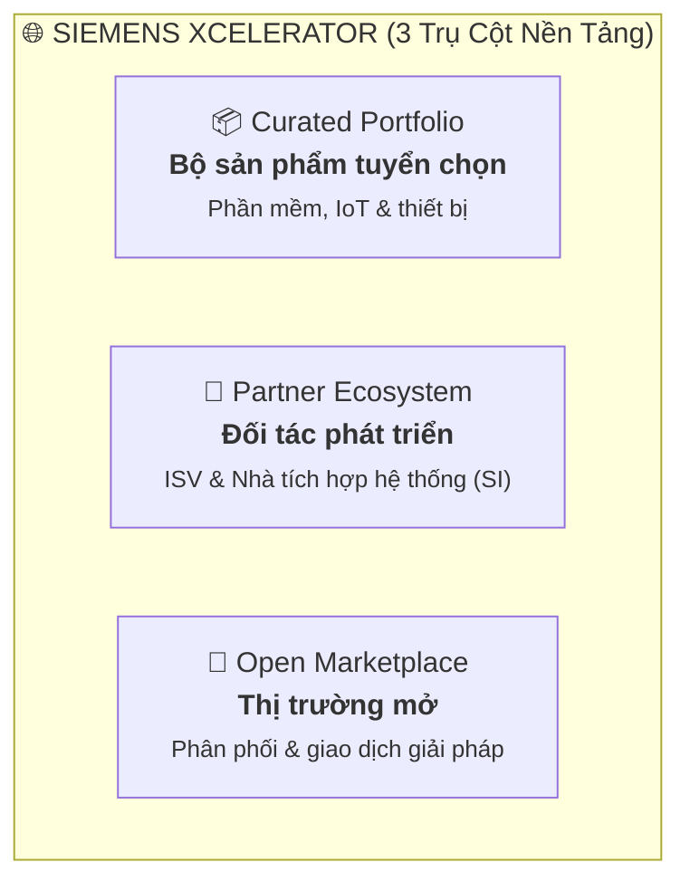
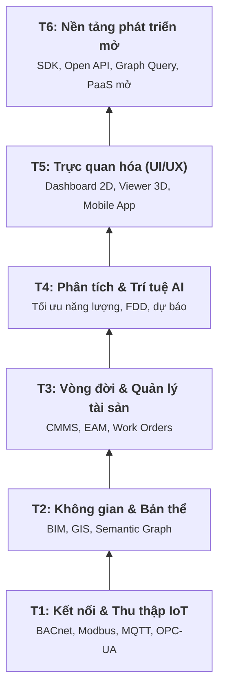

# 🏙️ Báo cáo Digital Twin Siemens

> 📅 **Cập nhật:** 02/11/2026  |  ✍️ **Tác giả:** Hoàng Trung Hiếu  
> 🏷️ **Chủ đề:** Đánh giá năng lực công nghệ & Khảo sát thực tế hệ sinh thái Digital Twin Siemens

> [!NOTE]
> **Phạm vi nghiên cứu:** Đánh giá năng lực thực tế của Siemens trong bài toán Bản sao số (Digital Twin) cho Tòa nhà, Khuôn viên và Công trình phức hợp (Sân vận động).

---

## 📑 Mục lục

- [📏 Quy chuẩn đánh giá mức độ bằng chứng (A - B - C)](#-quy-chuẩn-đánh-giá-mức-độ-bằng-chứng-a---b---c)
- [📘 1. Thông tin cần biết về Siemens Digital Twin](#-1-thông-tin-cần-biết-về-siemens-digital-twin)
  - [⚡ Tóm tắt nhanh](#-tóm-tắt-nhanh)
  - [🌐 1.1. Hệ sinh thái Xcelerator](#-11-hệ-sinh-thái-xcelerator)
    - [Mạng lưới đối tác phát triển (trường hợp ioLabs)](#mạng-lưới-đối-tác-phát-triển-trường-hợp-iolabs)
  - [📦 1.2. Các sản phẩm chủ lực](#-12-các-sản-phẩm-chủ-lực)
    - [🗂️ 1.2.1. Cấu trúc dữ liệu làm việc](#️-121-cấu-trúc-dữ-liệu-làm-việc)
    - [🏢 1.2.2. Bộ giải pháp Building X](#-122-bộ-giải-pháp-building-x)
    - [🤝 1.2.3. Mô hình kinh doanh: Dựng Digital Twin theo yêu cầu](#-123-mô-hình-kinh-doanh-dựng-digital-twin-theo-yêu-cầu)
- [🔍 2. Đánh giá chuyên sâu](#-2-đánh-giá-chuyên-sâu)
  - [🧱 2.1. So sánh hệ sinh thái với kiến trúc DTP tiêu chuẩn](#-21-so-sánh-hệ-sinh-thái-với-kiến-trúc-dtp-tiêu-chuẩn)
  - [📈 2.2. Đánh giá mức độ trưởng thành (Maturity Level)](#-22-đánh-giá-mức-độ-trưởng-thành-maturity-level)
  - [💰 2.3. Cấu trúc chi phí](#-23-cấu-trúc-chi-phí)
  - [🔌 2.4. Khả năng mở rộng & Ràng buộc](#-24-khả-năng-mở-rộng--ràng-buộc)
  - [🏟️ 2.5. Đánh giá qua các dự án thực tế](#️-25-đánh-giá-qua-các-dự-án-thực-tế)
    - [Quy mô khu vực: ghép theo dự án (Siemensstadt Square)](#quy-mô-khu-vực-ghép-theo-dự-án-siemensstadt-square)
    - [Khảo sát thực tế 6 dự án sân vận động quốc tế](#khảo-sát-thực-tế-6-dự-án-sân-vận-động-quốc-tế)
- [✅ 3. Kết luận chung](#-3-kết-luận-chung)
- [📚 Danh mục tài liệu tham khảo](#-danh-mục-tài-liệu-tham-khảo)

---

## 📏 Quy chuẩn đánh giá mức độ bằng chứng (A - B - C)

| Cấp độ | Định nghĩa | Tiêu chí xác minh |
| :---: | :--- | :--- |
| **Mức A** | **Bằng chứng thực nghiệm / trực tiếp** | Đã kiểm chứng trực tiếp trên hệ thống thật, hoặc có case study công khai được đối chiếu độc lập. |
| **Mức B** | **Bằng chứng tài liệu chính thức** | Dựa trực tiếp trên tài liệu chính thức của Siemens (tài liệu kỹ thuật, API, báo cáo, thông cáo báo chí). |
| **Mức C** | **Suy luận chuyên môn / gián tiếp** | Nhận định của nhóm nghiên cứu hoặc dữ liệu từ bên thứ ba chưa được Siemens chuẩn hóa xác nhận. |

---

## 📘 1. Thông tin cần biết về Siemens Digital Twin

### ⚡ Tóm tắt nhanh

* **Nền tảng:** Siemens không cung cấp nền tảng DTP mở để developer tự dựng Digital Twin từ đầu. Thay vào đó là Building X, ứng dụng SaaS dựng sẵn cho tòa nhà, cùng các SaaS vệ tinh như Brightly (quản lý bảo trì). Marketplace Xcelerator giới thiệu các giải pháp này, trong đó có Digital Twin ([10](https://www.siemens.com/us/en/products/xcelerator.html)).
* **Khả năng mở rộng:** Chức năng Digital Twin phụ thuộc vào những gì Building X hỗ trợ. Có thể mở rộng qua API hoặc Mendix (nền tảng low-code của Siemens), nhưng không tự do bằng tự dựng Twin từ đầu ([7](https://www.siemens.com/en-us/products/building-x/apis/), [6](https://developer.siemens.com/building-x-openness/resources/mendix/overview.html)).
* **Dịch vụ dựng Digital Twin theo yêu cầu:** Siemens Advanta tư vấn, thiết kế và tích hợp Digital Twin theo nhu cầu khách hàng; các đối tác phát triển bổ sung công nghệ chuyên biệt ([4](https://www.siemens-advanta.com/services/offers/digital-twin-services-for-building-campuses-cities)).
* **Khoảng trống công nghệ:** Siemens có dữ liệu vận hành (BMS Desigo CC) và bảo trì (Brightly CMMS), nhưng phụ thuộc đối tác phát triển như ioLabs, BizzTech, Bentley Systems về 3D và GIS diện rộng ([14](https://www.siemens.com/en-us/products/bizztech-operational-digital-twin-for-smart-infrastructure/), [16](https://www.siemens.com/en-us/products/iolabs-ag-bim-and-gis-powered-digital-twins/), [31](https://press.siemens.com/global/en/pressrelease/siemens-leverages-siemens-xcelerator-transform-industrial-location-city-future-digital)).
* **Bằng chứng từ sân vận động:** Khảo sát sáu sân vận động quốc tế cho thấy Siemens chủ yếu dùng cho BMS, an ninh và quản lý năng lượng; chưa ghi nhận Digital Twin tích hợp toàn diện.

---

### 🌐 1.1. Hệ sinh thái Xcelerator

Thay vì xây một DTP duy nhất, Siemens quy tụ nguồn lực vào **Siemens Xcelerator** ([10](https://www.siemens.com/us/en/products/xcelerator.html)), nền tảng kinh doanh số mở hoạt động trên 3 trụ cột:

1. **Curated Portfolio (bộ sản phẩm do Siemens tuyển chọn):** Phần mềm, dịch vụ và thiết bị IoT đạt chuẩn. Mảng công nghiệp gồm Teamcenter (PLM), NX (CAD), Simcenter, Tecnomatix và Opcenter ([11](https://cimdata.com/en/resources/solution-provider-profiles/plm-dossier-siemens-plm-software)). Mảng tòa nhà lấy **Building X** làm hạt nhân.
2. **Hệ sinh thái đối tác phát triển (Certified Partner Ecosystem):** Mạng lưới nhà phát triển độc lập (ISV) và nhà tích hợp hệ thống (SI) bổ trợ các khoảng trống chuyên biệt.
3. **Thị trường mở (Marketplace):** Nền tảng thương mại để phân phối và giao dịch ứng dụng.

#### Mạng lưới đối tác phát triển (trường hợp ioLabs)

Đối tác phát triển Thụy Sĩ **ioLabs** ([16](https://www.siemens.com/en-us/ecosystem/iolabs-ag/)) cũng đồng thời có mặt trong danh sách đối tác phát triển trên chợ ứng dụng của cả **Autodesk** (Revit/BIM) và **Esri** (GIS). Điều này cho thấy ioLabs giống một **nhà tích hợp BIM/GIS đa nền tảng độc lập (ISV/SI)** hơn là đội làm riêng cho Siemens. Siemens không xếp hạng cấp đối tác phát triển của họ, phản ánh chiến lược dùng "liên minh mở" để bù đắp năng lực không gian mà hãng chưa phát triển nội bộ.

---

### 📦 1.2. Các sản phẩm chủ lực

Ở mảng tòa nhà, Siemens bán nhiều sản phẩm rời, kết nối tập trung qua **Building X Cloud** (ra mắt năm 2022) ([12](https://assets.new.siemens.com/siemens/assets/api/uuid:36cbc2f1-b398-4b2e-aec5-42b31cc16aee/Siemens-launches-Building-X-an-open-AI-enabled-suite-for-net-zero-buildings.pdf)).

| Cấu phần / Sản phẩm | Nguồn gốc / Vị thế | Vai trò kỹ thuật & Nghiệp vụ | Nguồn |
| :--- | :--- | :--- | :---: |
| **Building X** | Sản phẩm nội bộ (ra mắt 2022) | Bốn chức năng chủ đạo dạng SaaS: tối ưu năng lượng (Energy Manager), điều hành vận hành (Operations Manager), an ninh (Security Manager) và xem ảnh hiện trường (360° Viewer). | [[12](https://assets.new.siemens.com/siemens/assets/api/uuid:36cbc2f1-b398-4b2e-aec5-42b31cc16aee/Siemens-launches-Building-X-an-open-AI-enabled-suite-for-net-zero-buildings.pdf)] |
| **Desigo CC** | Phần cứng & Phần mềm nội bộ | Nền tảng BMS truyền thống; từ bản V6 (30/9/2022) tích hợp sẵn kết nối đám mây để đẩy dữ liệu thời gian thực lên Building X. | [[8](https://press.siemens.com/global/en/pressrelease/new-desigo-cc-v6-building-management-platform-adds-native-cloud-connectivity)] |
| **Lifecycle Twin** | Thâu tóm **EcoDomus** (2021) | Quản lý tài sản dựa trên mô hình BIM, chuẩn hóa dữ liệu COBie và tích hợp Autodesk Revit. | [[9](https://www.siemens.com/en-us/products/building-x/applications/lifecycle-twin/)] |
| **Brightly Software** | Thâu tóm năm 2022 (1,575 tỷ USD) | Nền tảng CMMS/EAM điện toán đám mây số 1 thế giới; phụ trách lịch bảo trì, quản lý cơ sở vật chất (FM) và chi phí tài sản. | [[13](https://www.automation.com/en-us/articles/july-2022/siemens-acquires-brightly-software-digital)] |
| **BizzTech** | Đối tác phát triển Xcelerator | Nền tảng trực quan hóa twin vận hành có 3D, IoT và GIS. | [[14](https://www.siemens.com/en-us/products/bizztech-operational-digital-twin-for-smart-infrastructure/)] |
| **ioLabs AG** | Đối tác phát triển (Thụy Sĩ) | Chuyên gia dựng mô hình 3D theo chuẩn BIM/GIS; nền tảng **ioFM** theo triết lý "Minimal-BIM" tối ưu chi phí số hóa cơ sở vật chất. | [[16](https://www.siemens.com/en-us/products/iolabs-ag-bim-and-gis-powered-digital-twins/), [17](https://www.siemens.com/en-us/products/iolabs-ag-iofm-fast-and-cost-effective-way-to-digital-twin/)] |
| **Terabee, accuras** | Đối tác phát triển Xcelerator | Cung cấp thuật toán phân tích dữ liệu chuyên sâu tích hợp bổ trợ cho Building X. | [[15](https://memoori.com/siemens-xcelerator-partners-focus-analytics-building-x/?amp=1)] |
| *(Tham chiếu)* **Digital Twin Composer** | Hợp tác cùng NVIDIA | Engine dựng cảnh 3D dựa trên NVIDIA Omniverse cho nhà máy sản xuất (ngoài phạm vi sân vận động/tòa nhà thương mại). | [[18](https://news.siemens.com/en-us/digital-twin-composer-ces-2026)] |

---

#### 🗂️ 1.2.1. Cấu trúc dữ liệu làm việc

Siemens có thế mạnh về BIM và IoT; bản đồ chỉ ở dạng 2D, và GIS chưa thấy trong sản phẩm của chính hãng ([14](https://www.siemens.com/en-us/products/bizztech-operational-digital-twin-for-smart-infrastructure/), [16](https://www.siemens.com/en-us/products/iolabs-ag-bim-and-gis-powered-digital-twins/)).

| Loại dữ liệu | Bằng chứng kỹ thuật thực tế | Mức độ tin cậy |
| :--- | :--- | :---: |
| **BIM** | Lifecycle Twin dựa trên BIM, tích hợp Revit ([9](https://www.siemens.com/en-us/products/building-x/applications/lifecycle-twin/)); mô hình twin tòa nhà được khởi tạo từ tệp BIM ([19](https://myshare-cms.siemens.com/siemens-building-x-digital-twin)). | **Mức B** |
| **IoT / Đo lường** | Thiết bị, điểm đo, giá trị và báo động đưa vào thời gian thực qua hệ thống API ([19](https://myshare-cms.siemens.com/siemens-building-x-digital-twin), [20](https://developer.siemens.com/building-x-openness/dev-guide/gettingstarted.html)). | **Mức B** |
| **Không gian 3D** | *360° Viewer* chạy trên nền tảng NavVis IVION; dữ liệu 3D tốt nhất lấy từ dịch vụ quét hiện trường của NavVis ([33](https://www.navvis.com/blog/navvis-siemens-smart-infrastructure-bring-spatial-digital-twin-capabilities-to-siemens-building-x)). Chưa thấy API hình học 3D nội bộ của Siemens. | **Mức B** |
| **Bản đồ** | Geometry API của Building X chỉ nhận hình học 2D dạng GeoJSON ([21](https://developer.siemens.com/building-x-openness/api/geometry-api/overview.html)). | **Mức B** |
| **GIS** | Chưa thấy trong sản phẩm của chính hãng Siemens; lớp GIS phải lấy từ đối tác phát triển BizzTech ([14](https://www.siemens.com/en-us/products/bizztech-operational-digital-twin-for-smart-infrastructure/)) và ioLabs ([16](https://www.siemens.com/en-us/products/iolabs-ag-bim-and-gis-powered-digital-twins/)). | **Chưa thấy** |
| **IFC** | Toàn bộ tài liệu chính thức của Building X đã rà soát không nhắc tới việc nhập trực tiếp định dạng mở IFC. | **Chưa thấy** |

> [!WARNING]
> **Đối với bài toán Sân vận động:** Mô hình tòa nhà và dữ liệu thiết bị MEP bên trong sân đã có chỗ đứng. Tuy nhiên, toàn bộ bối cảnh không gian quanh sân (giao thông tiếp cận, bãi đỗ xe diện rộng) đều cần nguồn ngoài Siemens.

---

#### 🏢 1.2.2. Bộ giải pháp Building X

Building X là lớp phần mềm trung tâm của Siemens cho tòa nhà, chạy trên Building X Cloud và nhận dữ liệu từ BMS Desigo CC ([8](https://press.siemens.com/global/en/pressrelease/new-desigo-cc-v6-building-management-platform-adds-native-cloud-connectivity)).

##### Các chức năng chính (phần lớn là SaaS, tính phí theo điểm đo, theo cửa hoặc theo địa điểm)

- **Energy Manager:** Theo dõi và tối ưu năng lượng; dự báo mức tiêu thụ từ dữ liệu lịch sử ([12](https://assets.new.siemens.com/siemens/assets/api/uuid:36cbc2f1-b398-4b2e-aec5-42b31cc16aee/Siemens-launches-Building-X-an-open-AI-enabled-suite-for-net-zero-buildings.pdf)). Tính phí theo điểm đo.
- **Operations Manager:** Điều hành vận hành; giám sát trạng thái thiết bị, cảnh báo và chẩn đoán lỗi tự động ([3](https://www.siemens.com/en-us/products/building-x/applications/operations-manager/)). Chia ba gói Essential, Standard, Advanced theo từng địa điểm; là điều kiện bắt buộc để dùng các API Structure và Operations.
- **Security Manager:** Quản lý an ninh và kiểm soát ra vào; tính phí theo cửa hoặc tài sản ([28](https://developer.siemens.com/building-x-openness/sdk/security/security-mobile-app-sdk.html)).
- **360° Viewer:** Xem ảnh hiện trường 360° của công trình ([12](https://assets.new.siemens.com/siemens/assets/api/uuid:36cbc2f1-b398-4b2e-aec5-42b31cc16aee/Siemens-launches-Building-X-an-open-AI-enabled-suite-for-net-zero-buildings.pdf)).
- **Lifecycle Twin:** Quản lý tài sản dựa trên mô hình BIM, chuẩn hóa dữ liệu COBie, tích hợp Autodesk Revit ([9](https://www.siemens.com/en-us/products/building-x/applications/lifecycle-twin/)); đây là lớp gắn mô hình BIM với dữ liệu cảm biến ([19](https://myshare-cms.siemens.com/siemens-building-x-digital-twin)).
- **Portfolio Manager:** Quản lý danh mục nhiều tòa nhà ([32](https://www.automation.com/article/siemens-building-x-portfolio-manager-assets)).

##### Cơ chế kết nối và tích hợp

Để liên kết dữ liệu với bên ngoài, Siemens cung cấp hai cơ chế: **hệ thống REST APIs** ([7](https://www.siemens.com/en-us/products/building-x/apis/)) và **Mendix Connector** ([6](https://developer.siemens.com/building-x-openness/resources/mendix/overview.html)).

- **REST API:** Gọi API web thông thường với Contract giao tiếp rõ ràng. Chiều chính là ứng dụng ngoài gọi vào Building X để lấy dữ liệu; ngoài ra Streaming API cho Building X tự gửi dữ liệu mới ra qua webhook, và Point Value Ingest cho hệ thống ngoài đẩy giá trị điểm đo vào.
- **Cách tổ chức dữ liệu:** Building X sắp xếp dữ liệu theo cấu trúc phân cấp lồng nhau:  
  $$\text{Customer} \longrightarrow \text{Partition} \longrightarrow \text{Location} \longrightarrow \text{Device} \longrightarrow \text{Data Point}$$  
  Ứng dụng gọi API đi xuống từng cấp để tìm đúng điểm đo cần đọc, không phải nhận cả năm loại dữ liệu cùng lúc. API chia thành 9 nhóm theo chức năng (như Structure, Streaming, Energy, Geometry) ([20](https://developer.siemens.com/building-x-openness/dev-guide/gettingstarted.html)).
- **Khả năng chịu tải:** Streaming API gửi tối đa 1.000 điểm mỗi request; tài liệu nêu đã thử nghiệm tới 5.000 điểm đo và 10.000 sự kiện báo động ([26](https://developer.siemens.com/building-x-openness/api/streaming-api/overview.html), [27](https://developer.siemens.com/building-x-openness/api/point-value-ingest-api/overview.html)).

> [!TIP]
> **💡 Tăng tốc kết nối với Mendix Connector**  
> 
> Năm 2018, Siemens chi 600 triệu Euro (khoảng 730 triệu USD tiền mặt) mua lại Mendix, nền tảng Low-code hàng đầu thế giới.  
> 
> * **Nỗi đau truyền thống:** Muốn lấy dữ liệu điều hòa hay năng lượng từ Building X để hiển thị lên dashboard mới, lập trình viên phải đọc tài liệu API dày cộp, tự viết code bảo mật OAuth2, gửi HTTP request, parse JSON và bắt lỗi.  
> * **Giải pháp Mendix Connector:** Đóng gói toàn bộ đoạn code phức tạp đó thành một **khối chức năng trực quan (action block)**, tựa một miếng ghép Lego chuyển đổi hay plugin cài sẵn. Nhà phát triển kéo khối đó vào màn hình thiết kế Mendix là kết nối ngay với Building X, rút ngắn thời gian làm ứng dụng từ vài tháng xuống vài tuần ([6](https://developer.siemens.com/building-x-openness/resources/mendix/overview.html)).  
> 
> Ở mảng công nghiệp, Siemens áp dụng triết lý tương tự qua nền tảng IoT **Insights Hub** ([5](https://blogs.sw.siemens.com/insights-hub/2023/04/17/looking-for-an-alternative-discover-insights-hub-industrial-iot/)).

---

#### 🤝 1.2.3. Mô hình kinh doanh: Dựng Digital Twin theo yêu cầu

Khi bài toán vượt ra các gói SaaS có sẵn hoặc mở rộng lên cấp khuôn viên, Siemens giải quyết bằng dịch vụ dự án và mạng lưới liên minh.

Siemens Advanta là đơn vị tư vấn chuyển đổi số và phát triển phần mềm theo yêu cầu thương mại của tập đoàn ([4](https://www.siemens-advanta.com/services/offers/digital-twin-services-for-building-campuses-cities)).

> [!NOTE]
> ### 🔄 So sánh Siemens Advanta với VSF (VinSmart Future) của Vingroup  
> 
> * **Điểm tương đồng:** Cả hai là "bộ não phần mềm tinh nhuệ" của tập đoàn, quy tụ kiến trúc sư giải pháp và kỹ sư công nghệ cao cấp để nghiên cứu công nghệ lõi và giải các bài toán số hóa theo yêu cầu phức tạp mà sản phẩm đóng gói không đáp ứng hết.  
> * **Điểm khác biệt về mô hình tổ chức:**  
>   * **VSF:** Tech Hub nội bộ nòng cốt, phát triển nền tảng dùng chung, hạ tầng số và siêu ứng dụng (V-App) phục vụ xuyên suốt hệ sinh thái Vingroup (VinFast, Vinhomes, Vinmec...).  
>   * **Siemens Advanta:** Công ty tư vấn & gia công công nghệ cao cấp (B2B Commercial Unit) tương tự Accenture hay IBM Consulting. Khách hàng doanh nghiệp bên ngoài toàn cầu có thể ký hợp đồng thuê Advanta thiết kế và triển khai trọn gói giải pháp Digital Twin theo nhu cầu riêng.

---

## 🔍 2. Đánh giá chuyên sâu

### 🧱 2.1. So sánh hệ sinh thái với kiến trúc DTP tiêu chuẩn

Để có hệ quy chiếu đánh giá khách quan, báo cáo dùng Khung kiến trúc tham chiếu của một Nền tảng Digital Twin hoàn chỉnh (theo chuẩn *Digital Twin Consortium*, *Gartner* và các nền tảng tham chiếu như *Azure Digital Twins*, *Bentley iTwin*).

> *Dữ liệu chảy từ Tầng 1 lên Tầng 6; mỗi tầng dựa vào tầng dưới nó.*

Siemens mạnh ở T1 và T3, phụ thuộc đối tác phát triển ở T2 và T5, và **không có DTP mở ở T6**. Bảng dưới soi chiếu các cấu phần Siemens vào Khung 6 tầng DTP chuẩn:

| Tầng DTP chuẩn | Yêu cầu kỹ thuật chuẩn | Giải pháp của Siemens | Năng lực & mức độ tự chủ |
| :--- | :--- | :--- | :---: |
| **T1: Kết nối & Thu thập IoT** | BACnet, Modbus, MQTT, OPC-UA, Telemetry Stream | **Desigo CC** + bộ điều khiển phần cứng Siemens + Cloud Gateway | 🟢 **Rất mạnh** *(tự chủ 100%)* |
| **T2: Không gian & Bản thể học** | BIM (Revit/IFC), GIS địa lý, Semantic Graph (Ontology) | **Lifecycle Twin** (EcoDomus); **ioLabs** (BIM/GIS); **BizzTech** (3D Web) | 🟡 **Phụ thuộc đối tác** *(BIM mua lại, 3D/GIS nhờ bên ngoài)* |
| **T3: Vòng đời & Quản lý tài sản** | CMMS, EAM, Work Orders, lịch sử bảo trì thiết bị | **Brightly Software** (M&A 1,575 tỷ USD) | 🟢 **Rất mạnh** *(nhờ M&A)* |
| **T4: Phân tích & AI** | Tối ưu năng lượng, bảo trì dự đoán, FDD, Net-Zero | Ứng dụng SaaS đóng gói trong **Building X** + đối tác phát triển **Terabee, accuras** | 🔵 **Đóng gói sẵn (SaaS)** *(không mở engine AI thô)* |
| **T5: Trực quan hóa (UI/UX)** | Dashboard 2D, Viewer 3D WebGL/XR, Mobile App | Dashboard Building X, *360° Viewer* (NavVis IVION), 3D qua BizzTech | 🟡 **Khá** *(2D tốt, 3D thời gian thực dựa vào đối tác)* |
| **T6: Nền tảng phát triển mở** | SDK, Open APIs, Graph Query, PaaS mở cho developer | REST APIs; **Mendix Connector** (Low-code); **Siemens Advanta** (dịch vụ dự án) | 🔴 **KHÔNG CÓ DTP MỞ** *(thay bằng Low-code & dịch vụ dự án)* |

---

### 📈 2.2. Đánh giá mức độ trưởng thành (Maturity Level)

Verdantix gọi Building X ở giai đoạn "những ngày đầu" (early days) năm 2022 ([22](https://www.verdantix.com/insights/blogs/the-cloud-comes-down-to-the-ground-siemens-s-building-x-offers-an-integrated-view-into-building-operations)).

| Level theo Verdantix | Bằng chứng kỹ thuật thực tế | Đánh giá của nhóm |
| :--- | :--- | :---: |
| **1. Descriptive (Mô tả)** | Mô hình BIM gắn kết với dữ liệu cảm biến ([19](https://myshare-cms.siemens.com/siemens-building-x-digital-twin)). | Có bằng chứng (Mức B) |
| **2. Informative (Thông tin)** | Giám sát trạng thái, cảnh báo và chẩn đoán lỗi thiết bị tự động ([3](https://www.siemens.com/en-us/products/building-x/applications/operations-manager/)). | Có bằng chứng (Mức B) |
| **3. Predictive (Dự báo)** | Energy Manager dự báo mức tiêu thụ năng lượng từ dữ liệu lịch sử ([12](https://assets.new.siemens.com/siemens/assets/api/uuid:36cbc2f1-b398-4b2e-aec5-42b31cc16aee/Siemens-launches-Building-X-an-open-AI-enabled-suite-for-net-zero-buildings.pdf)). | Có bằng chứng (Mức B) |
| **4. Comprehensive (Toàn diện)** | Tài liệu có mô tả mô phỏng khí hậu, cải tạo, dòng người ([19](https://myshare-cms.siemens.com/siemens-building-x-digital-twin)). | Một phần, chưa thấy demo (Mức C) |
| **5. Autonomous (Tự trị)** | Agent HALØ của đối tác phát triển BizzTech mới dừng ở giai đoạn demo ý tưởng ([23](https://memoori.com/agentic-ai-in-buildings-siemens-2026-bizztech-partner/)). | Chưa đủ cơ sở |

Building X có tên trong báo cáo Green Quadrant 2024 của Verdantix về nền tảng vận hành tòa nhà ([24](https://atlas.verdantix.com/siemens/building-x)); Verdantix 2026 đánh giá digital twin và industrial metaverse vẫn ở giai đoạn đầu ([25](https://marketing.verdantix.com/blog/digital-twins-are-becoming-a-strategic-differentiator---and-siemens-is-leaning-in)).

---

### 💰 2.3. Cấu trúc chi phí

Siemens **không công bố bảng giá niêm yết** mà chào giá theo dự án ("Request quote"). Tổng chi phí cho một công trình hoặc sân vận động gồm 5 khoản mục chính:

| STT | Khoản mục chi phí | Cách thức tính phí & Dự toán tham chiếu | Nguồn |
| :---: | :--- | :--- | :---: |
| **1** | **Bản quyền SaaS Building X** | Thuê bao 12 tháng, trả trước, tự động gia hạn. Phí tính theo điểm đo (Energy), theo cửa/tài sản (Security) hoặc theo địa điểm (3 gói Essential, Standard, Advanced của Operations Manager). Dùng thử 14 ngày; sandbox đọc miễn phí. | [[3](https://www.siemens.com/en-us/products/building-x/applications/operations-manager/), [29](https://www.siemens.com/th-th/products/building-x/contact/request-trial/), [30](https://developer.siemens.com/building-x-openness/dev-guide/try-out.html)] |
| **2** | **Gói API kết nối** | Hạn mức 6 triệu lệnh gọi/năm/API. API Structure và Operations yêu cầu thuê bao Operations Manager; vượt hạn mức phải mua gói bổ sung. | [[7](https://www.siemens.com/en-us/products/building-x/apis/)] |
| **3** | **Bản quyền Low-code Mendix** | **Free:** 0 USD (không SLA). **Standard:** ~13.000 USD/năm (1 app) đến 32.700 USD/năm (không giới hạn app). **Premium:** Báo giá riêng, thường từ 50.000 đến trên 100.000 USD/năm. | Tài liệu Mendix |
| **4** | **Đối tác 3D / BIM / GIS** | **ioLabs:** Thuê bao theo số phòng hoặc diện tích sàn. **NavVis:** Tính theo thiết bị quét hoặc dịch vụ quét theo dự án, cộng phí nền tảng IVION. | [[17](https://www.siemens.com/en-us/products/iolabs-ag-iofm-fast-and-cost-effective-way-to-digital-twin/), [33](https://www.navvis.com/blog/navvis-siemens-smart-infrastructure-bring-spatial-digital-twin-capabilities-to-siemens-building-x)] |
| **5** | **Tư vấn Siemens Advanta** | Tính theo dự án trọn gói (Fixed-price milestone) hoặc theo thời gian và vật liệu (T&M), dao động khoảng **150 – 300+ USD/giờ**. | [[4](https://www.siemens-advanta.com/services/offers/digital-twin-services-for-building-campuses-cities)] |

---

### 🔌 2.4. Khả năng mở rộng & Ràng buộc

Siemens mở ở lớp dữ liệu và ứng dụng, nhưng đóng/phụ thuộc ở lớp 3D và mô hình.

| Lớp cấu phần | Bằng chứng kỹ thuật | Mức độ mở | Ràng buộc kỹ thuật & thương mại |
| :--- | :--- | :---: | :--- |
| **Dữ liệu** | JSON:API, OAuth machine user, streaming webhook ([20](https://developer.siemens.com/building-x-openness/dev-guide/gettingstarted.html), [26](https://developer.siemens.com/building-x-openness/api/streaming-api/overview.html)). | **Mở (Mức B)** | Thuận tiện trích xuất telemetry. |
| **Ứng dụng** | Mendix connector, đăng lên Xcelerator Marketplace ([6](https://developer.siemens.com/building-x-openness/resources/mendix/overview.html), [7](https://www.siemens.com/en-us/products/building-x/apis/)). | **Mở (Mức B)** | Lập trình ứng dụng kéo-thả linh hoạt qua Mendix. |
| **Không gian 3D** | 360° Viewer chạy bằng NavVis IVION ([33](https://www.navvis.com/blog/navvis-siemens-smart-infrastructure-bring-spatial-digital-twin-capabilities-to-siemens-building-x)); Geometry API chỉ nhận 2D GeoJSON ([21](https://developer.siemens.com/building-x-openness/api/geometry-api/overview.html)). | **Phụ thuộc đối tác** | Khó dựng mô hình 3D tương tác sâu nếu không dùng NavVis hoặc BizzTech. |
| **Mô hình, luật AI** | Thư viện luật chẩn đoán lỗi có sẵn và Fault Triage Agent ([3](https://www.siemens.com/en-us/products/building-x/applications/operations-manager/)). | **Chưa thấy** | Chưa thấy cách cho người dùng tự nhúng mô hình AI/ML tùy biến từ bên ngoài. |
| **Thương mại** | API cần mua theo gói thuê bao ứng dụng, giới hạn 6 triệu calls/năm ([7](https://www.siemens.com/en-us/products/building-x/apis/)). Sandbox chỉ đọc ([30](https://developer.siemens.com/building-x-openness/dev-guide/try-out.html)). | **Ràng buộc** | Chi phí tăng theo tải; sandbox không cho thử ghi dữ liệu vào hệ thống. |

---

### 🏟️ 2.5. Đánh giá qua các dự án thực tế

#### Quy mô khu vực: ghép theo dự án (điển hình Siemensstadt Square)

Siemens có làm twin cấp khu vực, nhưng bằng cách **ghép nhiều lớp theo từng dự án**, và lớp khuôn viên đến từ Bentley. Chưa thấy sản phẩm đóng gói sẵn của chính Siemens cho cấp này ([31](https://press.siemens.com/global/en/pressrelease/siemens-leverages-siemens-xcelerator-transform-industrial-location-city-future-digital)).

Dự án **Siemensstadt Square** (Berlin, khởi công 25/6/2024, khoảng 76 ha và hơn 1 triệu m² sàn) có twin gồm ba lớp tách biệt ([31](https://press.siemens.com/global/en/pressrelease/siemens-leverages-siemens-xcelerator-transform-industrial-location-city-future-digital)):

- **Twin khuôn viên:** Quy hoạch tổng thể thời gian thực, **phát triển cùng Bentley Systems**.
- **Twin tòa nhà:** Thuộc bộ Building X, dùng để quy hoạch lại các tòa nhà hiện hữu.
- **Twin năng lượng:** Dự báo và theo dõi các phương án cấp điện.

Tháng 3/2025, Siemens công bố SaaS **Building X Portfolio Manager** cho nhiều tòa nhà, nhưng mới triển khai nội bộ trên 1.300 site của chính họ, chưa phải bằng chứng cho khách hàng ngoài ([32](https://www.automation.com/article/siemens-building-x-portfolio-manager-assets)).

#### Khảo sát thực tế 6 dự án sân vận động quốc tế

Rà soát 6 sân vận động tham chiếu lớn trên thế giới có sử dụng công nghệ của Siemens:

- 🇦🇺 Optus Stadium (Perth, Úc)
- 🇦🇺 Melbourne Cricket Ground - MCG (Úc)
- 🇺🇸 Mercedes-Benz Superdome (New Orleans, Mỹ)
- 🇧🇷 Estádio Nacional Mané Garrincha (Brazil)
- 🇦🇹 Red Bull Arena Salzburg (Áo)
- 🇨🇿 Malšovická Aréna (Hradec Králové, CH Séc)

> [!IMPORTANT]
> **Kết luận thực chứng (Mức B):** Cả 6 sân tham chiếu đều chỉ dùng Siemens cho **quản lý tòa nhà (BMS Desigo CC), an ninh và năng lượng truyền thống, không phải digital twin tích hợp.**

---

## ✅ 3. Rút ra kết luận

> Siemens là **giải pháp ứng dụng dựng sẵn cho vận hành tòa nhà**, không phải nền tảng DTP mở để tự dựng Digital Twin từ đầu.

- **Vị thế:** Siemens mạnh ở tầng dữ liệu IoT (T1) và tầng ứng dụng (T5) với Building X; không có Digital Twin dựng từ đầu theo kiến trúc DTP chuẩn.
- **Mức trưởng thành:** Có bằng chứng (mức B) đến cấp Predictive; cấp Comprehensive mới một phần (mức C); cấp Autonomous chưa đủ cơ sở.
- **Khoảng trống:** 3D, GIS diện rộng và nhập IFC phải lấy từ đối tác phát triển (ioLabs, BizzTech, Bentley, NavVis ([14](https://www.siemens.com/en-us/products/bizztech-operational-digital-twin-for-smart-infrastructure/), [16](https://www.siemens.com/en-us/products/iolabs-ag-bim-and-gis-powered-digital-twins/), [33](https://www.navvis.com/blog/navvis-siemens-smart-infrastructure-bring-spatial-digital-twin-capabilities-to-siemens-building-x), [31](https://press.siemens.com/global/en/pressrelease/siemens-leverages-siemens-xcelerator-transform-industrial-location-city-future-digital))).
- **Chi phí:** Không công bố giá trọn gói; tổng chi phí gồm thuê bao SaaS theo điểm đo, cửa hoặc địa điểm, hạn mức API, Mendix, đối tác 3D/BIM và dịch vụ Siemens Advanta ([3](https://www.siemens.com/en-us/products/building-x/applications/operations-manager/), [7](https://www.siemens.com/en-us/products/building-x/apis/), [30](https://developer.siemens.com/building-x-openness/dev-guide/try-out.html)).
- **Thực tế triển khai:** Các sân vận động đã khảo sát chủ yếu dùng Siemens cho BMS, an ninh và năng lượng; twin cấp khu vực (Siemensstadt Square) được ghép từng dự án với Bentley ([31](https://press.siemens.com/global/en/pressrelease/siemens-leverages-siemens-xcelerator-transform-industrial-location-city-future-digital)).
- **Đối với bài toán sân vận động:** Siemens phù hợp làm lớp vận hành tòa nhà và thiết bị MEP; không gian quanh sân (giao thông, bãi đỗ xe) cần nguồn ngoài Siemens.

---

## 📚 Danh mục tài liệu tham khảo

| STT | Tài liệu tham khảo | Tổ chức / Nguồn công bố |
| :---: | :--- | :--- |
| **[1]** | [Siemens Annual Report 2025](https://assets.new.siemens.com/siemens/assets/api/uuid:428ea18a-e7ab-4f93-a160-33908f1c3540/Siemens-Annual-Report-2025.pdf) | Siemens AG |
| **[2]** | [Siemens Earnings Release Q4 FY2025](https://assets.new.siemens.com/siemens/assets/api/uuid:3948cdd4-35e0-4c1d-8412-9aed4097b3d0/HQCOPR202511117277EN.pdf) | Siemens AG |
| **[3]** | [Building X Operations Manager](https://www.siemens.com/en-us/products/building-x/applications/operations-manager/) | Siemens Smart Infrastructure |
| **[4]** | [Siemens Advanta: Infrastructure Twins](https://www.siemens-advanta.com/services/offers/digital-twin-services-for-building-campuses-cities) | Siemens Advanta |
| **[5]** | [Siemens Insights Hub: industrial IoT](https://blogs.sw.siemens.com/insights-hub/2023/04/17/looking-for-an-alternative-discover-insights-hub-industrial-iot/) | Siemens Software Blog |
| **[6]** | [Building X Openness: Mendix connector](https://developer.siemens.com/building-x-openness/resources/mendix/overview.html) | Siemens Developer Portal |
| **[7]** | [Building X APIs](https://www.siemens.com/en-us/products/building-x/apis/) | Siemens Smart Infrastructure |
| **[8]** | [Desigo CC V6, thông cáo báo chí](https://press.siemens.com/global/en/pressrelease/new-desigo-cc-v6-building-management-platform-adds-native-cloud-connectivity) | Siemens Press Release |
| **[9]** | [Building X Lifecycle Twin](https://www.siemens.com/en-us/products/building-x/applications/lifecycle-twin/) | Siemens Smart Infrastructure |
| **[10]** | [Siemens Xcelerator](https://www.siemens.com/us/en/products/xcelerator.html) | Siemens USA |
| **[11]** | [CIMdata, PLM Dossier: Siemens PLM Software](https://cimdata.com/en/resources/solution-provider-profiles/plm-dossier-siemens-plm-software) | CIMdata Research |
| **[12]** | [Siemens launches Building X (thông cáo, PDF)](https://assets.new.siemens.com/siemens/assets/api/uuid:36cbc2f1-b398-4b2e-aec5-42b31cc16aee/Siemens-launches-Building-X-an-open-AI-enabled-suite-for-net-zero-buildings.pdf) | Siemens Press Release |
| **[13]** | [Siemens acquires Brightly Software (automation.com, 7/2022)](https://www.automation.com/en-us/articles/july-2022/siemens-acquires-brightly-software-digital) | Automation.com |
| **[14]** | [BizzTech: Operational Digital Twin for Smart Infrastructure](https://www.siemens.com/en-us/products/bizztech-operational-digital-twin-for-smart-infrastructure/) | Siemens Marketplace |
| **[15]** | [Memoori: Siemens Xcelerator partners focus on analytics for Building X](https://memoori.com/siemens-xcelerator-partners-focus-analytics-building-x/?amp=1) | Memoori Research |
| **[16]** | [ioLabs: BIM- and GIS-Powered Digital Twins](https://www.siemens.com/en-us/products/iolabs-ag-bim-and-gis-powered-digital-twins/) | Siemens Marketplace |
| **[17]** | [ioLabs: ioFM Fast and Cost-Effective Way to Digital Twin](https://www.siemens.com/en-us/products/iolabs-ag-iofm-fast-and-cost-effective-way-to-digital-twin/) | Siemens Marketplace |
| **[18]** | [Digital Twin Composer, CES 2026](https://news.siemens.com/en-us/digital-twin-composer-ces-2026) | Siemens Newsroom |
| **[19]** | [Building X digital twin](https://myshare-cms.siemens.com/siemens-building-x-digital-twin) | Siemens Technical Asset |
| **[20]** | [Building X Openness: Developer Getting started](https://developer.siemens.com/building-x-openness/dev-guide/gettingstarted.html) | Siemens Developer Portal |
| **[21]** | [Building X Openness: Geometry API](https://developer.siemens.com/building-x-openness/api/geometry-api/overview.html) | Siemens Developer Portal |
| **[22]** | [Verdantix: The cloud comes down to the ground (2022)](https://www.verdantix.com/insights/blogs/the-cloud-comes-down-to-the-ground-siemens-s-building-x-offers-an-integrated-view-into-building-operations) | Verdantix Research |
| **[23]** | [Memoori: Agentic AI in buildings, Siemens 2026 BizzTech partner](https://memoori.com/agentic-ai-in-buildings-siemens-2026-bizztech-partner/) | Memoori Research |
| **[24]** | [Verdantix Green Quadrant: Building Operations Platforms 2024](https://atlas.verdantix.com/siemens/building-x) | Verdantix Benchmark |
| **[25]** | [Verdantix: Digital twins are becoming a strategic differentiator (2/2026)](https://marketing.verdantix.com/blog/digital-twins-are-becoming-a-strategic-differentiator---and-siemens-is-leaning-in) | Verdantix Insights |
| **[26]** | [Building X Openness: Streaming API](https://developer.siemens.com/building-x-openness/api/streaming-api/overview.html) | Siemens Developer Portal |
| **[27]** | [Building X Openness: Point Value Ingest API](https://developer.siemens.com/building-x-openness/api/point-value-ingest-api/overview.html) | Siemens Developer Portal |
| **[28]** | [Building X Openness: Security mobile app SDK](https://developer.siemens.com/building-x-openness/sdk/security/security-mobile-app-sdk.html) | Siemens Developer Portal |
| **[29]** | [Building X: request a trial](https://www.siemens.com/th-th/products/building-x/contact/request-trial/) | Siemens Commercial Portal |
| **[30]** | [Building X Openness: Try out & Sandbox limits](https://developer.siemens.com/building-x-openness/dev-guide/try-out.html) | Siemens Developer Portal |
| **[31]** | [Siemensstadt Square, thông cáo Siemens](https://press.siemens.com/global/en/pressrelease/siemens-leverages-siemens-xcelerator-transform-industrial-location-city-future-digital) | Siemens Press Release |
| **[32]** | [Building X Portfolio Manager (automation.com)](https://www.automation.com/article/siemens-building-x-portfolio-manager-assets) | Automation.com |
| **[33]** | [NavVis và Siemens Building X Spatial Digital Twin](https://www.navvis.com/blog/navvis-siemens-smart-infrastructure-bring-spatial-digital-twin-capabilities-to-siemens-building-x) | NavVis Official Blog |
